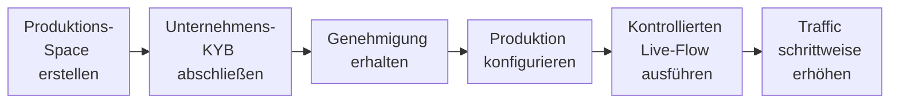

Die Produktionsaktivierung verifiziert Ihr integrierendes Unternehmen. Sie ist getrennt von den API-Kunden, die Sie für Ihr Produkt anlegen.

## Produktions-Space aktivieren {#activate-your-production-space}

1. Melden Sie sich im Swipelux Dashboard an und wählen Sie **Produktions-Space erstellen**.
2. Öffnen Sie den KYB-Tab oder gehen Sie zu [Unternehmensverifizierung](https://www.swipelux.app/kyb).
3. Füllen Sie jedes angeforderte Feld aus und laden Sie die erforderlichen Dokumente hoch.
4. Reichen Sie Ihr integrierendes Unternehmen zur Verifizierung ein und warten Sie auf die Freigabe.

Erst nachdem das KYB Ihres integrierenden Unternehmens freigegeben ist, können Sie produktive API-Kunden und Transaktionen anlegen.

In einem Live-Space, der KYB erfordert, gibt Swipelux bis zur Freigabe für jede schreibende Anfrage außerhalb der Unternehmensverifizierung und der Webhook-Verwaltung `422` [`merchant_kyb_not_approved`](/integration/errors#merchant-kyb-not-approved) zurück. Dazu gehören Kunden, Fähigkeiten, Konten, Empfänger, Regeln, Quotes und Transfers.

Während Sie auf die Freigabe warten, können Sie weiterhin:

- `GET`- und `HEAD`-Anfragen senden.
- Ihre Unternehmensverifizierung abschließen (Profil, verbundene Parteien, Dokumente und Aufgabeneinreichungen für den KYB-Kunden Ihres Unternehmens).
- Webhook-Endpunkte über die API verwalten sowie Secret Keys, Spaces und Rail-Gebühren im Dashboard verwalten.

Bis zur Freigabe gelten Limits für Einstellungen:

- Sie können insgesamt 20 Webhook-URL-Änderungen pro Stunde vornehmen, über alle Endpunkte in Ihren Live-Spaces hinweg, die KYB erfordern. Änderungen in Sandbox-Spaces zählen nicht. Bei Überschreitung des Webhook-URL-Limits geben `POST /v3/webhooks` oder `PATCH /v3/webhooks/{webhookId}` `422 merchant_kyb_not_approved` zurück.
- Im Dashboard können Sie bis zu 10 aktive API-Schlüssel pro Live-Space haben, der KYB erfordert.
- Im Dashboard können Sie bis zu 5 Spaces pro Händler haben, solange Sie mindestens einen Live-Space haben, alle Ihre Live-Spaces KYB erfordern und keiner freigegeben ist. Dabei zählen sowohl Sandbox- als auch Live-Spaces. Wenn ein Live-Space kein KYB erfordert, gilt dieses Space-Limit nicht.

Das Dashboard lehnt Anfragen, die das Schlüssel- oder Space-Limit überschreiten, mit einer einfachen `422`-Antwort ohne den Code `merchant_kyb_not_approved` ab. Wenn Sie nur die Ereignisse eines Endpunkts ändern oder seine aktuelle URL speichern, gilt das nicht als URL-Änderung. Widerrufene API-Schlüssel zählen nicht zum Schlüssellimit.

Sandbox-Spaces sind von der Schreibsperre, dem Webhook-URL-Limit und dem Schlüssellimit ausgenommen, sodass Sie dort weiter entwickeln und testen können. Sie zählen jedoch weiterhin zum Space-Limit des Händlers.

## Produktion unabhängig halten

Legen Sie Produktionsressourcen explizit an. Das Ändern eines API-Schlüssels migriert den Sandbox-Zustand nicht. Ein Sandbox-Schlüssel kann nicht auf Produktionsressourcen zugreifen. Siehe [Schlüsselbereich](/de/integration/authentication#key-scope).

- Speichern Sie Produktions-Credentials in einem separaten Secret-Manager-Eintrag.
- Verwenden Sie ausschließlich produktive Deployment-Konfigurationen und Ressourcen-IDs.
- Registrieren Sie einen separaten Produktions-Webhook-Endpunkt und ein separates Signaturgeheimnis.
- Legen Sie die erforderlichen Kunden, Fähigkeiten, Konten, Empfänger und Ziele in der Produktion neu an.
- Beschränken Sie den Produktionszugriff auf die Dienste und Bediener, die ihn benötigen.

Sandbox und Produktion verwenden `https://platform.swipelux.com`; der API-Schlüssel wählt die Umgebung.

## Launch-Checkliste abschließen

- [ ] Testen Sie den Happy Path und die erwarteten Fehlerpfade in der Sandbox.
- [ ] Senden Sie einen `Idempotency-Key` bei jedem Schreibvorgang, der einen erfordert, und bewahren Sie ihn für sichere Wiederholungen auf.
- [ ] Verifizieren Sie Webhook-Signaturen vor dem Parsen, persistieren Sie Ereignis-IDs dauerhaft und testen Sie den Replay.
- [ ] Behandeln Sie nicht verfügbare Fähigkeiten, offene Aufgaben und geänderte Aufgabenrevisionen.
- [ ] Behandeln Sie dokumentierte [API-Fehler und Wiederholungen](/integration/errors), einschließlich idempotenter Wiederholungen mit dem ursprünglichen Schlüssel.
- [ ] Machen Sie Transferfehler und umsetzbare Anweisungen für Ihre Bediener sichtbar.
- [ ] Stellen Sie sicher, dass Logs `X-Request-Id` oder `correlationId` beibehalten, ohne Secrets oder sensible Finanzdaten offenzulegen.

## Einen kontrollierten Live-Flow ausführen

Beginnen Sie mit einem bekannten Kunden und einer geringwertigen Transaktion. Halten Sie fest:

| Kontrolle | Vor dem Test festlegen |
| --- | --- |
| Geltungsbereich | Kunde, Fähigkeit, Konto oder Ziel, Betrag und Methode. |
| Erwartetes Ergebnis | API-Zustand, Guthaben oder Anweisungen und erwartetes Webhook-Ereignis. |
| Verantwortlich | Person, die den vollständigen Flow beobachtet. |
| Stoppbedingung | Jeder unerwartete Zustand, fehlender Webhook, falscher Betrag oder ungelöste Aufgabe. |

Verifizieren Sie sowohl die aktuelle API-Ressource als auch die authentifizierte Webhook-Zustellung. Wenn eines davon vom erwarteten Ergebnis abweicht, stoppen Sie und untersuchen Sie es, bevor Sie weiteren Traffic senden.

Nachdem der vollständige Flow erfolgreich war, erhöhen Sie das Volumen schrittweise und überwachen Sie Zustände von Fähigkeiten, Konten, Zielen und Transfers.

Kehren Sie zu [Häufige Abläufe](/de/integration/common-flows) für die Produktreise zurück, lesen Sie [Fehler und Wiederholungen](/integration/errors) für die Fehlerbehandlung oder verwenden Sie die [API-Referenz](/de/api-reference/introduction) für die exakten Verträge.
