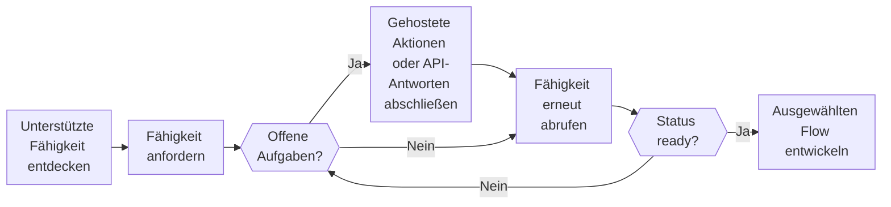

Eine Fähigkeit sagt Ihnen, ob ein Kunde ein bestimmtes Ergebnis, eine Zahlungsmethode und Richtung verwenden kann. Offene Aufgaben sagen Ihnen, was passieren muss, bevor diese Fähigkeit oder eine zugehörige Ressource fortgesetzt werden kann.



```bash Environment variables
export API_BASE='https://platform.swipelux.com'
export SWIPELUX_API_KEY='replace-with-your-api-key'
```

## Unterstützte Fähigkeiten entdecken {#discover-supported-capabilities}

Lesen Sie die aktuellen Optionen des Kunden mit [`GET /v3/customers/{customerId}/capabilities/supported`](/api-reference/capabilities/get-v3-customers-by-customer-id-capabilities-supported):

```bash List supported capabilities
curl --request GET \
  "${API_BASE}/v3/customers/${CUSTOMER_ID}/capabilities/supported" \
  --header "X-API-Key: ${SWIPELUX_API_KEY}"
```

Wählen Sie einen Antwort-Eintrag, der den beabsichtigten `directions`, `method` und `accountType` entspricht. Fahren Sie nur fort, wenn `availability` gleich `available` oder `beta` und `eligibility.eligible` gleich `true` ist. Wenn `institutions` zurückgegeben werden, wählen Sie nur eine ID aus dieser Antwort aus.

Jeder Institutionseintrag enthält eine `logoUrl` und ein `isDefault`-Flag. Verwenden Sie `logoUrl`, um das Logo der Bank in einer Bankauswahl-UI anzuzeigen, und rendern Sie Ihr eigenes generisches Banksymbol, wenn der Wert `null` ist. `isDefault` gilt nur für diesen Kunden und diese Fähigkeit, nicht global für die Institution. [`GET /v3/institutions`](/api-reference/institutions/get-v3-institutions) gibt dieselbe nullable `logoUrl` zurück. Institutions-IDs sind opak, verarbeiten Sie neue IDs daher ohne Codeänderungen.

```json Institution entry
{
  "institutions": [
    {
      "id": "jpmorgan",
      "name": "JPMorgan Chase",
      "bic": "CHASUS33",
      "logoUrl": "https://wallet.swipelux.com/bank-logos/jpmorgan.png",
      "countries": ["US"],
      "isDefault": true,
      "currencies": [
        { "code": "USD", "institution": "jpmorgan" }
      ]
    }
  ]
}
```

Für jede benannte Fähigkeit listet jeder Institutionseintrag auch `currencies` auf. Jedes Element gibt einen Währungs-`code` an, den ein ausgegebenes Konto empfangen kann, und die `institution`, die Sie senden, wenn Sie [dieses Konto eröffnen](/de/integration/issue-bank-account#choose-the-bank). `ach_named`, `wire_named` und `rtp_named` listen USD auf. `sepa_named` listet EUR, `faster_payments_named` listet GBP und `ipp_named` listet AED auf. `swift_named` listet jede Währung auf, in der die Bank SWIFT-Konten ausgibt. Eine Währung kann eine andere Institution nennen als der Eintrag selbst. Zum Beispiel nennen Nicht-USD-SWIFT-Währungen bei `lead_bank` `bmo`. Gepoolte Fähigkeiten lassen `currencies` weg.

Bei `swift_named` entscheidet die Bank, welche dieser Währungen jeder Kunde eröffnen kann. Ein Konto in einer Währung, die die Bank diesem Kunden nicht anbietet, endet als `rejected` mit `statusReason.code: currency_unavailable`.

Senden Sie `bmo` nur, wenn Sie das Konto eröffnen. Eine Fähigkeitsanfrage oder Aufgabenvorschau, die `bmo` in `institutions` nennt, gibt `422 capability_institutions_unsupported` zurück. Fordern Sie stattdessen `swift_named` bei `lead_bank` an.

Wenn Sie `institutions` weglassen, wählt Swipelux die zutreffende Standardbank für diesen Kunden. Der Standard wird pro Kunde festgelegt und kann sich im Laufe der Zeit ändern, zum Beispiel wenn sich das Profil des Kunden ändert oder das Onboarding einer Bank öffnet oder schließt. Lesen Sie `isDefault` jedes Mal aus der Antwort zu den unterstützten Fähigkeiten, statt den Wert zu speichern. Im Live-Modus:

- `ach_named` und `wire_named` verwenden standardmäßig Lead Bank (`lead_bank`), wenn Lead Bank neue Kunden annimmt und diesen Kunden onboarden kann: Das Profil nennt mindestens ein Land und Lead Bank akzeptiert jedes Land darin, das Profil eines Unternehmens nennt eine Rechtsform, die Lead Bank akzeptiert, und der Kunde hat keinen `ready`-Antrag bei einer anderen Bank, weder named noch pooled. Andernfalls verwenden sie standardmäßig JPMorgan Chase (`jpmorgan`).
- `ach_pooled` und `wire_pooled` verwenden standardmäßig JPMorgan Chase (`jpmorgan`).

Der Standard gilt nur für eine neue Auswahl. Ein genehmigter (`ready`) Antrag, den der Kunde bereits hat, oder ein aktueller Antrag bei einer anderen Bank hat weiterhin Vorrang vor dem Standard und vor der mit `isDefault` markierten Bank. Um eine Bank festzulegen, senden Sie ihre ID in `institutions`. In der Sandbox werden ACH-, Wire- und SWIFT-Fähigkeiten nur bei JPMorgan Chase (`jpmorgan`) bereitgestellt. Siehe [Sandbox-Tests](/de/integration/sandbox).

Speichern Sie die ausgewählte `data[].id` als `CAPABILITY_ID`. Kopieren Sie niemals eine Fähigkeits-ID von einem anderen Kunden oder aus einer anderen Umgebung.

### Anzeigen, warum eine Bank nicht verfügbar ist {#show-why-a-bank-is-unavailable}

Jeder Eintrag enthält außerdem `unavailableInstitutions`. Dieses Feld listet die Banken auf, die diese Fähigkeitsvariante anbieten, diesen Kunden aber nicht akzeptieren. Jeder Eintrag hat eine `id`, einen `name` und ein nicht leeres `reasons`-Array. Jeder Grund hat dieselbe Struktur wie `statusReason`, mit `actor: "provider"` und `retryable: false`. Verwenden Sie `unavailableInstitutions`, um Kunden zu zeigen, warum eine Bank in Ihrer Bankauswahl-UI fehlt, zum Beispiel indem Sie die Bank deaktiviert mit der `message` des Grundes darstellen.

```json Unavailable institution entry
{
  "unavailableInstitutions": [
    {
      "id": "lead_bank",
      "name": "Lead Bank",
      "reasons": [
        {
          "code": "jurisdiction_unsupported",
          "message": "The bank does not accept customers from a country on this customer's profile.",
          "actor": "provider",
          "retryable": false
        }
      ]
    }
  ]
}
```

Aktuelle Grundcodes:

| Code | Bedeutung |
| --- | --- |
| `jurisdiction_unsupported` | Die Bank akzeptiert ein Land im Profil des Kunden nicht. |
| `legal_form_unsupported` | Die Bank akzeptiert die Rechtsform des Kunden nicht. |
| `customer_type_unsupported` | Die Bank akzeptiert den Kundentyp nicht. |

Behandeln Sie unbekannte Codes ohne Codeänderungen, da Swipelux neue Codes hinzufügen kann. Eine Bank erscheint nie gleichzeitig in `institutions` und `unavailableInstitutions`. `unavailableInstitutions` ist immer vorhanden und bei pooled und Nicht-Bank-Einträgen `[]`. Eine Bank, die in keiner der beiden Listen steht, wird aus einem Grund ausgelassen, der nichts mit diesem Kunden zu tun hat. Wenn Sie eine nicht verfügbare Bank in einer Fähigkeitsanfrage angeben, wird weiterhin [`422 capability_institutions_unsupported`](/integration/errors#capability-institutions-unsupported) zurückgegeben.

### Prüfen, wo ein Konto eröffnet werden kann {#check-where-an-account-can-open}

Jeder Eintrag enthält außerdem `banks`. Bei named Einträgen listet das Feld jede Bank aus `institutions` oder `unavailableInstitutions` auf, dazu jede Bank, bei der der Kunde einen Antrag für diese Variante hat. Bei anderen Einträgen ist es `[]`. Jede Bank hat dieselben Felder `id`, `name`, `bic` und `logoUrl` wie ein Institutionseintrag und ergänzt den Stand des Kunden bei dieser Bank:

```json Bank entry
{
  "banks": [
    {
      "id": "jpmorgan",
      "name": "JPMorgan Chase",
      "bic": "CHASUS33",
      "logoUrl": null,
      "status": "approved",
      "applicationId": "apl_000000000000000005",
      "accountOpening": "now",
      "currencies": [
        { "code": "USD", "institution": "jpmorgan" }
      ]
    }
  ]
}
```

`status` ist einer der folgenden Werte:

- `approved`: Ein bereiter Antrag bei der Bank deckt diese Variante ab.
- `pending`: Ein Antrag bei der Bank hat sie angefordert, und die Bank hat sie noch nicht genehmigt.
- `refused`: Die Bank hat den Kunden abgelehnt.
- `not_requested`: Kein Antrag bei der Bank fordert sie an. Eine Fähigkeitsanfrage kann diese Bank auswählen.
- `not_offered`: Die Bank akzeptiert diesen Kunden für diese Variante nicht.

`applicationId` nennt den Antrag, der `status` bestimmt, oder ist `null`. `accountOpening` gibt an, was eine [Anfrage für ein ausgegebenes Konto](/de/integration/issue-bank-account#choose-the-bank), die diese Bank nennt, aktuell bewirkt:

- `now`: Die Anfrage wird akzeptiert und das Konto wird ausgegeben.
- `after_approval`: Die Anfrage wird mit `allowPending: true` akzeptiert und wartet auf die Genehmigung der Bank.
- `application`: Fordern Sie zuerst die Fähigkeit mit dieser Bank in `institutions` an.
- `none`: Bei dieser Bank wird aktuell keine Kontoanfrage akzeptiert.

Bei `now` und `after_approval` listet `currencies` nur die Währungen auf, in denen eine Anfrage akzeptiert wird. Eine Währung, in der der Kunde bei dieser Bank bereits ein Konto hat, fehlt deshalb. Andernfalls listet das Feld jede Währung auf, in der die Bank diese Variante eröffnet. Jedes Element nennt die zu sendende `institution`, wie in `institutions[].currencies`.

Entscheiden Sie allein anhand von `accountOpening`, ob Sie die Kontoeröffnung bei einer Bank anbieten. `institutions` beantwortet eine andere Frage: wohin eine neue Fähigkeitsanfrage gehen kann. Das Feld kann eine einzige Standardbank auflisten, während eine andere Bank den Kunden bereits genehmigt hat.

### Pooled vs. named Kontotypen {#pooled-vs-named-account-types}

Bank-Fähigkeiten gibt es in zwei Varianten, kodiert im Feld `accountType` und dem Fähigkeits-ID-Suffix (zum Beispiel `ach_pooled`, `wire_named`):

- **`pooled`**: gemeinsam genutztes Swipelux-Bankkonto. Jedes Pay-in verwendet eine eindeutige Referenz, um Gelder weiterzuleiten. Wählen Sie dies für einmalige Transfers.
- **`named`**: dedizierte Bankdaten für den Kunden (virtuelle IBAN, dediziertes ACH-Konto). Wiederverwendbar und mit jedem Zahler teilbar. Erforderlich für [ausgegebene Bankkonten](/de/integration/issue-bank-account).

Standardmäßig `pooled`. Verwenden Sie `named` nur, wenn der Kunde wiederverwendbare Bankdaten benötigt. Prüfen Sie die `supported`-Antwort, um zu sehen, welche Varianten verfügbar sind.

Um SWIFT-Einzahlungen zu empfangen oder SWIFT-Bankdaten auszugeben, verwenden Sie `swift_named`. `swift_pooled` unterstützt nur Payouts, prüfen Sie also die `directions` jeder Option in der Antwort zu den unterstützten Fähigkeiten. Ein named SWIFT-Konto gibt wiederverwendbare Empfangsdaten zurück, darunter die BIC der Bank, eine Referenz, falls eine erforderlich ist, und die Begünstigtenadresse, sofern die Bank sie bereitstellt.

Für ausgegebene ACH-, Wire- und SWIFT-Konten können Sie mit `institution` eine bestimmte Bank auswählen und die Kontoanfrage speichern, bevor die Bank den Kunden genehmigt. Siehe [Bankkonto ausgeben](/de/integration/issue-bank-account#choose-the-bank).

## Fähigkeit anfordern {#request-the-capability}

Fordern Sie die ausgewählte Option mit [`POST /v3/customers/{customerId}/capabilities/{capabilityId}`](/api-reference/capabilities/post-v3-customers-by-customer-id-capabilities-by-capability-id) an:

```bash Request capability
curl --request POST \
  "${API_BASE}/v3/customers/${CUSTOMER_ID}/capabilities/${CAPABILITY_ID}" \
  --header "X-API-Key: ${SWIPELUX_API_KEY}" \
  --header "Idempotency-Key: capability-request-001" \
  --header "Content-Type: application/json" \
  --data '{}'
```

Verwenden Sie ein explizites `institutions`-Array nur, wenn Sie aus IDs auswählen müssen, die von der Supported-Capability-Antwort zurückgegeben wurden.

Speichern Sie `data.status` als `CAPABILITY_STATUS`, `data.accountProvisioning` als `ACCOUNT_PROVISIONING_STATUS`, `data.openTaskIds` als `OPEN_TASK_IDS` und jede `data.applications[].id` in `APPLICATION_IDS`.

### Gemeinsame Anträge pro Bank {#shared-applications-per-bank}

Bei named Bank-Fähigkeiten hat jeder Kunde einen Antragsfall pro Bank. Pooled- und Plattform-Fähigkeiten verwenden Fälle ohne Bank. Swipelux teilt einen Fall über alle kompatiblen Fähigkeiten, die Sie anfordern:

- Eine Genehmigung kann mehrere Fähigkeiten abdecken. Zum Beispiel kann ein genehmigter Fall bei einer Bank sowohl eine ACH- als auch eine Wire-Fähigkeit `ready` machen.
- Eine spätere Anfrage, die zu einem bestehenden Fall passt, verwendet diesen wieder. Swipelux eröffnet keinen zweiten Antrag und fügt keine doppelten Aufgaben hinzu.
- Fälle bei verschiedenen Banken sind unabhängig. Eine Ablehnung bei einer Bank wirkt sich nicht auf einen Fall bei einer anderen Bank aus.

Die Antwort auf die Anfrage zeigt Ihnen, welchen Fall Swipelux verwendet hat:

- `201` bedeutet, dass die Anfrage einen neuen Antragsfall eröffnet hat.
- `200` bedeutet, dass die Anfrage einem Antragsfall zugeordnet wurde, den der Kunde bereits hatte, zum Beispiel bei einer wiederholten Anfrage für eine Bank-Fähigkeit, die der Kunde bereits besitzt, oder bei einer Anfrage für eine stornierte Bank-Fähigkeit, die sich ihrem bestehenden Antrag anschließt. Eine wiederholte Anfrage für `card` oder `stablecoin_transfers` gibt weiterhin [`409 capability_already_exists`](/integration/errors#capability-already-exists) zurück, und eine Anfrage für eine stornierte Fähigkeit `card` gibt [`409 capability_not_reopenable`](/integration/errors#capability-not-reopenable) zurück.
- `selectedApplicationId` ist ein Feld auf oberster Ebene neben `data` mit der ID des Falls, den die Anfrage ausgewählt oder eröffnet hat. Swipelux lässt es weg, wenn die Anfrage keinen Fall ausgewählt hat. Eine idempotente Wiederholung gibt denselben Wert zurück.

Gekürzte Antwort:

```json Response (abbreviated)
{
  "data": {
    "id": "ach_named",
    "status": "pending",
    "openTaskIds": ["tsk_000000000000000002"],
    "applications": [{ "id": "apl_000000000000000005", "status": "in_review" }]
  },
  "selectedApplicationId": "apl_000000000000000005"
}
```

Senden Sie bei named Fähigkeiten dieselbe `institutions`-Liste erneut, um denselben Fall auszuwählen, oder senden Sie eine einzelne Institutions-ID, um gezielt diese Bank anzusprechen. Eine Bank, die den Kunden endgültig abgelehnt hat, wird übersprungen. Wenn Sie nur diese Bank angeben oder alle berechtigten Banken den Kunden abgelehnt haben, gibt die Anfrage [`409 capability_terminally_rejected`](/integration/errors#capability-terminally-rejected) zurück. Um es nach einer Ablehnung bei einer anderen Bank zu versuchen, fordern Sie die Fähigkeit erneut mit der Institutions-ID dieser Bank an.

Der Status einer Fähigkeit spiegelt alle zugehörigen Fälle des Kunden wider. Bei einer named Fähigkeit genügt ein `ready`-Fall, dessen Genehmigung sie abdeckt, damit sie `ready` wird, unabhängig davon, was andere Banken melden. Eine pooled Fähigkeit wartet zusätzlich auf ihre Methodenprüfung, die in `probes` in der Antragsliste des Kunden gemeldet wird.

#### Anträge des Kunden auflisten {#list-the-customers-applications}

Listen Sie alle Antragsfälle des Kunden mit [`GET /v3/customers/{customerId}/applications`](/api-reference/capabilities/get-v3-customers-by-customer-id-applications) auf. Die Ergebnisse sind mit `nextCursor` und `hasMore` paginiert und akzeptieren `updatedAfter`:

```bash List applications
curl --request GET \
  "${API_BASE}/v3/customers/${CUSTOMER_ID}/applications" \
  --header "X-API-Key: ${SWIPELUX_API_KEY}"
```

Jeder Eintrag enthält die Antragsfelder, die in `applications[]` einer Fähigkeit zurückgegeben werden, und zusätzlich:

- `scope`: `named` für einen Fall bei einer Bank, `provider_pooled` oder `platform` für Fälle ohne Bank oder `null` für einen nicht klassifizierten historischen Fall. `institution` fehlt bei `provider_pooled`- und `platform`-Fällen.
- `requestedScope[]`: die Fähigkeitsschlüssel, die für den Fall angefordert wurden, jeweils mit ihrem ersten `requestedAt`. Einträge werden nie entfernt.
- `coverage[]`: die Fähigkeitsschlüssel, die die Genehmigung des Falls abdeckt, jeweils mit `grantedAt` und `source`. Coverage erfasst den Umfang, nicht die Autorisierung. Lesen Sie die Fähigkeit, um ihren aktuellen Status zu erhalten.
- `probes[]`: Methodenprüfungen für die pooled Fähigkeitsschlüssel, die der Fall abdeckt, jeweils mit `capabilityKey`, `status` und `reason`. Named Schlüssel erfordern nie eine Prüfung.
- `generation`, `predecessorApplicationId` und `supersededByApplicationId`: Nachfolgeverknüpfungen. Wenn `supersededByApplicationId` gesetzt ist, wurde der Fall ersetzt. Folgen Sie dieser ID zum aktuellen Fall. Die `applications[]` einer Fähigkeit listen nur aktuelle Fälle auf, daher erscheint ein ersetzter Fall nur in dieser Liste.

Gekürzte Antwort:

```json Response (abbreviated)
{
  "data": [
    {
      "id": "apl_000000000000000005",
      "status": "ready",
      "scope": "named",
      "institution": { "id": "jpmorgan", "name": "JPMorgan Chase", "bic": "CHASUS33" },
      "requestedScope": [
        { "capabilityKey": "ach_named", "requestedAt": "2026-09-20T10:00:00.000Z" }
      ],
      "coverage": [
        { "capabilityKey": "ach_named", "grantedAt": "2026-09-22T12:00:00.000Z", "source": "approval" },
        { "capabilityKey": "wire_named", "grantedAt": "2026-09-22T12:00:00.000Z", "source": "approval" }
      ],
      "probes": [],
      "generation": 1,
      "predecessorApplicationId": null,
      "supersededByApplicationId": null
    }
  ],
  "nextCursor": null,
  "hasMore": false
}
```

## Aktuelle Aufgaben erledigen {#complete-current-tasks}

Listen Sie Aufgaben mit [`GET /v3/customers/{customerId}/tasks`](/api-reference/tasks/list-customer-tasks) auf, wählen Sie IDs aus `OPEN_TASK_IDS` aus und lesen Sie dann jede aktuelle Aufgabe mit [`GET /v3/customers/{customerId}/tasks/{taskId}`](/api-reference/tasks/get-customer-task):

```bash List open tasks
curl --request GET \
  "${API_BASE}/v3/customers/${CUSTOMER_ID}/tasks/${TASK_ID}" \
  --header "X-API-Key: ${SWIPELUX_API_KEY}"
```

Verwenden Sie die neuesten `data.revision` und `data.requirements`. Rufen Sie die Aufgabe unmittelbar vor dem Absenden erneut ab, wenn sich eines von beiden geändert haben könnte.

### Wiederverwendete Profilnachweise {#reused-profile-evidence}

Bei Antragsaufnahme-Aufgaben, die eine direkte API-Einreichung akzeptieren, verwendet Swipelux Informationen wieder, die der Kunde bereits bereitgestellt hat. Wenn eine solche Aufgabe erstellt oder abgeglichen wird, prüft Swipelux das Kundenprofil und die vom Kunden selbst hochgeladenen Dokumente. Berechtigte Anforderungen, die bereits durch einen verwendbaren Profilwert oder ein Dokument belegt sind, wechseln zu `in_review`, statt handlungsfähig zu bleiben. Profilaktualisierungen und neue Dokument-Uploads lösen dieselbe Prüfung für bestehende Aufgaben aus.

Nur fehlende oder inkompatible Werte bleiben handlungsfähig. Die Wiederverwendung genehmigt die Nachweise nicht. Swipelux prüft sie weiterhin. Ausdrückliche Korrekturanfragen und bereits beantwortete Anforderungen bleiben handlungsfähig. Dokumente von Eigentümern und verbundenen Parteien werden nicht wiederverwendet, und Anforderungen, die nur über eine gehostete Session erfasst werden, behalten ihren normalen Ablauf.

### Anforderungen rendern {#render-requirements}

Erstellen Sie Formulare aus den Metadaten, die jede Anforderung zurückgibt, statt aus Anforderungsschlüsseln. Eine Anforderung kann einen optionalen kurzen `title` enthalten, und jeder `request` enthält einen `prompt`, der unter der Überschrift angezeigt wird.

Anforderungen mit `request.type: "profile"` identifizieren das Profilfeld mit `profilePointer` und ergänzen Eingabemetadaten:

- `allowedValues`: die zulässigen Werte für ein skalares Feld oder für jedes Element eines Array-Felds. Senden Sie diese Werte, nicht übersetzte Anzeigebezeichnungen.
- `valueSchema`: ein eigenständiges JSON Schema Draft 7-Dokument, das die Eingabeform, verschachtelte Eigenschaften, Pflichtfelder und strukturelle Einschränkungen beschreibt. Enums für Objekte erscheinen an der jeweiligen Eigenschaft, zum Beispiel `valueSchema.items.properties.type.enum` für Steueridentifikatoren. Swipelux wendet nach der Einreichung weiterhin feldübergreifende Validierung und Prüfungsvalidierung an, daher kann ein Wert, der das Schema erfüllt, dennoch abgelehnt werden.
- `valueType: "country"` oder `itemValueType: "country"` für Arrays: Das Feld akzeptiert ISO 3166-1 alpha-2-Codes in Großbuchstaben. Verschachtelte Ländereigenschaften in `valueSchema` verwenden `format: "iso-3166-1-alpha-2"`. Verwenden Sie für lokalisierte Bezeichnungen eine Standard-Länderliste.

```json Requirement
{
  "id": "req_000000000000000010",
  "key": "account_purposes",
  "title": "Account purpose",
  "status": "action_required",
  "request": {
    "type": "profile",
    "prompt": "Select every purpose that applies.",
    "required": true,
    "profilePointer": "/financialProfile/accountPurposes",
    "valueType": "array",
    "itemValueType": "string",
    "allowedValues": ["business_expenses", "ecommerce", "payroll"],
    "valueSchema": {
      "$schema": "http://json-schema.org/draft-07/schema#",
      "type": "array",
      "items": { "enum": ["business_expenses", "ecommerce", "payroll"] }
    }
  }
}
```

Dieses Beispiel kürzt den Wertekatalog; die API gibt jeden zulässigen Wert zurück. Einige Profilanforderungen haben kein veröffentlichtes Schema und lassen `valueSchema` und `allowedValues` weg. Rendern Sie diese anhand von `prompt` und `valueType`.

Jede offene Aufgabe enthält einen `dueAt`-Zeitstempel. Wenn Swipelux eine Aufgabe ohne explizites Fälligkeitsdatum erstellt, wird `dueAt` standardmäßig auf genau 31 Tage nach dem `createdAt` der Aufgabe gesetzt. Behandeln Sie `dueAt` als informativ: Sie können es nicht über die API setzen, und es löst keinen automatischen Lebenszyklusübergang aus. Nur das separate Feld `deadline` verursacht, falls vorhanden, einen automatischen Übergang.

### Gehostete Aktionen {#hosted-actions}

In der Antwort mit den Aufgabendetails enthält jeder Eintrag in `verificationSessions` und `tosSessions` ein `action`-Objekt. Antworten der Aufgabenliste enthalten diese Aktionslinks nicht. Speichern Sie die `id` jeder Sitzung und lesen Sie `action.kind`, bevor Sie den Kunden weiterleiten; leiten Sie die Verfügbarkeit des Links nicht aus dem `status` der Sitzung ab.

- `action.kind: "available"` enthält `action.url` und `action.expiresAt` (derzeit immer `null`). Speichern Sie `action.url`, senden Sie den Kunden dorthin und lesen Sie die Aufgabe anschließend erneut. Die Felder `url` und `expiresAt` auf Sitzungsebene enthalten dieselben Werte.
- `action.kind: "unavailable"` bedeutet, dass kein Link angezeigt werden soll. Die Felder `url` und `expiresAt` auf Sitzungsebene fehlen. Der `status` einer Sitzung allein bestimmt nicht, welche Aktionsart Sie erhalten.

```json Verification session
{
  "data": {
    "verificationSessions": [
      {
        "id": "vfy_000000000000000003",
        "key": "identity_verification",
        "type": "identity_verification",
        "status": "action_required",
        "coveredRequirementIds": ["req_000000000000000011", "req_000000000000000012"],
        "action": {
          "kind": "available",
          "url": "https://platform.swipelux.com/kyc/redirect/cus_000000000000000001/tsk_000000000000000002/vfy_000000000000000003",
          "expiresAt": null
        },
        "url": "https://platform.swipelux.com/kyc/redirect/cus_000000000000000001/tsk_000000000000000002/vfy_000000000000000003",
        "expiresAt": null
      }
    ],
    "tosSessions": [
      {
        "id": "vfy_000000000000000004",
        "key": "terms_of_service",
        "type": "terms_of_service",
        "status": "completed",
        "action": { "kind": "unavailable" }
      }
    ]
  }
}
```

Dies sind aufgabenbezogene Aktionen, kein separater Kundenverifizierungs-Lebenszyklus.

Jeder `verificationSessions[]`-Eintrag in Aufgabenabfragen und in den Aufgabendetails des Kunden enthält `coveredRequirementIds`. Das Feld listet die IDs der aktiven Anforderungen der Aufgabe auf, die die Session erfüllen kann. Verwenden Sie es, um zu sehen, welche Anforderungen eine gehostete Session oder eine [importierte Verifizierung](#import-an-existing-identity-verification) erledigen kann. Erfüllen Sie alle anderen Anforderungen über [API-Antworten](#api-answers).

Bei neuen Intake-Aufgaben für Privatpersonen deckt die gehostete Identitäts-Session nur das Ausweisdokument, das Selfie und den Adressnachweis ab. Anforderungen zum Herkunftsnachweis der Gelder, etwa `proof_of_funds`, `source_of_funds_document`, `named_source_of_funds_document` und `sole_proprietor_document`, sind nicht Teil der gehosteten Session. [Laden Sie diese Dokumente direkt hoch](#upload-documents) und reichen Sie sie ein. Swipelux prüft sie, und die Aufgabe bleibt offen, bis sie akzeptiert sind.

Eine gehostete Antwort auf eine Profilanforderung für einen strukturierten Wert, etwa eine Adresse oder Steueridentifikationsnummern, muss dieselben Schema- und Einschränkungsprüfungen bestehen wie eine direkte Antwort. Besteht sie diese nicht, bleibt die Anforderung offen. Eine Anforderung, die Swipelux aus diesem Grund auf `action_required` zurücksetzt, trägt `reviewFeedback.code: hosted_profile_direct_submission_required`. Erfassen Sie diesen Wert beim Kunden und reichen Sie ihn als [API-Antwort](#api-answers) ein.

### Eine bestehende Identitätsverifizierung importieren {#import-an-existing-identity-verification}

Wenn Sie Privatpersonen bereits in Ihrem eigenen Konto beim Identitätsverifizierungsanbieter von Swipelux verifizieren, können Sie diese Verifizierung in die Identitäts-Session der Intake-Aufgabe des Kunden importieren, statt den Kunden durch den gehosteten Ablauf zu schicken. Diese Option gilt nur für API-Integrationen mit Privatkunden. Unternehmen und verbundene Parteien werden nicht unterstützt.

Richten Sie vor dem Import die Freigabe bei Ihrem Identitätsverifizierungsanbieter ein:

1. Fordern Sie bei Swipelux dessen Partner-Token an und fügen Sie Swipelux dann in Ihrem Konto beim Identitätsverifizierungsanbieter als Freigabepartner hinzu.
2. Erzeugen Sie für Live-Verifizierungen ein Share-Token für Swipelux mit der Empfänger-Client-ID (`forClientId`) `swipelux.com_21030`.
3. Senden Sie das Token an Swipelux, bevor es abläuft. Share-Tokens sind opak, nur einmal verwendbar, höchstens 1.024 UTF-8-Bytes groß und laufen standardmäßig nach 20 Minuten ab. Behandeln Sie jedes Token wie ein Zugangsdatum.

Die Aufgabe muss eine Intake-Aufgabe für eine Privatperson sein und die gehostete Verifizierungs-Session als Einreichungsmethode anbieten. Die Session muss `type: "identity_verification"` und `status: "action_required"` haben. Der Kunde darf bei Swipelux noch keine laufende oder abgeschlossene Verifizierung haben, und es darf noch kein Import laufen. Das Öffnen des gehosteten Links startet die Verifizierung, das Lesen der Aufgabe dagegen nicht. Rufen Sie dann `POST /v3/customers/{customerId}/tasks/{taskId}/verification-sessions/{verificationSessionId}/share-token` auf. Die Anfrage benötigt dieselben Berechtigungen `accounts:write`, `customers:read` und `customers:write` wie Aufgabeneinreichungen sowie einen `Idempotency-Key`:

```json Request body
{
  "shareToken": "<share token>"
}
```

```json Response
{
  "verificationSessionId": "vfy_000000000000000003",
  "status": "in_review"
}
```

Ihr Anbieter kopiert die passenden Schritte in das Konto von Swipelux, und die Prüfungen laufen erneut gegen das Level, das die Aufgabe verlangt. Swipelux speichert oder protokolliert das Share-Token niemals.

- `status: "in_review"` bedeutet, dass die Prüfungen ausstehen. Wenn die Prüfungen abgeschlossen sind, erledigt Swipelux die abgedeckten Anforderungen auf dieselbe Weise wie bei einer gehosteten Session.
- `status: "action_required"` bedeutet, dass Schritte fehlen. Der Kunde kann sie über den bestehenden gehosteten Link der Session abschließen, oder Sie können die abgedeckten Anforderungen direkt einreichen.

Der Import erfüllt nur die in `coveredRequirementIds` aufgeführten Anforderungen: das Ausweisdokument, das Selfie und, sofern die Aufgabe es verlangt, den Adressnachweis. Reichen Sie Profilantworten, den Herkunftsnachweis der Gelder und andere Anforderungen als [API-Antworten](#api-answers) ein. Um eine Anfrage zu wiederholen, senden Sie sie erneut mit demselben `Idempotency-Key`.

| Status | Code | Was zu tun ist |
| --- | --- | --- |
| `409` | `verification_already_started` | Dieser Kunde hat bei Swipelux bereits eine laufende oder abgeschlossene Verifizierung, oder es läuft bereits ein Import, zum Beispiel weil der Kunde einen gehosteten Link geöffnet hat. Nicht wiederholen. Fahren Sie über die bestehende Session fort. |
| `409` | `verification_session_not_allowed` | Die Aufgabe oder Session ist nicht für den Import berechtigt. Nicht wiederholen. Lesen Sie die Aufgabe und verwenden Sie die Methoden, die sie anbietet. |
| `422` | `share_token_rejected` | Der Identitätsverifizierungsanbieter hat das Token abgelehnt, zum Beispiel weil es abgelaufen ist, bereits verwendet wurde oder für einen anderen Empfänger ausgestellt wurde. Erzeugen Sie ein neues Token für Swipelux und wiederholen Sie die Anfrage mit einem neuen `Idempotency-Key`. |
| `503` | `kyc_provider_unavailable` | Bei `retryable: true` hatte Swipelux das Token noch nicht gesendet. Wiederholen Sie die Anfrage nach einer Wartezeit. Bei `retryable: false` hat der Import möglicherweise stattgefunden, konnte aber nicht bestätigt werden. Senden Sie das Token nicht erneut. Fahren Sie über den gehosteten Link der Session fort. |

### Dokumente hochladen {#upload-documents}

Wenn eine Anforderung ein Dokument verlangt, laden Sie es mit [`POST /v3/customers/{customerId}/documents`](/api-reference/documents/post-v3-customers-by-customer-id-documents) hoch:

```bash Upload document
export DOCUMENT_PATH='/absolute/path/to/requested-document.pdf'

curl --request POST \
  "${API_BASE}/v3/customers/${CUSTOMER_ID}/documents" \
  --header "X-API-Key: ${SWIPELUX_API_KEY}" \
  --header "Idempotency-Key: customer-document-001" \
  --form "file=@${DOCUMENT_PATH}"
```

Speichern Sie die zurückgegebene `data.id` als `DOCUMENT_ID`, bevor Sie die Antwort einreichen, die darauf verweist.

Jede v3-Dokumentressource enthält `contentSha256`, den SHA-256-Hash der gespeicherten Datei als `sha256:` gefolgt vom hexadezimalen Hash in Kleinbuchstaben. Zwei Dokumente mit demselben Hash sind byte-identisch. Um zu prüfen, ob eine Datei bereits vom Kunden hochgeladen wurde, zum Beispiel eine Datei, deren Ersetzung ein Prüfer angefordert hat, berechnen Sie ihren SHA-256 vor dem Hochladen und vergleichen Sie ihn mit `contentSha256` der Dokumente, auf die die Antworten der früheren Einreichung in `documentIds` verweisen. Das Feld ist `null` für Dokumente, die gespeichert wurden, bevor Swipelux Hashes erfasst hat.

Eine Dokumentantwort muss mindestens eine Datei enthalten, die für diese Anforderung noch nicht zurückgegeben wurde. Wenn jede Datei in der Antwort bei einer früheren Prüfung zurückgegeben wurde, lehnt Swipelux die Antwort mit `documents_already_returned` ab. Sie können frühere Dateien zusammen mit einer neuen erneut senden. Wenn eine Datei versehentlich zurückgegeben wurde, laden Sie sie erneut hoch, um eine neue Dokument-ID zu erhalten. Der Prüfer sieht weiterhin die frühere Entscheidung.

Um eine gespeicherte Datei später abzurufen, rufen Sie [`GET /v3/customers/{customerId}/documents/{documentId}/download`](/api-reference/documents/get-v3-customers-by-customer-id-documents-by-document-id-download) auf. Swipelux liefert eine `url`, die die Datei als Anhang herunterlädt und nach einer Stunde abläuft. Archivierte Dokumente liefern `404`.

### API-Antworten {#api-answers}

Reichen Sie einen vollständigen Antwortsatz für die aktuelle Revision mit [`POST /v3/customers/{customerId}/tasks/{taskId}/submissions`](/api-reference/task-submissions/create-customer-task-submission) ein:

```bash Submit task answers
curl --request POST \
  "${API_BASE}/v3/customers/${CUSTOMER_ID}/tasks/${TASK_ID}/submissions" \
  --header "X-API-Key: ${SWIPELUX_API_KEY}" \
  --header "Idempotency-Key: task-submission-001" \
  --header "Content-Type: application/json" \
  --data @- <<'JSON'
{
  "taskRevision": 3,
  "answers": [
    {
      "requirementId": "req_from_current_task",
      "answer": {
        "type": "text",
        "value": "Current answer"
      }
    }
  ]
}
JSON
```

Übernehmen Sie jede Anforderungs-ID und jeden Antworttyp aus der neuesten Aufgabe. Wenn die API meldet, dass sich die Aufgabe geändert hat, rufen Sie sie erneut ab und bauen Sie die Einreichung aus der neuen Revision neu auf.

#### Gültige Antworten mit `allowPartial` behalten {#keep-valid-answers-with-allowpartial}

Standardmäßig lässt eine abgelehnte Antwort die gesamte Anfrage scheitern, und Swipelux speichert nichts. Die Antwort ist `400 validation_error`, `400 invalid_document_reference`, `400 documents_already_returned` oder `409 absence_conflicts_with_profile`. Fügen Sie `"allowPartial": true` hinzu, wenn Swipelux die gültigen Antworten speichern und nur die ungültigen ablehnen soll:

```json Partial submission request
{
  "taskRevision": 3,
  "allowPartial": true,
  "answers": [
    { "requirementId": "req_a", "answer": { "type": "text", "value": "Salary" } },
    { "requirementId": "req_b", "answer": { "type": "document", "documentIds": ["doc_unknown"] } }
  ]
}
```

Swipelux gibt `201` mit der gespeicherten Einreichung in `data` zurück, die nur die behaltenen Antworten enthält, und listet die übrigen in `refusedAnswers` auf:

```json Partial submission response
{
  "data": { "id": "sub_000000000000000001", "outcome": "in_review", "answers": [{ "requirementId": "req_a" }] },
  "refusedAnswers": [
    {
      "requirementId": "req_b",
      "code": "invalid_document_reference",
      "pointer": "/answers/1/answer",
      "message": "A referenced document is invalid."
    }
  ]
}
```

Jede abgelehnte Antwort hat einen dieser Codes:

| `code` | Bedeutung |
| --- | --- |
| `invalid` | Die Antwort entspricht nicht der Form, dem Format oder den Einschränkungen der Anforderung, oder das Kundenprofil akzeptiert den Wert nicht. |
| `absence_conflicts_with_profile` | Eine Abwesenheit wurde für einen Wert gesendet, den das Profil enthält. |
| `invalid_document_reference` | Ein referenziertes Dokument kann für diesen Kunden und diese Anforderung nicht verwendet werden. |
| `documents_already_returned` | Jede Datei in der Dokumentantwort wurde für diese Anforderung bereits zurückgegeben. Senden Sie eine neue Datei, allein oder zusammen mit früheren. |
| `depends_on_refused_answer` | Die Antwort ist für sich gültig, wird aber zusammen mit einer abgelehnten beurteilt. Eine bedingte Antwort und die Antwort, die sie steuert, werden gemeinsam behalten oder abgelehnt. |

Weitere Codes können hinzukommen. Behandeln Sie einen unbekannten Code als `invalid`. `message` wiederholt nie den übermittelten Wert.

`allowPartial` lockert die anderen Regeln nicht:

- Die Anfrage muss weiterhin jede Anforderung beantworten, die sie auch ohne das Feld beantworten müsste. Unbeantwortete offene Anforderungen geben weiterhin `422 task_submission_incomplete` zurück.
- Ein Body, der schon am Anfrageschema scheitert, etwa durch ein unbekanntes Feld oder einen falschen Typ, gibt weiterhin `400 validation_error` zurück.
- Wenn keine Antwort behalten werden kann, gibt Swipelux `400 validation_error` zurück, speichert nichts und listet jede abgelehnte Antwort in `errors[]` auf.
- `refusedAnswers` ist genau dann vorhanden, möglicherweise leer, wenn die Anfrage `"allowPartial": true` gesendet hat. Eine Wiederholung mit demselben `Idempotency-Key` gibt dieselben `refusedAnswers` zurück.

Lesen Sie die Aufgabe erneut, bevor Sie eine abgelehnte Antwort korrigieren. Eine abgelehnte Anforderung ist normalerweise weiterhin `action_required`, aber eine Dokumentanforderung kann bereits durch eine hinterlegte Datei beantwortet sein. Reichen Sie die Korrekturen mit der neuen `taskRevision` und einem neuen `Idempotency-Key` ein. Senden Sie eine bedingte Antwort zusammen mit der Antwort, die sie steuert.

#### Eine auf Prüfung wartende Einreichung zurücknehmen {#withdraw-a-submission-awaiting-review}

Um eine Einreichung zu korrigieren, die noch `in_review` ist, nehmen Sie sie mit `POST /v3/customers/{customerId}/tasks/{taskId}/withdrawals` zurück. Die Anfrage hat keinen Body und benötigt einen `Idempotency-Key`. API-Schlüssel benötigen `accounts:write`, `customers:read` und `customers:write`, wie bei Einreichungen:

```bash Withdraw task submission
curl --request POST \
  "${API_BASE}/v3/customers/${CUSTOMER_ID}/tasks/${TASK_ID}/withdrawals" \
  --header "X-API-Key: ${SWIPELUX_API_KEY}" \
  --header "Idempotency-Key: task-withdrawal-001"
```

Swipelux gibt `200` mit der Einreichung in `data` zurück. Ihr `outcome` wird `withdrawn`, ihre Antworten kehren ohne `reviewFeedback` zu `action_required` zurück, und die nächste Einreichung beginnt eine neue `remediationRound`. Bereits akzeptierte Anforderungen und das Kundenprofil bleiben unverändert. Antworten, die Swipelux aus dem Profil oder aus hinterlegten Dateien ausgefüllt hat, bleiben in Prüfung. Sie können so oft zurücknehmen, wie Sie benötigen. Lesen Sie die Aufgabe erneut und reichen Sie dann korrigierte Antworten ein.

Swipelux lehnt eine Rücknahme in diesen Fällen ab:

- `404 task_not_found`: die Aufgabe existiert für diesen Kunden nicht.
- `409 task_not_in_review`: nicht genau eine Einreichung wartet auf Prüfung (keine oder mehr als eine, zum Beispiel eine Teileinreichung und ihre Korrektur), oder die Frist der Aufgabe ist abgelaufen.
- `409 submission_already_forwarded`: die Bank prüft diese Aufgabe direkt, oder Swipelux hat die Einreichung bereits zur Prüfung weitergeleitet. Aufgaben, die mit `POST /v3/sandbox/tasks` erstellt wurden, geben diesen Code ebenfalls zurück.

Das `outcome` einer Einreichung kann jetzt `withdrawn` sein. Aktualisieren Sie jeden Client, der `outcome` gegen eine feste Liste prüft.

### Voraussetzung des wirtschaftlich Berechtigten für Unternehmen {#beneficial-owner-prerequisite-for-businesses}

Das Anfordern einer Unternehmens-Fähigkeit, die Nachweise zum wirtschaftlich Berechtigten benötigt, gelingt auch dann, wenn der Kunde noch keinen qualifizierenden Eigentümer hat. Die Fähigkeit wird als `restricted` mit `statusReason.code: tasks_due` erstellt, und die Unternehmens-Intake-Aufgabe fordert die fehlenden Eigentumsfakten an, einschließlich der Eigentumsstruktur.

Dieselbe Aufgabe trägt eine `resource_reference`-Anforderung, deren Anfrage `qualification: "beneficial_owner"` enthält:

```json Beneficial owner requirement
{
  "type": "resource_reference",
  "prompt": "Add or select a qualifying beneficial owner.",
  "required": true,
  "resourceType": "related_party",
  "qualification": "beneficial_owner"
}
```

Eine verbundene Partei qualifiziert sich, wenn sie eine aktive `person`-Partei desselben Kunden mit einem angegebenen Eigentumsanteil von mindestens 25 oder mit `ownership.declared: true` ohne Prozentangabe ist.

Die Anforderung wird aus dem aktuellen Bestand verbundener Parteien abgeleitet, daher beantworten Sie sie in der Regel nicht direkt:

- Das Erstellen oder Aktualisieren einer qualifizierenden verbundenen Partei erfüllt die Anforderung in derselben Neubewertung und eröffnet die eigene Profil- und Dokumentenarbeit dieses Eigentümers. Siehe [Verbundene Parteien für Unternehmen hinzufügen](/de/integration/onboarding/customers#add-business-related-parties).
- Sie können eine qualifizierende Partei auch explizit mit einer `resource_reference`-Antwort referenzieren, die ihre `relatedPartyId` trägt.
- Die Anforderung bleibt nach ihrer Erfüllung in der aktuellen Aufgabe aufgeführt. Wenn keine andere Verpflichtung mehr offen ist, wird die Aufgabe `satisfied`.
- Das Archivieren der letzten qualifizierenden Partei oder das Entfernen der Fakten, die sie qualifiziert haben, öffnet die Anforderung erneut, auch nachdem die Aufgabe `satisfied` war.

## Fortfahren, wenn die Fähigkeit bereit ist {#continue-when-the-capability-is-ready}

Lesen Sie die Fähigkeit erneut mit [`GET /v3/customers/{customerId}/capabilities/{capabilityId}`](/api-reference/capabilities/get-v3-customers-by-customer-id-capabilities-by-capability-id):

```bash Refetch capability
curl --request GET \
  "${API_BASE}/v3/customers/${CUSTOMER_ID}/capabilities/${CAPABILITY_ID}" \
  --header "X-API-Key: ${SWIPELUX_API_KEY}"
```

Ersetzen Sie den gespeicherten Status, den Account-Provisioning-Status und die Aufgaben-IDs durch die neueste Antwort. Der `status` der Fähigkeit meldet, ob die Berechtigung genehmigt ist. Bei einer Fähigkeit, die ein Konto ausstellt, meldet `accountProvisioning` separat, ob dieses Konto `not_started`, `in_progress`, `issued` oder `failed` ist; eine Fähigkeit, die kein Konto ausstellt, gibt `not_applicable` zurück.

Solange die Fähigkeit `pending` ist, zeigen zwei der `statusReason.code`-Werte, die sie melden kann, ob eine Prüfung läuft. `preparing_submission` bedeutet, dass Swipelux noch einen Antrag zur Einreichung vorbereitet und keine Prüfung läuft, auch wenn der Antrag einer anderen Bank `rejected` ist oder Aufmerksamkeit erfordert. `review_in_progress` bedeutet, dass eine Prüfung läuft, zum Beispiel während ein Antrag `in_review` ist oder eine [gehostete Verifizierung](#hosted-actions) geöffnet ist. Beide verwenden `resolution: wait`. Ein Wechsel zwischen diesen Codes belässt den Status bei `pending`, daher wird kein `capability.status_changed`-Ereignis gesendet. Lesen Sie die Fähigkeit, um den aktuellen Code zu sehen.

Eine Fähigkeit kann auch `restricted` sein, mit `statusReason.code: offer_unavailable` und `resolution: contact_support`. Swipelux gibt diesen Code zurück, wenn ein genehmigter Antrag die Fähigkeit abdeckt, aber kein aktuelles Angebot sie erlaubt. Der Antrag ist bereits genehmigt, daher ändert Warten nichts an der Fähigkeit. Wenden Sie sich an den Swipelux-Support, anstatt weiter abzufragen. In diesem Fall ersetzt dieser Code `related_application_action_required` und `resolution: wait`. Offene Kundenaufgaben haben weiterhin Vorrang, schließen Sie daher zuerst alle aktuellen Aufgaben ab.

```json Capability restricted by offer availability
{
  "status": "restricted",
  "statusReason": {
    "code": "offer_unavailable",
    "resolution": "contact_support",
    "message": "The approved Application covers this capability, but no current offer permits it. Contact support."
  }
}
```

Fahren Sie nur fort, wenn der aktuelle Fähigkeitsstatus das Konto, das Quote oder den Transfer erlaubt, den Sie erstellen möchten. Wenn der Flow ein ausgestelltes Konto benötigt, warten Sie zusätzlich, bis `accountProvisioning` den Wert `issued` erreicht.

Wählen Sie als Nächstes die passende Reise in [Häufige Abläufe](/de/integration/common-flows).
