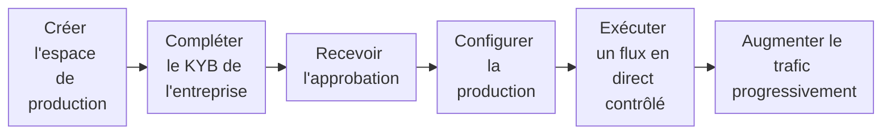

L'activation en production vérifie votre entreprise d'intégration. Elle est distincte des clients API que vous créez pour votre produit.

## Activer votre espace de production {#activate-your-production-space}

1. Connectez-vous au tableau de bord Swipelux et sélectionnez **Créer un espace de production**.
2. Ouvrez l'onglet KYB ou allez à [Vérification d'entreprise](https://www.swipelux.app/kyb).
3. Complétez chaque champ demandé et téléversez les documents requis.
4. Soumettez votre entreprise d'intégration pour vérification et attendez l'approbation.

Ce n'est qu'après l'approbation du KYB de votre entreprise d'intégration que vous pouvez créer des clients API et des transactions en production.

Dans un espace live qui exige le KYB, Swipelux renvoie `422` [`merchant_kyb_not_approved`](/integration/errors#merchant-kyb-not-approved) pour toute requête d'écriture en dehors de la vérification d'entreprise et de la gestion des webhooks jusqu'à l'approbation. Cela inclut les clients, capacités, comptes, destinataires, règles, cotations et transferts.

En attendant l'approbation, vous pouvez toujours :

- Envoyer des requêtes `GET` et `HEAD`.
- Compléter la vérification de votre entreprise (profil, related parties, documents et soumissions de tâches pour le client KYB de votre entreprise).
- Gérer les endpoints de webhook via l'API, et gérer les clés secrètes, les espaces et les frais de rail dans le tableau de bord.

Les paramètres sont limités jusqu'à l'approbation :

- Vous pouvez effectuer 20 modifications d'URL de webhook par heure au total, sur l'ensemble des endpoints de vos espaces live qui exigent le KYB. Les modifications dans les espaces sandbox ne sont pas comptabilisées. Le dépassement de la limite d'URL de webhook renvoie `422 merchant_kyb_not_approved` depuis `POST /v3/webhooks` ou `PATCH /v3/webhooks/{webhookId}`.
- Dans le tableau de bord, vous pouvez avoir jusqu'à 10 clés API actives par espace live qui exige le KYB.
- Dans le tableau de bord, vous pouvez avoir jusqu'à 5 espaces par merchant tant que vous avez au moins un espace live, que tous vos espaces live exigent le KYB et qu'aucun n'est approuvé. Cette limite comptabilise à la fois les espaces sandbox et live. Si un espace live n'exige pas le KYB, cette limite d'espaces ne s'applique pas.

Le tableau de bord refuse les requêtes qui dépassent la limite de clés ou d'espaces avec une simple réponse `422`, sans le code `merchant_kyb_not_approved`. Modifier uniquement les événements d'un endpoint, ou enregistrer son URL actuelle, ne compte pas comme une modification d'URL. Les clés API révoquées ne sont pas comptabilisées dans la limite de clés.

Les espaces sandbox sont exemptés du blocage des écritures, de la limite d'URL de webhook et de la limite de clés : vous pouvez donc continuer à développer et à tester dans ces espaces. Ils restent toutefois comptabilisés dans la limite d'espaces du merchant.

## Garder la production indépendante

Créez les ressources de production explicitement. Changer une clé API ne migre pas l'état sandbox. Une clé sandbox ne peut pas accéder aux ressources de production. Consultez [Portée de la clé](/fr/integration/authentication#key-scope).

- Stockez les identifiants de production dans une entrée de gestionnaire de secrets séparée.
- Utilisez une configuration de déploiement et des IDs de ressources spécifiques à la production.
- Enregistrez un endpoint webhook et un secret de signature de production séparés.
- Recréez les clients, capacités, comptes, destinataires et destinations requis en production.
- Restreignez l'accès à la production aux services et opérateurs qui en ont besoin.

Le sandbox et la production utilisent `https://platform.swipelux.com` ; la clé API sélectionne l'environnement.

## Compléter la checklist de lancement

- [ ] Testez le chemin heureux et les chemins d'échec attendus en sandbox.
- [ ] Envoyez une `Idempotency-Key` avec chaque écriture qui en requiert une et conservez-la pour des tentatives sûres.
- [ ] Vérifiez les signatures des webhooks avant l'analyse, persistez durablement les IDs d'événements et testez la relecture.
- [ ] Gérez les capacités indisponibles, les tâches ouvertes et les révisions de tâches modifiées.
- [ ] Gérez les [erreurs et nouvelles tentatives API](/integration/errors) documentées, y compris les tentatives idempotentes avec la clé d'origine.
- [ ] Faites remonter les échecs de transfert et les instructions exploitables à vos opérateurs.
- [ ] Confirmez que les journaux conservent `X-Request-Id` ou `correlationId` sans exposer de secrets ou de données financières sensibles.

## Exécuter un flux en direct contrôlé

Commencez par un client connu et une transaction de faible valeur. Enregistrez :

| Contrôle | Définir avant le test |
| --- | --- |
| Portée | Client, capacité, compte ou destination, montant et méthode. |
| Résultat attendu | État de l'API, solde ou instructions, et événement webhook attendu. |
| Propriétaire | Personne responsable de surveiller le flux complet. |
| Condition d'arrêt | Tout état inattendu, webhook manquant, montant incorrect ou tâche non résolue. |

Vérifiez à la fois la ressource API actuelle et la livraison webhook authentifiée. Si l'un ou l'autre diffère du résultat attendu, arrêtez et investiguez avant d'envoyer plus de trafic.

Une fois le flux complet réussi, augmentez progressivement le volume tout en surveillant les états des capacités, comptes, destinations et transferts.

Retournez à [Flux courants](/fr/integration/common-flows) pour le parcours produit, consultez [Erreurs et nouvelles tentatives](/integration/errors) pour la gestion des échecs, ou utilisez la [Référence API](/fr/api-reference/introduction) pour les contrats exacts.
