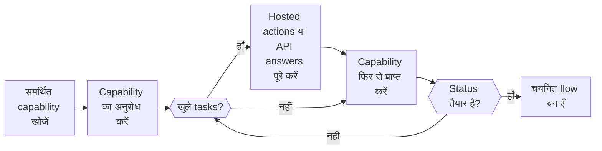

एक capability आपको बताती है कि क्या एक customer किसी विशिष्ट outcome, payment method, और direction का उपयोग कर सकता है। Open tasks आपको बताते हैं कि उस capability या संबंधित resource के आगे बढ़ने से पहले क्या होना चाहिए।



```bash Environment variables
export API_BASE='https://platform.swipelux.com'
export SWIPELUX_API_KEY='replace-with-your-api-key'
```

## समर्थित capabilities खोजें {#discover-supported-capabilities}

Customer के वर्तमान विकल्पों को [`GET /v3/customers/{customerId}/capabilities/supported`](/api-reference/capabilities/get-v3-customers-by-customer-id-capabilities-supported) के साथ पढ़ें:

```bash List supported capabilities
curl --request GET \
  "${API_BASE}/v3/customers/${CUSTOMER_ID}/capabilities/supported" \
  --header "X-API-Key: ${SWIPELUX_API_KEY}"
```

एक response entry चुनें जो इच्छित `directions`, `method`, और `accountType` से मेल खाती हो। केवल तब जारी रखें जब `availability` `available` या `beta` हो और `eligibility.eligible` `true` हो। यदि `institutions` लौटाए जाते हैं, तो केवल उस response से एक ID चुनें।

प्रत्येक institution entry में एक `logoUrl` और एक `isDefault` flag शामिल होता है। Bank selection UI में bank का logo दिखाने के लिए `logoUrl` का उपयोग करें, और जब यह `null` हो तो अपना generic bank icon render करें। `isDefault` केवल इस customer और capability पर लागू होता है, institution पर globally नहीं। [`GET /v3/institutions`](/api-reference/institutions/get-v3-institutions) वही nullable `logoUrl` लौटाता है। Institution IDs opaque हैं, इसलिए code बदले बिना नए IDs को handle करें।

```json Institution entry
{
  "institutions": [
    {
      "id": "jpmorgan",
      "name": "JPMorgan Chase",
      "bic": "CHASUS33",
      "logoUrl": "https://wallet.swipelux.com/bank-logos/jpmorgan.png",
      "countries": ["US"],
      "isDefault": true,
      "currencies": [
        { "code": "USD", "institution": "jpmorgan" }
      ]
    }
  ]
}
```

हर named capability के लिए, हर institution entry `currencies` भी सूचीबद्ध करती है। हर item एक currency `code` देता है जिसे issued account प्राप्त कर सकता है, और वह `institution` जिसे आप [उस account को खोलते समय](/hi/integration/issue-bank-account#choose-the-bank) भेजते हैं। `ach_named`, `wire_named` और `rtp_named` USD सूचीबद्ध करते हैं। `sepa_named` EUR, `faster_payments_named` GBP और `ipp_named` AED सूचीबद्ध करता है। `swift_named` हर वह currency सूचीबद्ध करता है जिसमें bank SWIFT accounts issue करता है। कोई currency entry से अलग institution बता सकती है। उदाहरण के लिए, `lead_bank` पर non-USD SWIFT currencies `bmo` बताती हैं। Pooled capabilities `currencies` को छोड़ देती हैं।

`swift_named` के लिए, bank तय करता है कि हर customer इनमें से कौन-सी currencies खोल सकता है। ऐसी currency में account जो bank इस customer को offer नहीं करता, `statusReason.code: currency_unavailable` के साथ `rejected` पर समाप्त होता है।

`bmo` केवल account खोलते समय भेजें। ऐसा capability request या task preview जो `institutions` में `bmo` बताता है, `422 capability_institutions_unsupported` लौटाता है। इसके बजाय `lead_bank` पर `swift_named` का request करें।

जब आप `institutions` छोड़ देते हैं, तो Swipelux इस customer के लिए लागू default bank चुनता है। Default हर customer के लिए अलग से तय होता है और समय के साथ बदल सकता है, उदाहरण के लिए जब customer की profile बदलती है या किसी bank का onboarding खुलता या बंद होता है। `isDefault` को store करने के बजाय हर बार supported-capability response से पढ़ें। Live mode में:

- `ach_named` और `wire_named` का default Lead Bank (`lead_bank`) है, जब Lead Bank नए customers स्वीकार करता है और इस customer को onboard कर सकता है: profile में कम से कम एक country हो और Lead Bank उसमें मौजूद हर country स्वीकार करता हो, business की profile में ऐसा legal form हो जिसे Lead Bank स्वीकार करता है, और customer का किसी अन्य bank पर कोई `ready` application न हो, चाहे named हो या pooled। अन्यथा उनका default JPMorgan Chase (`jpmorgan`) है।
- `ach_pooled` और `wire_pooled` का default JPMorgan Chase (`jpmorgan`) है।

Default केवल नए selection पर लागू होता है। Customer के पास पहले से मौजूद approved (`ready`) application, या किसी अन्य bank पर current application, अब भी default और `isDefault` से marked bank पर प्राथमिकता रखता है। किसी bank को pin करने के लिए, उसका ID `institutions` में भेजें। Sandbox में, ACH, Wire और SWIFT capabilities केवल JPMorgan Chase (`jpmorgan`) पर उपलब्ध हैं। [Sandbox testing](/hi/integration/sandbox) देखें।

चयनित `data[].id` को `CAPABILITY_ID` के रूप में संग्रहीत करें। किसी अन्य customer या environment से capability ID को कभी copy न करें।

### Bank उपलब्ध क्यों नहीं है, यह दिखाएँ {#show-why-a-bank-is-unavailable}

प्रत्येक entry में `unavailableInstitutions` भी शामिल होता है। यह उन banks को सूचीबद्ध करता है जो यह capability variant offer करते हैं लेकिन इस customer को स्वीकार नहीं करते। प्रत्येक entry में एक `id`, एक `name`, और एक non-empty `reasons` array होता है। प्रत्येक reason का shape `statusReason` जैसा ही होता है, जिसमें `actor: "provider"` और `retryable: false` होते हैं। Customers को यह दिखाने के लिए कि आपके bank selection UI में कोई bank क्यों नहीं है, `unavailableInstitutions` का उपयोग करें, उदाहरण के लिए bank को reason के `message` के साथ disabled के रूप में render करके।

```json Unavailable institution entry
{
  "unavailableInstitutions": [
    {
      "id": "lead_bank",
      "name": "Lead Bank",
      "reasons": [
        {
          "code": "jurisdiction_unsupported",
          "message": "The bank does not accept customers from a country on this customer's profile.",
          "actor": "provider",
          "retryable": false
        }
      ]
    }
  ]
}
```

वर्तमान reason codes:

| Code | अर्थ |
| --- | --- |
| `jurisdiction_unsupported` | Bank customer की profile पर मौजूद किसी country को स्वीकार नहीं करता। |
| `legal_form_unsupported` | Bank customer के legal form को स्वीकार नहीं करता। |
| `customer_type_unsupported` | Bank customer के type को स्वीकार नहीं करता। |

अज्ञात codes को code बदले बिना handle करें, क्योंकि Swipelux नए codes जोड़ सकता है। कोई bank कभी भी `institutions` और `unavailableInstitutions` दोनों में नहीं दिखता। `unavailableInstitutions` हमेशा मौजूद रहता है और pooled व non-bank entries पर `[]` होता है। जो bank किसी भी list में नहीं है, उसे इस customer से असंबंधित किसी कारण से छोड़ा गया है। Capability request में किसी unavailable bank का नाम देने पर अब भी [`422 capability_institutions_unsupported`](/integration/errors#capability-institutions-unsupported) लौटता है।

### देखें कि account कहाँ खुल सकता है {#check-where-an-account-can-open}

प्रत्येक entry में `banks` भी शामिल होता है। Named entries पर, यह `institutions` या `unavailableInstitutions` में मौजूद हर bank को सूचीबद्ध करता है, साथ ही हर वह bank जहाँ customer का इस variant के लिए application है। अन्य entries पर यह `[]` होता है। प्रत्येक bank में institution entry जैसे ही `id`, `name`, `bic`, और `logoUrl` होते हैं, और उस bank पर customer की स्थिति जुड़ती है:

```json Bank entry
{
  "banks": [
    {
      "id": "jpmorgan",
      "name": "JPMorgan Chase",
      "bic": "CHASUS33",
      "logoUrl": null,
      "status": "approved",
      "applicationId": "apl_000000000000000005",
      "accountOpening": "now",
      "currencies": [
        { "code": "USD", "institution": "jpmorgan" }
      ]
    }
  ]
}
```

`status` इनमें से एक होता है:

- `approved`: bank पर एक ready application इस variant को cover करता है।
- `pending`: bank पर एक application ने इसका अनुरोध किया है और bank ने अभी इसे approve नहीं किया है।
- `refused`: bank ने customer को reject कर दिया।
- `not_requested`: bank पर कोई application इसका अनुरोध नहीं करता। Capability request इस bank को चुन सकता है।
- `not_offered`: bank इस variant के लिए इस customer को स्वीकार नहीं करता।

`applicationId` उस application का नाम देता है जो `status` तय करता है, या `null` होता है। `accountOpening` बताता है कि इस bank का नाम देने वाला [issued account request](/hi/integration/issue-bank-account#choose-the-bank) अभी क्या करता है:

- `now`: request स्वीकार होता है और account जारी होता है।
- `after_approval`: request `allowPending: true` के साथ स्वीकार होता है और bank के approval की प्रतीक्षा करता है।
- `application`: पहले `institutions` में इस bank के साथ capability का अनुरोध करें।
- `none`: अभी इस bank पर कोई account request स्वीकार नहीं होता।

`now` और `after_approval` के लिए, `currencies` केवल वे currencies सूचीबद्ध करता है जिनमें request स्वीकार होता है। इसलिए जिस currency में customer का इस bank पर पहले से account है, वह छोड़ दी जाती है। अन्यथा यह हर वह currency सूचीबद्ध करता है जिसमें bank यह variant खोलता है। हर item भेजने के लिए `institution` का नाम देता है, जैसे `institutions[].currencies` में।

किसी bank पर account opening offer करनी है या नहीं, यह केवल `accountOpening` से तय करें। `institutions` एक अलग सवाल का जवाब देता है: नया capability request कहाँ जा सकता है। यह एक ही default bank सूचीबद्ध कर सकता है, जबकि कोई दूसरा bank customer को पहले ही approve कर चुका हो।

### Pooled बनाम named account types {#pooled-vs-named-account-types}

Bank capabilities दो variants में आती हैं, जिन्हें `accountType` field और capability ID suffix (उदाहरण के लिए `ach_pooled`, `wire_named`) के रूप में encode किया गया है:

- **`pooled`**: साझा Swipelux bank account। Funds को route करने के लिए प्रत्येक pay-in एक unique reference का उपयोग करता है। एक-बार के transfers के लिए इसे चुनें।
- **`named`**: customer के लिए dedicated bank details (virtual IBAN, dedicated ACH account)। पुन: उपयोग करने योग्य और किसी भी payer के साथ साझा करने योग्य। [Issued bank accounts](/hi/integration/issue-bank-account) के लिए आवश्यक।

Default रूप से `pooled` का उपयोग करें। `named` का उपयोग केवल तभी करें जब customer को पुन: उपयोग करने योग्य bank details की आवश्यकता हो। यह देखने के लिए कि कौन से variants उपलब्ध हैं, `supported` response की जाँच करें।

SWIFT deposits प्राप्त करने या SWIFT bank details जारी करने के लिए, `swift_named` का उपयोग करें। `swift_pooled` केवल payouts को support करता है, इसलिए supported-capability response में प्रत्येक option के `directions` की जाँच करें। Named SWIFT account पुन: उपयोग करने योग्य receiving details लौटाता है, जिनमें bank का BIC, आवश्यक होने पर एक reference, और bank द्वारा प्रदान किए जाने पर beneficiary address शामिल है।

Issued ACH, Wire, और SWIFT accounts के लिए, आप `institution` के साथ एक सटीक bank चुन सकते हैं और bank द्वारा customer को approve करने से पहले account request save कर सकते हैं। [Bank account जारी करें](/hi/integration/issue-bank-account#choose-the-bank) देखें।

## Capability का अनुरोध करें {#request-the-capability}

चयनित option का अनुरोध [`POST /v3/customers/{customerId}/capabilities/{capabilityId}`](/api-reference/capabilities/post-v3-customers-by-customer-id-capabilities-by-capability-id) के साथ करें:

```bash Request capability
curl --request POST \
  "${API_BASE}/v3/customers/${CUSTOMER_ID}/capabilities/${CAPABILITY_ID}" \
  --header "X-API-Key: ${SWIPELUX_API_KEY}" \
  --header "Idempotency-Key: capability-request-001" \
  --header "Content-Type: application/json" \
  --data '{}'
```

एक explicit `institutions` array का उपयोग केवल तब करें जब आपको supported-capability response द्वारा लौटाए गए IDs में से चयन करने की आवश्यकता हो।

`data.status` को `CAPABILITY_STATUS`, `data.accountProvisioning` को `ACCOUNT_PROVISIONING_STATUS`, `data.openTaskIds` को `OPEN_TASK_IDS`, और प्रत्येक `data.applications[].id` को `APPLICATION_IDS` में संग्रहीत करें।

### प्रति bank साझा applications {#shared-applications-per-bank}

Named bank capabilities के लिए, प्रत्येक customer के पास प्रति bank एक application case होता है। Pooled और platform capabilities बिना bank वाले cases का उपयोग करती हैं। Swipelux आपके द्वारा अनुरोधित हर compatible capability में एक case साझा करता है:

- एक approval कई capabilities को cover कर सकता है। उदाहरण के लिए, एक bank पर approved case ACH और wire दोनों capabilities को `ready` बना सकता है।
- बाद का कोई request जो किसी मौजूदा case से मेल खाता है, उसी का पुन: उपयोग करता है। Swipelux कोई दूसरा application नहीं खोलता और कोई duplicate tasks नहीं जोड़ता।
- अलग-अलग banks पर cases स्वतंत्र होते हैं। एक bank पर rejection किसी दूसरे bank के case को प्रभावित नहीं करता।

Request response आपको बताता है कि Swipelux ने किस case का उपयोग किया:

- `201` का अर्थ है कि request ने एक नया application case खोला।
- `200` का अर्थ है कि request किसी ऐसे application case पर resolve हुआ जो customer के पास पहले से था, उदाहरण के लिए ऐसी bank capability के लिए दोहराया गया request जो customer के पास पहले से है, या किसी canceled bank capability के लिए request जो उसके मौजूदा application में शामिल होता है। `card` या `stablecoin_transfers` के लिए दोहराया गया request अब भी [`409 capability_already_exists`](/integration/errors#capability-already-exists) लौटाता है, और canceled `card` capability के लिए request [`409 capability_not_reopenable`](/integration/errors#capability-not-reopenable) लौटाता है।
- `selectedApplicationId` `data` के बगल में एक top-level field है, जिसमें उस case का ID होता है जिसे request ने चुना या खोला। जब request ने कोई case नहीं चुना, तो Swipelux इसे छोड़ देता है। Idempotent replay वही value लौटाता है।

संक्षिप्त response:

```json Response (abbreviated)
{
  "data": {
    "id": "ach_named",
    "status": "pending",
    "openTaskIds": ["tsk_000000000000000002"],
    "applications": [{ "id": "apl_000000000000000005", "status": "in_review" }]
  },
  "selectedApplicationId": "apl_000000000000000005"
}
```

Named capabilities के लिए, उसी case को चुनने के लिए वही `institutions` list फिर से भेजें, या उस bank को target करने के लिए एक institution ID भेजें। जिस bank ने customer को terminally reject किया है, उसे skip किया जाता है। जब आप केवल उसी bank का नाम देते हैं, या हर eligible bank ने customer को reject कर दिया है, तो request [`409 capability_terminally_rejected`](/integration/errors#capability-terminally-rejected) लौटाता है। Rejection के बाद किसी दूसरे bank को आज़माने के लिए, उस bank के institution ID के साथ capability का फिर से अनुरोध करें।

किसी capability का status customer के सभी संबंधित cases को दर्शाता है। Named capability के लिए, एक `ready` case जिसका approval उसे cover करता है, उसे `ready` बनाने के लिए पर्याप्त है, चाहे दूसरे banks कुछ भी report करें। Pooled capability अपने method check की भी प्रतीक्षा करती है, जो customer applications list पर `probes` में report होता है।

#### Customer के applications सूचीबद्ध करें {#list-the-customers-applications}

Customer के हर application case को [`GET /v3/customers/{customerId}/applications`](/api-reference/capabilities/get-v3-customers-by-customer-id-applications) के साथ सूचीबद्ध करें। Results `nextCursor` और `hasMore` के साथ paginated होते हैं, और `updatedAfter` स्वीकार करते हैं:

```bash List applications
curl --request GET \
  "${API_BASE}/v3/customers/${CUSTOMER_ID}/applications" \
  --header "X-API-Key: ${SWIPELUX_API_KEY}"
```

प्रत्येक entry में capability के `applications[]` में लौटाए गए application fields शामिल होते हैं, साथ ही:

- `scope`: एक bank पर case के लिए `named`, बिना bank वाले cases के लिए `provider_pooled` या `platform`, या unclassified historical case के लिए `null`। `provider_pooled` और `platform` cases के लिए `institution` मौजूद नहीं होता।
- `requestedScope[]`: case के विरुद्ध अनुरोधित capability keys, प्रत्येक अपने पहले `requestedAt` के साथ। Entries कभी हटाई नहीं जातीं।
- `coverage[]`: वे capability keys जिन्हें case का approval cover करता है, प्रत्येक `grantedAt` और `source` के साथ। Coverage scope record करता है, authorization नहीं। वर्तमान status के लिए capability पढ़ें।
- `probes[]`: case द्वारा cover की गई pooled capability keys के लिए method checks, प्रत्येक `capabilityKey`, `status`, और `reason` के साथ। Named keys को कभी probe की आवश्यकता नहीं होती।
- `generation`, `predecessorApplicationId`, और `supersededByApplicationId`: succession links। जब `supersededByApplicationId` set हो, तो case को replace कर दिया गया है। वर्तमान case तक पहुँचने के लिए उस ID का पालन करें। किसी capability की `applications[]` केवल वर्तमान cases सूचीबद्ध करती है, इसलिए replace किया गया case केवल इसी सूची में दिखता है।

संक्षिप्त response:

```json Response (abbreviated)
{
  "data": [
    {
      "id": "apl_000000000000000005",
      "status": "ready",
      "scope": "named",
      "institution": { "id": "jpmorgan", "name": "JPMorgan Chase", "bic": "CHASUS33" },
      "requestedScope": [
        { "capabilityKey": "ach_named", "requestedAt": "2026-09-20T10:00:00.000Z" }
      ],
      "coverage": [
        { "capabilityKey": "ach_named", "grantedAt": "2026-09-22T12:00:00.000Z", "source": "approval" },
        { "capabilityKey": "wire_named", "grantedAt": "2026-09-22T12:00:00.000Z", "source": "approval" }
      ],
      "probes": [],
      "generation": 1,
      "predecessorApplicationId": null,
      "supersededByApplicationId": null
    }
  ],
  "nextCursor": null,
  "hasMore": false
}
```

## वर्तमान tasks पूरे करें {#complete-current-tasks}

Tasks को [`GET /v3/customers/{customerId}/tasks`](/api-reference/tasks/list-customer-tasks) के साथ सूचीबद्ध करें, `OPEN_TASK_IDS` से IDs चुनें, फिर प्रत्येक वर्तमान task को [`GET /v3/customers/{customerId}/tasks/{taskId}`](/api-reference/tasks/get-customer-task) के साथ पढ़ें:

```bash List open tasks
curl --request GET \
  "${API_BASE}/v3/customers/${CUSTOMER_ID}/tasks/${TASK_ID}" \
  --header "X-API-Key: ${SWIPELUX_API_KEY}"
```

नवीनतम `data.revision` और `data.requirements` का उपयोग करें। यदि दोनों में से कोई बदल सकता है, तो submit करने से ठीक पहले task को पुन: प्राप्त करें।

### पुन: उपयोग किए गए profile evidence {#reused-profile-evidence}

Direct API submission स्वीकार करने वाले application intake tasks के लिए, Swipelux उस जानकारी का पुन: उपयोग करता है जो customer पहले ही दे चुका है। जब ऐसा task बनाया या reconcile किया जाता है, तो Swipelux customer profile और customer के अपने upload किए गए documents की जाँच करता है। जो eligible requirements पहले से किसी usable profile value या document द्वारा समर्थित हैं, वे actionable रहने के बजाय `in_review` में चली जाती हैं। Profile updates और नए document uploads मौजूदा tasks के लिए वही जाँच trigger करते हैं।

केवल missing या incompatible values actionable रहती हैं। पुन: उपयोग evidence को approve नहीं करता। Swipelux फिर भी उसकी review करता है। Explicit correction requests और पहले से answered requirements actionable रहती हैं। Owner और related-party documents का पुन: उपयोग नहीं होता, और केवल hosted session के माध्यम से collect की जाने वाली requirements अपने सामान्य flow का पालन करती हैं।

### Requirements render करें {#render-requirements}

Forms को requirement keys के बजाय प्रत्येक requirement द्वारा लौटाए गए metadata से बनाएँ। एक requirement में एक वैकल्पिक छोटा `title` शामिल हो सकता है, और हर `request` में heading के नीचे दिखाने के लिए एक `prompt` शामिल होता है।

`request.type: "profile"` वाली requirements `profilePointer` के साथ profile field की पहचान करती हैं और input metadata जोड़ती हैं:

- `allowedValues`: किसी scalar field के लिए, या किसी array field के प्रत्येक item के लिए अनुमत values। इन्हीं values को submit करें, translated display labels को नहीं।
- `valueSchema`: एक self-contained JSON Schema Draft 7 document जो input shape, nested properties, required fields, और structural constraints का वर्णन करता है। Objects पर enums संबंधित property पर दिखाई देते हैं, उदाहरण के लिए tax identifiers के लिए `valueSchema.items.properties.type.enum`। Swipelux submission के बाद भी cross-field और review validation लागू करता है, इसलिए schema पास करने वाली value भी reject हो सकती है।
- `valueType: "country"`, या arrays के लिए `itemValueType: "country"`: field uppercase ISO 3166-1 alpha-2 codes लेता है। `valueSchema` में nested country properties `format: "iso-3166-1-alpha-2"` का उपयोग करती हैं। Localized labels के लिए एक standard country list का उपयोग करें।

```json Requirement
{
  "id": "req_000000000000000010",
  "key": "account_purposes",
  "title": "Account purpose",
  "status": "action_required",
  "request": {
    "type": "profile",
    "prompt": "Select every purpose that applies.",
    "required": true,
    "profilePointer": "/financialProfile/accountPurposes",
    "valueType": "array",
    "itemValueType": "string",
    "allowedValues": ["business_expenses", "ecommerce", "payroll"],
    "valueSchema": {
      "$schema": "http://json-schema.org/draft-07/schema#",
      "type": "array",
      "items": { "enum": ["business_expenses", "ecommerce", "payroll"] }
    }
  }
}
```

यह उदाहरण value catalog को छोटा करता है; API हर अनुमत value लौटाता है। कुछ profile requirements का कोई published schema नहीं होता और वे `valueSchema` और `allowedValues` को छोड़ देती हैं। उन्हें `prompt` और `valueType` से render करें।

प्रत्येक खुले टास्क में एक `dueAt` टाइमस्टैम्प शामिल होता है। जब Swipelux बिना किसी स्पष्ट नियत तिथि के टास्क बनाता है, तो `dueAt` डिफ़ॉल्ट रूप से टास्क के `createdAt` के ठीक 31 दिन बाद सेट होता है। `dueAt` को केवल सूचनात्मक मानें: आप इसे API के माध्यम से सेट नहीं कर सकते, और यह कोई स्वचालित लाइफ़साइकल ट्रांज़िशन ट्रिगर नहीं करता। केवल अलग `deadline` फ़ील्ड, यदि मौजूद हो, स्वचालित ट्रांज़िशन का कारण बनता है।

### Hosted actions {#hosted-actions}

Task-detail response में `verificationSessions` और `tosSessions` की प्रत्येक entry में `action` object शामिल होता है। Task-list responses में ये action links शामिल नहीं होते। प्रत्येक session का `id` store करें, फिर customer को भेजने से पहले `action.kind` पढ़ें; session के `status` से link की उपलब्धता का अनुमान न लगाएँ।

- `action.kind: "available"` में `action.url` और `action.expiresAt` शामिल होते हैं (वर्तमान में हमेशा `null`)। `action.url` store करें, customer को उस पर भेजें, फिर task को दोबारा पढ़ें। Session-level `url` और `expiresAt` fields में वही values होती हैं।
- `action.kind: "unavailable"` का अर्थ है कि कोई link नहीं दिखाया जाना चाहिए। Session-level `url` और `expiresAt` fields मौजूद नहीं होते। Session का `status` अकेले यह तय नहीं करता कि आपको कौन सा action kind मिलेगा।

```json Verification session
{
  "data": {
    "verificationSessions": [
      {
        "id": "vfy_000000000000000003",
        "key": "identity_verification",
        "type": "identity_verification",
        "status": "action_required",
        "coveredRequirementIds": ["req_000000000000000011", "req_000000000000000012"],
        "action": {
          "kind": "available",
          "url": "https://platform.swipelux.com/kyc/redirect/cus_000000000000000001/tsk_000000000000000002/vfy_000000000000000003",
          "expiresAt": null
        },
        "url": "https://platform.swipelux.com/kyc/redirect/cus_000000000000000001/tsk_000000000000000002/vfy_000000000000000003",
        "expiresAt": null
      }
    ],
    "tosSessions": [
      {
        "id": "vfy_000000000000000004",
        "key": "terms_of_service",
        "type": "terms_of_service",
        "status": "completed",
        "action": { "kind": "unavailable" }
      }
    ]
  }
}
```

ये task-scoped actions हैं, अलग customer-verification lifecycle नहीं।

Task reads और customer task detail में हर `verificationSessions[]` entry में `coveredRequirementIds` शामिल होता है। यह task की उन live requirements के IDs सूचीबद्ध करता है जिन्हें session भर सकता है। इसका उपयोग यह देखने के लिए करें कि कोई hosted session या [imported verification](#import-an-existing-identity-verification) किन requirements को settle कर सकता है। बाकी सभी requirements को [API answers](#api-answers) के ज़रिए भरें।

नए individual intake tasks के लिए, hosted identity session केवल ID document, selfie, और proof of address को cover करता है। Proof-of-funds requirements, जैसे `proof_of_funds`, `source_of_funds_document`, `named_source_of_funds_document`, और `sole_proprietor_document`, hosted session का हिस्सा नहीं हैं। उन documents को सीधे [upload](#upload-documents) और submit करें। Swipelux उनकी review करता है, और जब तक वे accept नहीं हो जाते, task खुला रहता है।

किसी structured value, जैसे address या tax identifiers, की profile requirement के hosted answer को direct answer वाले ही schema और constraint checks पास करने होंगे। ऐसा न होने पर requirement open रहती है। जिस requirement को Swipelux इस कारण `action_required` पर लौटाता है, उसमें `reviewFeedback.code: hosted_profile_direct_submission_required` होता है। Customer से वह value लें और उसे [API answer](#api-answers) के रूप में submit करें।

### मौजूदा identity verification import करें {#import-an-existing-identity-verification}

यदि आप पहले से Swipelux के identity verification provider के साथ अपने account में individuals को verify करते हैं, तो आप customer को hosted flow से भेजने के बजाय उस verification को customer के intake task के identity session में import कर सकते हैं। यह विकल्प केवल individual customers वाले API integrations के लिए है। Businesses और related parties समर्थित नहीं हैं।

Import करने से पहले, अपने identity verification provider के साथ sharing सेट अप करें:

1. Swipelux से उसका partner token माँगें, फिर अपने identity verification provider account में Swipelux को sharing partner के रूप में जोड़ें।
2. Live verifications के लिए, recipient client ID (`forClientId`) `swipelux.com_21030` के साथ Swipelux के लिए एक share token generate करें।
3. Token के expire होने से पहले उसे Swipelux को भेजें। Share tokens opaque और single-use होते हैं, अधिकतम 1,024 UTF-8 bytes के होते हैं, और डिफ़ॉल्ट रूप से 20 मिनट बाद expire हो जाते हैं। हर token को एक credential की तरह मानें।

Task एक individual intake task होना चाहिए और उसमें submission method के रूप में hosted verification session उपलब्ध होना चाहिए। Session में `type: "identity_verification"` और `status: "action_required"` होना चाहिए। Customer के पास Swipelux के साथ पहले से कोई in-progress या completed verification नहीं होना चाहिए, और कोई import पहले से नहीं चल रहा होना चाहिए। Hosted link खोलने से verification शुरू हो जाता है, लेकिन task पढ़ने से नहीं। फिर `POST /v3/customers/{customerId}/tasks/{taskId}/verification-sessions/{verificationSessionId}/share-token` call करें। Request के लिए task submissions वाली ही `accounts:write`, `customers:read`, और `customers:write` permissions, और साथ में एक `Idempotency-Key` आवश्यक है:

```json Request body
{
  "shareToken": "<share token>"
}
```

```json Response
{
  "verificationSessionId": "vfy_000000000000000003",
  "status": "in_review"
}
```

आपका provider मेल खाने वाले steps को Swipelux के account में copy करता है, और checks task द्वारा आवश्यक level के अनुसार फिर से चलते हैं। Swipelux कभी भी share token को store या log नहीं करता।

- `status: "in_review"` का अर्थ है कि checks pending हैं। Checks पूरे होने पर, Swipelux covered requirements को उसी तरह settle करता है जैसे hosted session के लिए करता है।
- `status: "action_required"` का अर्थ है कि steps missing हैं। Customer उन्हें session के मौजूदा hosted link के ज़रिए पूरा कर सकता है, या आप covered requirements को सीधे submit कर सकते हैं।

Import केवल `coveredRequirementIds` में सूचीबद्ध requirements को भरता है: ID document, selfie, और जहाँ task को इसकी आवश्यकता हो, proof of address। Profile answers, proof of funds, और अन्य requirements को [API answers](#api-answers) के रूप में submit करें। किसी request को replay करने के लिए, उसे उसी `Idempotency-Key` के साथ फिर से भेजें।

| Status | Code | क्या करें |
| --- | --- | --- |
| `409` | `verification_already_started` | इस customer के पास Swipelux के साथ पहले से कोई in-progress या completed verification है, या कोई import पहले से चल रहा है, उदाहरण के लिए क्योंकि customer ने hosted link खोला था। Retry न करें। मौजूदा session के ज़रिए जारी रखें। |
| `409` | `verification_session_not_allowed` | Task या session import के लिए eligible नहीं है। Retry न करें। Task पढ़ें और उसमें दिए गए methods का उपयोग करें। |
| `422` | `share_token_rejected` | Identity verification provider ने token को अस्वीकार कर दिया, उदाहरण के लिए क्योंकि वह expire हो गया था, पहले ही उपयोग हो चुका था, या किसी अन्य recipient के लिए जारी किया गया था। Swipelux के लिए एक नया token generate करें और नई `Idempotency-Key` के साथ retry करें। |
| `503` | `kyc_provider_unavailable` | `retryable: true` होने पर, Swipelux ने अभी तक token नहीं भेजा था। कुछ देर बाद retry करें। `retryable: false` होने पर, import हो चुका हो सकता है लेकिन उसकी पुष्टि नहीं हो सकी। Token दोबारा न भेजें। Session के hosted link के ज़रिए जारी रखें। |

### Documents upload करें {#upload-documents}

जब कोई requirement एक document का अनुरोध करता है, तो उसे [`POST /v3/customers/{customerId}/documents`](/api-reference/documents/post-v3-customers-by-customer-id-documents) के साथ upload करें:

```bash Upload document
export DOCUMENT_PATH='/absolute/path/to/requested-document.pdf'

curl --request POST \
  "${API_BASE}/v3/customers/${CUSTOMER_ID}/documents" \
  --header "X-API-Key: ${SWIPELUX_API_KEY}" \
  --header "Idempotency-Key: customer-document-001" \
  --form "file=@${DOCUMENT_PATH}"
```

Answer submit करने से पहले जो इसे संदर्भित करता है, लौटाए गए `data.id` को `DOCUMENT_ID` के रूप में संग्रहीत करें।

हर v3 document resource में `contentSha256` शामिल होता है, जो stored file का SHA-256 digest है, `sha256:` के बाद lowercase hex digest के रूप में। एक ही digest वाले दो documents byte-identical होते हैं। यह जाँचने के लिए कि कोई file customer पहले ही upload कर चुका है या नहीं, उदाहरण के लिए वह file जिसे किसी reviewer ने replace करने को कहा, upload करने से पहले उसका SHA-256 compute करें और उसे उन documents के `contentSha256` से compare करें जिन्हें पिछले submission के answers `documentIds` में reference करते हैं। Swipelux के digests record करने से पहले stored documents के लिए यह field `null` होता है।

किसी संग्रहीत फ़ाइल को बाद में प्राप्त करने के लिए, [`GET /v3/customers/{customerId}/documents/{documentId}/download`](/api-reference/documents/get-v3-customers-by-customer-id-documents-by-document-id-download) कॉल करें। Swipelux एक `url` लौटाता है जो फ़ाइल को attachment के रूप में download करता है और एक घंटे बाद समाप्त हो जाता है। Archived documents `404` लौटाते हैं।

### API answers {#api-answers}

वर्तमान revision के लिए एक पूर्ण answer set [`POST /v3/customers/{customerId}/tasks/{taskId}/submissions`](/api-reference/task-submissions/create-customer-task-submission) के साथ submit करें:

```bash Submit task answers
curl --request POST \
  "${API_BASE}/v3/customers/${CUSTOMER_ID}/tasks/${TASK_ID}/submissions" \
  --header "X-API-Key: ${SWIPELUX_API_KEY}" \
  --header "Idempotency-Key: task-submission-001" \
  --header "Content-Type: application/json" \
  --data @- <<'JSON'
{
  "taskRevision": 3,
  "answers": [
    {
      "requirementId": "req_from_current_task",
      "answer": {
        "type": "text",
        "value": "Current answer"
      }
    }
  ]
}
JSON
```

प्रत्येक requirement ID और answer type नवीनतम task से लें। यदि API यह रिपोर्ट करता है कि task बदल गया है, तो इसे पुन: प्राप्त करें और नए revision से submission को फिर से बनाएँ।

#### `allowPartial` के साथ valid answers रखें {#keep-valid-answers-with-allowpartial}

Default रूप से, एक refused answer पूरे request को fail कर देता है और Swipelux कुछ भी store नहीं करता। Response `400 validation_error`, `400 invalid_document_reference` या `409 absence_conflicts_with_profile` होता है। जब आप चाहते हैं कि Swipelux valid answers store करे और केवल invalid answers को refuse करे, तो `"allowPartial": true` जोड़ें:

```json Partial submission request
{
  "taskRevision": 3,
  "allowPartial": true,
  "answers": [
    { "requirementId": "req_a", "answer": { "type": "text", "value": "Salary" } },
    { "requirementId": "req_b", "answer": { "type": "document", "documentIds": ["doc_unknown"] } }
  ]
}
```

Swipelux `data` में stored submission के साथ `201` लौटाता है, जिसमें केवल रखे गए answers होते हैं, और बाकी को `refusedAnswers` में सूचीबद्ध करता है:

```json Partial submission response
{
  "data": { "id": "sub_000000000000000001", "outcome": "in_review", "answers": [{ "requirementId": "req_a" }] },
  "refusedAnswers": [
    {
      "requirementId": "req_b",
      "code": "invalid_document_reference",
      "pointer": "/answers/1/answer",
      "message": "A referenced document is invalid."
    }
  ]
}
```

हर refused answer में इनमें से एक code होता है:

| `code` | अर्थ |
| --- | --- |
| `invalid` | Answer request के shape, format या constraints को पूरा नहीं करता, या customer profile value को स्वीकार नहीं करता। |
| `absence_conflicts_with_profile` | ऐसी value के लिए absence भेजी गई जो profile में मौजूद है। |
| `invalid_document_reference` | Referenced document इस customer और request के लिए उपयोग नहीं किया जा सकता। |
| `depends_on_refused_answer` | Answer अपने आप में valid है लेकिन refused answer के साथ मिलाकर judge किया जाता है। एक conditional answer और उसे control करने वाला answer साथ में रखे या refuse किए जाते हैं। |

आगे और codes जोड़े जा सकते हैं। Unknown code को `invalid` मानें। `message` कभी भी submitted value को नहीं दोहराता।

`allowPartial` अन्य rules को ढीला नहीं करता:

- Request को अब भी हर उस requirement का उत्तर देना होगा जिसका उत्तर उसे field के बिना देना पड़ता। Unanswered open requirements अब भी `422 task_submission_incomplete` लौटाते हैं।
- ऐसा body जो खुद request schema में fail होता है, जैसे unknown field या गलत type, अब भी `400 validation_error` लौटाता है।
- जब कोई भी answer रखा नहीं जा सकता, तो Swipelux `400 validation_error` लौटाता है, कुछ भी store नहीं करता, और हर refused answer को `errors[]` में सूचीबद्ध करता है।
- `refusedAnswers` ठीक तब मौजूद होता है, संभवतः खाली, जब request ने `"allowPartial": true` भेजा हो। उसी `Idempotency-Key` के साथ replay वही `refusedAnswers` लौटाता है।

Refused answer को सुधारने से पहले task को फिर से पढ़ें। Refused requirement सामान्यतः अब भी `action_required` होता है, लेकिन document request का उत्तर record पर मौजूद किसी file से पहले ही दिया जा चुका हो सकता है। Corrections को नए `taskRevision` और नए `Idempotency-Key` के साथ submit करें। Conditional answer को उसे control करने वाले answer के साथ भेजें।

#### Review की प्रतीक्षा कर रहे submission को withdraw करें {#withdraw-a-submission-awaiting-review}

जो submission अभी भी `in_review` है, उसे सुधारने के लिए `POST /v3/customers/{customerId}/tasks/{taskId}/withdrawals` से वापस लें। Request का कोई body नहीं है और इसके लिए `Idempotency-Key` आवश्यक है। API keys को submissions की तरह `accounts:write`, `customers:read` और `customers:write` चाहिए:

```bash Withdraw task submission
curl --request POST \
  "${API_BASE}/v3/customers/${CUSTOMER_ID}/tasks/${TASK_ID}/withdrawals" \
  --header "X-API-Key: ${SWIPELUX_API_KEY}" \
  --header "Idempotency-Key: task-withdrawal-001"
```

Swipelux `data` में submission के साथ `200` लौटाता है। उसका `outcome` `withdrawn` हो जाता है, उसके answers `reviewFeedback` के बिना `action_required` पर लौट आते हैं, और अगला submission एक नया `remediationRound` शुरू करता है। पहले से accepted requirements और customer profile अपरिवर्तित रहते हैं। जिन answers को Swipelux ने profile या record पर मौजूद files से भरा, वे review में बने रहते हैं। आप जितनी बार ज़रूरत हो withdraw कर सकते हैं। Task को फिर से पढ़ें, फिर corrected answers submit करें।

Swipelux इन मामलों में withdrawal को refuse करता है:

- `404 task_not_found`: इस customer के लिए task मौजूद नहीं है।
- `409 task_not_in_review`: ठीक एक submission review की प्रतीक्षा में नहीं है (कोई नहीं, या एक से अधिक, उदाहरण के लिए एक partial submission और उसका correction), या task की deadline निकल चुकी है।
- `409 submission_already_forwarded`: bank इस task को सीधे review करता है, या Swipelux submission को पहले ही review के लिए आगे भेज चुका है। `POST /v3/sandbox/tasks` से बने tasks भी इसे लौटाते हैं।

Submission `outcome` अब `withdrawn` हो सकता है। ऐसे किसी भी client को update करें जो `outcome` को एक fixed list से check करता है।

### Businesses के लिए beneficial-owner पूर्वापेक्षा {#beneficial-owner-prerequisite-for-businesses}

ऐसी business capability का अनुरोध करना जिसे beneficial-owner evidence की आवश्यकता है, तब भी सफल होता है जब customer के पास अभी तक कोई qualifying owner नहीं है। Capability `restricted` के रूप में `statusReason.code: tasks_due` के साथ बनाई जाती है, और business intake task छूटे हुए ownership facts का अनुरोध करता है, जिसमें ownership structure शामिल है।

वही task एक `resource_reference` requirement रखता है जिसके request में `qualification: "beneficial_owner"` शामिल है:

```json Beneficial owner requirement
{
  "type": "resource_reference",
  "prompt": "Add or select a qualifying beneficial owner.",
  "required": true,
  "resourceType": "related_party",
  "qualification": "beneficial_owner"
}
```

एक related party तब qualify करती है जब वह उसी customer की एक active `person` party हो जिसका supplied ownership percentage कम से कम 25 हो, या जिसके पास `ownership.declared: true` हो और कोई percentage न दिया गया हो।

यह requirement वर्तमान related-party roster से derive होता है, इसलिए आप आमतौर पर इसका सीधे उत्तर नहीं देते:

- एक qualifying related party बनाना या अपडेट करना उसी reevaluation में requirement को पूरा करता है और उस owner के अपने profile और document work को खोलता है। [Business related parties जोड़ें](/hi/integration/onboarding/customers#add-business-related-parties) देखें।
- आप एक `resource_reference` answer के साथ, जो उसका `relatedPartyId` रखता है, किसी qualifying party को स्पष्ट रूप से reference भी कर सकते हैं।
- पूरा होने के बाद भी requirement वर्तमान task में सूचीबद्ध रहता है। जब कोई अन्य obligation खुला नहीं रहता, तो task `satisfied` हो जाता है।
- आखिरी qualifying party को archive करना, या उसे qualify करने वाले facts को हटाना, requirement को फिर से खोल देता है, भले ही task `satisfied` हो चुका हो।

## जब capability तैयार हो तो जारी रखें {#continue-when-the-capability-is-ready}

Capability को [`GET /v3/customers/{customerId}/capabilities/{capabilityId}`](/api-reference/capabilities/get-v3-customers-by-customer-id-capabilities-by-capability-id) के साथ फिर से पढ़ें:

```bash Refetch capability
curl --request GET \
  "${API_BASE}/v3/customers/${CUSTOMER_ID}/capabilities/${CAPABILITY_ID}" \
  --header "X-API-Key: ${SWIPELUX_API_KEY}"
```

संग्रहीत status, account-provisioning status, और task IDs को नवीनतम response से बदलें। Capability `status` रिपोर्ट करता है कि entitlement approve हुआ है या नहीं। Account जारी करने वाली capability के लिए, `accountProvisioning` अलग से रिपोर्ट करता है कि वह account `not_started`, `in_progress`, `issued`, या `failed` है; जो capability account जारी नहीं करती वह `not_applicable` लौटाती है।

जब capability `pending` होती है, तो वह जो `statusReason.code` values report कर सकती है, उनमें से दो यह दिखाती हैं कि review चल रहा है या नहीं। `preparing_submission` का अर्थ है कि Swipelux अभी भी submission के लिए application तैयार कर रहा है और कोई review नहीं चल रहा, भले ही किसी दूसरे bank का application `rejected` हो या उस पर ध्यान देने की ज़रूरत हो। `review_in_progress` का अर्थ है कि review चल रहा है, उदाहरण के लिए जब कोई application `in_review` हो या कोई [hosted verification](#hosted-actions) खुला हो। दोनों `resolution: wait` का उपयोग करते हैं। इन codes के बीच बदलाव status को `pending` ही रखता है, इसलिए कोई `capability.status_changed` event नहीं भेजा जाता। मौजूदा code देखने के लिए capability पढ़ें।

कोई capability `statusReason.code: offer_unavailable` और `resolution: contact_support` के साथ `restricted` भी हो सकती है। Swipelux यह code तब लौटाता है जब कोई approved application उस capability को cover करता है, लेकिन कोई मौजूदा offer उसकी अनुमति नहीं देता। Application पहले से approved है, इसलिए इंतज़ार करने से capability नहीं बदलती। Polling करने के बजाय Swipelux support से संपर्क करें। इस स्थिति में यह code `related_application_action_required` और `resolution: wait` की जगह लेता है। खुले customer tasks को अब भी प्राथमिकता मिलती है, इसलिए पहले सभी मौजूदा tasks पूरे करें।

```json Capability restricted by offer availability
{
  "status": "restricted",
  "statusReason": {
    "code": "offer_unavailable",
    "resolution": "contact_support",
    "message": "The approved Application covers this capability, but no current offer permits it. Contact support."
  }
}
```

केवल तब जारी रखें जब वर्तमान capability status उस account, quote, या transfer की अनुमति देती है जिसे आप बनाने का इरादा रखते हैं। जब flow को issued account की आवश्यकता हो, तो `accountProvisioning` के `issued` होने की भी प्रतीक्षा करें।

आगे, [Common flows](/hi/integration/common-flows) में मेल खाती यात्रा चुनें।
