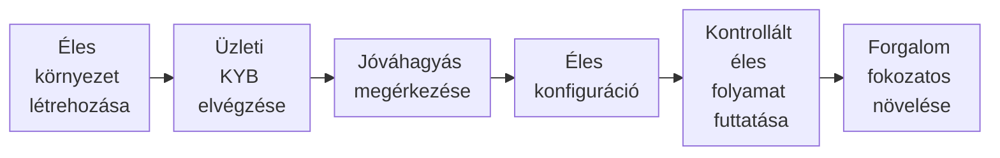

Az éles aktiválás ellenőrzi az integráló vállalkozását. Ez elkülönül a termékéhez létrehozott API-ügyfelektől.

## Az éles környezet aktiválása {#activate-your-production-space}

1. Jelentkezzen be a Swipelux Dashboardba és válassza a **Create a production space** lehetőséget.
2. Nyissa meg a KYB fület vagy menjen az [Üzleti ellenőrzés](https://www.swipelux.app/kyb) oldalra.
3. Töltsön ki minden kért mezőt és töltse fel a szükséges dokumentumokat.
4. Küldje el az integráló vállalkozását ellenőrzésre és várja meg a jóváhagyást.

Éles API-ügyfeleket és tranzakciókat csak azután hozhat létre, hogy az integráló vállalkozása KYB-ellenőrzését jóváhagyták.

KYB-t igénylő éles környezetben a Swipelux a jóváhagyásig `422` [`merchant_kyb_not_approved`](/integration/errors#merchant-kyb-not-approved) választ ad az üzleti ellenőrzésen és a webhookkezelésen kívüli minden írási kérésre. Ez vonatkozik az ügyfelekre, képességekre, számlákra, címzettekre, szabályokra, árajánlatokra és átutalásokra.

Amíg a jóváhagyásra vár, továbbra is:

- Küldhet `GET` és `HEAD` kéréseket.
- Elvégezheti a vállalkozása üzleti ellenőrzését (profil, kapcsolódó felek, dokumentumok és a vállalkozása KYB-ügyfelének feladatbeküldései).
- Kezelheti a webhook-végpontokat az API-n keresztül, valamint a titkos kulcsokat, a környezeteket és a rail-díjakat a Dashboardban.

A beállításokra a jóváhagyásig korlátok vonatkoznak:

- Óránként összesen 20 webhook URL-módosítást végezhet a KYB-t igénylő éles környezetei összes végpontján. A sandbox környezetekben végzett módosítások nem számítanak bele. A webhook URL-korlát túllépése `422 merchant_kyb_not_approved` választ ad a `POST /v3/webhooks` vagy a `PATCH /v3/webhooks/{webhookId}` kérésre.
- A Dashboardban legfeljebb 10 aktív API-kulcsa lehet KYB-t igénylő éles környezetenként.
- A Dashboardban kereskedőnként legfeljebb 5 környezete lehet, amíg legalább egy éles környezete van, minden éles környezete KYB-t igényel, és egyiket sem hagyták jóvá. Ebbe a sandbox és az éles környezetek is beleszámítanak. Ha bármelyik éles környezet nem igényel KYB-t, ez a környezetkorlát nem érvényes.

A Dashboard a kulcs- vagy környezetkorlátot túllépő kéréseket egyszerű `422` válasszal utasítja el, a `merchant_kyb_not_approved` kód nélkül. Ha egy végpontnak csak az eseményeit módosítja, vagy a jelenlegi URL-jét menti el, az nem számít URL-módosításnak. A visszavont API-kulcsok nem számítanak bele a kulcskorlátba.

A sandbox környezetekre nem vonatkozik az írási tiltás, a webhook URL-korlát és a kulcskorlát, így ott tovább fejleszthet és tesztelhet. A kereskedő környezetkorlátjába azonban továbbra is beleszámítanak.

## Tartsa függetlenül az éles környezetet

Hozzon létre éles erőforrásokat kifejezetten. Az API-kulcs megváltoztatása nem migrálja a sandbox állapotot.

- Tárolja az éles hitelesítő adatokat külön titkos kulcskezelői bejegyzésben.
- Használjon csak élesre vonatkozó telepítési konfigurációt és erőforrás-azonosítókat.
- Regisztráljon külön éles webhook végpontot és aláíró titkot.
- Hozza létre újra a szükséges ügyfeleket, képességeket, számlákat, címzetteket és célpontokat az éles környezetben.
- Korlátozza az éles hozzáférést azokra a szolgáltatásokra és operátorokra, amelyeknek szükségük van rá.

A sandbox és az éles környezet `https://platform.swipelux.com` címet használ; az API-kulcs választja ki a környezetet.

## Az indítási ellenőrzőlista elvégzése

- [ ] Tesztelje a boldog és a várható hibás útvonalakat sandboxban.
- [ ] Küldjön `Idempotency-Key` fejlécet minden olyan íráshoz, amely megkívánja, és őrizze meg a biztonságos újrapróbáláshoz.
- [ ] Ellenőrizze a webhook aláírásokat elemzés előtt, tárolja tartósan az esemény ID-ket, és tesztelje az újrajátszást.
- [ ] Kezelje az elérhetetlen képességeket, nyitott feladatokat és megváltozott feladat-revíziókat.
- [ ] Kezelje a dokumentált [API-hibákat és újrapróbálkozásokat](/integration/errors), beleértve az idempotens újrapróbálásokat az eredeti kulccsal.
- [ ] Jelenítse meg az átutalási hibákat és a cselekvésre alkalmas utasításokat az operátorai számára.
- [ ] Erősítse meg, hogy a naplók megőrzik az `X-Request-Id` vagy `correlationId` értéket titkok vagy érzékeny pénzügyi adatok felfedése nélkül.

## Egy kontrollált éles folyamat futtatása

Kezdje egy ismert ügyféllel és egy alacsony értékű tranzakcióval. Rögzítse:

| Kontroll | A teszt előtt meghatározandó |
| --- | --- |
| Terjedelem | Ügyfél, képesség, számla vagy célpont, összeg és módszer. |
| Várt eredmény | API-állapot, egyenleg vagy utasítások, és a várható webhook esemény. |
| Felelős | A teljes folyamatot figyelő személy. |
| Leállási feltétel | Bármilyen váratlan állapot, hiányzó webhook, hibás összeg vagy megoldatlan feladat. |

Ellenőrizze mind az aktuális API erőforrást, mind a hitelesített webhook kézbesítést. Ha bármelyik eltér a várt eredménytől, álljon meg és vizsgálja ki, mielőtt több forgalmat küld.

Miután a teljes folyamat sikeres, fokozatosan növelje a volument, miközben figyeli a képesség-, számla-, célpont- és átutalási állapotokat.

Térjen vissza a [Gyakori folyamatok](/hu/integration/common-flows) oldalra a termékútvonalért, tekintse át a [Hibák és újrapróbálkozások](/integration/errors) oldalt a hibakezeléshez, vagy használja az [API referenciát](/hu/api-reference/introduction) a pontos szerződésekhez.
