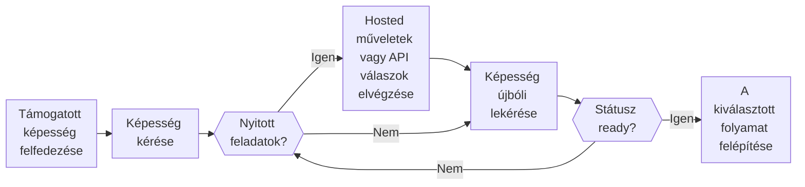

Egy képesség jelzi, hogy egy ügyfél képes-e használni egy adott eredményt, fizetési módot és irányt. A nyitott feladatok megmondják, mi kell ahhoz, hogy a képesség vagy egy kapcsolódó erőforrás előrehaladhasson.



```bash Environment variables
export API_BASE='https://platform.swipelux.com'
export SWIPELUX_API_KEY='replace-with-your-api-key'
```

## Támogatott képességek felfedezése {#discover-supported-capabilities}

Olvassa be az ügyfél aktuális lehetőségeit a [`GET /v3/customers/{customerId}/capabilities/supported`](/api-reference/capabilities/get-v3-customers-by-customer-id-capabilities-supported) művelettel:

```bash List supported capabilities
curl --request GET \
  "${API_BASE}/v3/customers/${CUSTOMER_ID}/capabilities/supported" \
  --header "X-API-Key: ${SWIPELUX_API_KEY}"
```

Válasszon egy válaszelemet, amely megfelel a szándékolt `directions`, `method` és `accountType` értékeknek. Csak akkor folytassa, ha az `availability` értéke `available` vagy `beta`, és az `eligibility.eligible` értéke `true`. Ha `institutions` értéket ad vissza, csak abból a válaszból válasszon azonosítót.

Minden intézménybejegyzés tartalmaz egy `logoUrl` mezőt és egy `isDefault` jelzőt. A `logoUrl` segítségével jelenítse meg a bank logóját a bankválasztó felületen, és ha értéke `null`, jelenítse meg saját általános bankikonját. Az `isDefault` csak erre az ügyfélre és képességre vonatkozik, nem globálisan az intézményre. A [`GET /v3/institutions`](/api-reference/institutions/get-v3-institutions) ugyanezt a nullázható `logoUrl` mezőt adja vissza. Az intézményazonosítók átlátszatlanok, ezért kezelje az új azonosítókat kódmódosítás nélkül.

```json Institution entry
{
  "institutions": [
    {
      "id": "jpmorgan",
      "name": "JPMorgan Chase",
      "bic": "CHASUS33",
      "logoUrl": "https://wallet.swipelux.com/bank-logos/jpmorgan.png",
      "countries": ["US"],
      "isDefault": true,
      "currencies": [
        { "code": "USD", "institution": "jpmorgan" }
      ]
    }
  ]
}
```

Minden dedikált képességnél minden intézménybejegyzés a `currencies` mezőt is felsorolja. Minden elem megad egy deviza `code` értéket, amelyet egy kibocsátott számla fogadhat, valamint azt az `institution` értéket, amelyet [a számla megnyitásakor](/hu/integration/issue-bank-account#choose-the-bank) el kell küldenie. Az `ach_named`, `wire_named` és `rtp_named` az USD-t sorolja fel. A `sepa_named` az EUR-t, a `faster_payments_named` a GBP-t, az `ipp_named` pedig az AED-t sorolja fel. A `swift_named` minden olyan devizát felsorol, amelyben a bank SWIFT-számlákat bocsát ki. Egy deviza a bejegyzéstől eltérő intézményt is megnevezhet. Például a `lead_bank` nem USD SWIFT-devizái a `bmo` intézményt nevezik meg. A közös képességek kihagyják a `currencies` mezőt.

A `swift_named` esetében a bank dönti el, hogy ezek közül a devizák közül melyikeket nyithatják meg az egyes ügyfelek. Az a számla, amelynek devizáját a bank nem kínálja ennek az ügyfélnek, `rejected` állapotba kerül `statusReason.code: currency_unavailable` értékkel.

A `bmo` értéket csak a számla megnyitásakor küldje el. Az a képességkérés vagy feladat-előnézet, amely a `bmo` értéket nevezi meg az `institutions` mezőben, `422 capability_institutions_unsupported` választ ad. Helyette kérje a `swift_named` képességet a `lead_bank` intézménynél.

Ha kihagyja az `institutions` mezőt, a Swipelux kiválasztja az ügyfélre vonatkozó alapértelmezett bankot. Az alapértelmezés ügyfelenként dől el, és idővel változhat, például ha az ügyfél profilja megváltozik, vagy egy bank bevonási folyamata megnyílik vagy lezárul. Az `isDefault` értékét minden alkalommal a támogatott képességek válaszából olvassa ki, ahelyett hogy eltárolná. Éles módban:

- Az `ach_named` és a `wire_named` alapértelmezése a Lead Bank (`lead_bank`), ha a Lead Bank fogad új ügyfeleket, és be tudja vonni ezt az ügyfelet: a profil legalább egy országot megad, és a Lead Bank minden benne szereplő országot elfogad, egy vállalkozás profilja olyan jogi formát ad meg, amelyet a Lead Bank elfogad, és az ügyfélnek nincs `ready` állapotú kérelme egy másik banknál, sem dedikált, sem közös. Ellenkező esetben az alapértelmezés a JPMorgan Chase (`jpmorgan`).
- Az `ach_pooled` és a `wire_pooled` alapértelmezése a JPMorgan Chase (`jpmorgan`).

Az alapértelmezés csak új kiválasztásra vonatkozik. Az ügyfél már meglévő jóváhagyott (`ready`) kérelme, vagy egy másik banknál lévő aktuális kérelme továbbra is elsőbbséget élvez az alapértelmezéssel és az `isDefault` jelölésű bankkal szemben. Egy bank rögzítéséhez küldje el annak azonosítóját az `institutions` mezőben. A sandboxban az ACH, Wire és SWIFT képességek csak a JPMorgan Chase-nél (`jpmorgan`) érhetők el. Lásd: [Sandbox tesztelés](/hu/integration/sandbox).

Tárolja a kiválasztott `data[].id` értéket `CAPABILITY_ID`-ként. Soha ne másoljon képességazonosítót másik ügyféltől vagy környezetből.

### Annak megjelenítése, miért nem érhető el egy bank {#show-why-a-bank-is-unavailable}

Minden bejegyzés tartalmazza az `unavailableInstitutions` mezőt is. Ez azokat a bankokat sorolja fel, amelyek kínálják ezt a képességváltozatot, de nem fogadják el ezt az ügyfelet. Minden bejegyzésnek van egy `id`, egy `name` és egy nem üres `reasons` tömbje. Minden ok ugyanolyan szerkezetű, mint a `statusReason`, `actor: "provider"` és `retryable: false` értékkel. Az `unavailableInstitutions` segítségével mutassa meg az ügyfeleknek, miért hiányzik egy bank a bankválasztó felületről, például úgy, hogy a bankot letiltottként jeleníti meg az ok `message` szövegével.

```json Unavailable institution entry
{
  "unavailableInstitutions": [
    {
      "id": "lead_bank",
      "name": "Lead Bank",
      "reasons": [
        {
          "code": "jurisdiction_unsupported",
          "message": "The bank does not accept customers from a country on this customer's profile.",
          "actor": "provider",
          "retryable": false
        }
      ]
    }
  ]
}
```

Jelenlegi okkódok:

| Kód | Jelentés |
| --- | --- |
| `jurisdiction_unsupported` | A bank nem fogad el egy, az ügyfél profiljában szereplő országot. |
| `legal_form_unsupported` | A bank nem fogadja el az ügyfél jogi formáját. |
| `customer_type_unsupported` | A bank nem fogadja el az ügyfél típusát. |

Úgy kezelje az ismeretlen kódokat, hogy ne kelljen módosítania a kódját, mert a Swipelux új kódokat adhat hozzá. Egy bank soha nem szerepel egyszerre az `institutions` és az `unavailableInstitutions` listában. Az `unavailableInstitutions` mindig jelen van, és értéke `[]` a közös és a nem banki bejegyzéseknél. Az a bank, amely egyik listában sem szerepel, ettől az ügyféltől független okból maradt ki. Ha egy képességkérésben nem elérhető bankot nevez meg, a válasz továbbra is [`422 capability_institutions_unsupported`](/integration/errors#capability-institutions-unsupported).

### Annak ellenőrzése, hol nyitható számla {#check-where-an-account-can-open}

Minden bejegyzés tartalmazza a `banks` mezőt is. Dedikált bejegyzéseknél felsorol minden bankot, amely az `institutions` vagy az `unavailableInstitutions` listában szerepel, valamint minden bankot, ahol az ügyfélnek alkalmazása van ehhez a változathoz. Más bejegyzéseknél értéke `[]`. Minden banknak ugyanaz az `id`, `name`, `bic` és `logoUrl` mezője van, mint egy intézménybejegyzésnek, és ezeken felül megadja az ügyfél helyzetét az adott banknál:

```json Bank entry
{
  "banks": [
    {
      "id": "jpmorgan",
      "name": "JPMorgan Chase",
      "bic": "CHASUS33",
      "logoUrl": null,
      "status": "approved",
      "applicationId": "apl_000000000000000005",
      "accountOpening": "now",
      "currencies": [
        { "code": "USD", "institution": "jpmorgan" }
      ]
    }
  ]
}
```

A `status` értéke a következők egyike:

- `approved`: a banknál lévő kész alkalmazás lefedi ezt a változatot.
- `pending`: a banknál lévő alkalmazás kérte, de a bank még nem hagyta jóvá.
- `refused`: a bank elutasította az ügyfelet.
- `not_requested`: a banknál egyetlen alkalmazás sem kéri. Egy képességkérés kiválaszthatja ezt a bankot.
- `not_offered`: a bank ehhez a változathoz nem fogadja el ezt az ügyfelet.

Az `applicationId` azt az alkalmazást nevezi meg, amely a `status` értékét meghatározza, vagy `null`. Az `accountOpening` megmondja, mit tesz most egy olyan [kibocsátott számlára vonatkozó kérés](/hu/integration/issue-bank-account#choose-the-bank), amely ezt a bankot nevezi meg:

- `now`: a kérést elfogadják, és a számlát kibocsátják.
- `after_approval`: a kérést `allowPending: true` értékkel elfogadják, és a bank jóváhagyására vár.
- `application`: először kérje a képességet úgy, hogy ez a bank szerepel az `institutions` listában.
- `none`: ennél a banknál most nem fogadnak el számlakérést.

`now` és `after_approval` esetén a `currencies` csak azokat a devizákat sorolja fel, amelyekben kérés elfogadható. Ezért kimarad az a deviza, amelyben az ügyfélnek már van számlája ennél a banknál. Egyébként minden olyan devizát felsorol, amelyben a bank ezt a változatot megnyitja. Minden elem megnevezi az elküldendő `institution` értéket, ahogy az `institutions[].currencies` is.

Kizárólag az `accountOpening` alapján döntse el, hogy felkínálja-e a számlanyitást egy banknál. Az `institutions` egy másik kérdésre felel: hová mehet egy új képességkérés. Felsorolhat egyetlen alapértelmezett bankot akkor is, ha egy másik bank már jóváhagyta az ügyfelet.

### Közös és dedikált számlatípusok {#pooled-vs-named-account-types}

A banki képességek két változatban léteznek, amelyeket az `accountType` mező és a képességazonosító utótagja kódol (például `ach_pooled`, `wire_named`):

- **`pooled`**: közös Swipelux bankszámla. Minden pénzbefizetés egyedi hivatkozást használ a pénz irányítására. Egyszeri átutalásokhoz válassza ezt.
- **`named`**: dedikált banki adatok az ügyfélnek (virtuális IBAN, dedikált ACH számla). Újrafelhasználható és megosztható bármely fizetővel. [Kibocsátott bankszámlákhoz](/hu/integration/issue-bank-account) szükséges.

Alapértelmezés szerint válassza a `pooled` opciót. `named`-et csak akkor használjon, ha az ügyfélnek újrafelhasználható banki adatok szükségesek. Ellenőrizze a `supported` válaszban, hogy mely változatok érhetők el.

SWIFT betétek fogadásához vagy SWIFT banki adatok kibocsátásához használja a `swift_named` opciót. A `swift_pooled` csak kifizetéseket támogat, ezért ellenőrizze az egyes opciók `directions` értékét a támogatott képesség válaszában. Egy dedikált SWIFT számla újrafelhasználható fogadási adatokat ad vissza, beleértve a bank BIC-kódját, szükség esetén egy hivatkozást, valamint a kedvezményezett címét, ha a bank megadja.

Kibocsátott ACH, Wire és SWIFT számlák esetén az `institution` mezővel kiválaszthat egy pontos bankot, és elmentheti a számlakérést, mielőtt a bank jóváhagyja az ügyfelet. Lásd: [Bankszámla kibocsátása](/hu/integration/issue-bank-account#choose-the-bank).

## A képesség kérése {#request-the-capability}

Kérje a kiválasztott opciót a [`POST /v3/customers/{customerId}/capabilities/{capabilityId}`](/api-reference/capabilities/post-v3-customers-by-customer-id-capabilities-by-capability-id) művelettel:

```bash Request capability
curl --request POST \
  "${API_BASE}/v3/customers/${CUSTOMER_ID}/capabilities/${CAPABILITY_ID}" \
  --header "X-API-Key: ${SWIPELUX_API_KEY}" \
  --header "Idempotency-Key: capability-request-001" \
  --header "Content-Type: application/json" \
  --data '{}'
```

Csak akkor használjon explicit `institutions` tömböt, ha a támogatott képesség válasza által visszaadott azonosítókból kell választania.

Tárolja a `data.status` értéket `CAPABILITY_STATUS`-ként, a `data.accountProvisioning` értéket `ACCOUNT_PROVISIONING_STATUS`-ként, a `data.openTaskIds` értéket `OPEN_TASK_IDS`-ként, és minden `data.applications[].id` értéket az `APPLICATION_IDS` alatt.

### Megosztott alkalmazások bankonként {#shared-applications-per-bank}

Dedikált (named) banki képességek esetén minden ügyfélnek bankonként egy alkalmazási esete van. A közös (pooled) és platformképességek bank nélküli eseteket használnak. A Swipelux egy esetet megoszt az Ön által kért összes kompatibilis képesség között:

- Egyetlen jóváhagyás több képességet is lefedhet. Például egy banknál jóváhagyott eset egy ACH és egy wire képességet is `ready` állapotba hozhat.
- Egy későbbi kérés, amely egy meglévő esetnek megfelel, azt újrahasznosítja. A Swipelux nem nyit második alkalmazást, és nem ad hozzá duplikált feladatokat.
- A különböző bankoknál lévő esetek függetlenek. Az egyik banknál történt elutasítás nem érinti a másik banknál lévő esetet.

A kérésre adott válasz megmutatja, melyik esetet használta a Swipelux:

- A `201` azt jelenti, hogy a kérés új alkalmazási esetet nyitott.
- A `200` azt jelenti, hogy a kérés egy, az ügyfélnél már meglévő alkalmazási esetre oldódott fel, például egy olyan banki képesség ismételt kérésekor, amellyel az ügyfél már rendelkezik, vagy egy törölt banki képesség kérésekor, amely a meglévő kérelméhez csatlakozik. A `card` vagy `stablecoin_transfers` ismételt kérése továbbra is [`409 capability_already_exists`](/integration/errors#capability-already-exists) hibát ad vissza, egy törölt `card` képesség kérése pedig [`409 capability_not_reopenable`](/integration/errors#capability-not-reopenable) hibát.
- A `selectedApplicationId` egy legfelső szintű mező a `data` mellett, amely a kérés által kiválasztott vagy megnyitott eset azonosítóját tartalmazza. A Swipelux kihagyja, ha a kérés nem választott ki esetet. Egy idempotens ismétlés ugyanazt az értéket adja vissza.

Rövidített válasz:

```json Response (abbreviated)
{
  "data": {
    "id": "ach_named",
    "status": "pending",
    "openTaskIds": ["tsk_000000000000000002"],
    "applications": [{ "id": "apl_000000000000000005", "status": "in_review" }]
  },
  "selectedApplicationId": "apl_000000000000000005"
}
```

Dedikált képességek esetén küldje el újra ugyanazt az `institutions` listát ugyanazon eset kiválasztásához, vagy küldjön egyetlen intézményazonosítót az adott bank megcélzásához. A Swipelux kihagyja azt a bankot, amely véglegesen elutasította az ügyfelet. Ha csak ezt a bankot nevezi meg, vagy minden jogosult bank elutasította az ügyfelet, a kérés [`409 capability_terminally_rejected`](/integration/errors#capability-terminally-rejected) hibát ad vissza. Ha elutasítás után egy másik bankkal szeretne próbálkozni, kérje újra a képességet az adott bank intézményazonosítójával.

Egy képesség státusza az ügyfél összes kapcsolódó esetét tükrözi. Dedikált képesség esetén egyetlen `ready` eset, amelynek jóváhagyása lefedi a képességet, elegendő ahhoz, hogy az `ready` legyen, függetlenül attól, mit jeleznek más bankok. A közös képesség a módszerellenőrzését is megvárja, amelyet az ügyfél alkalmazáslistájában a `probes` jelez.

#### Az ügyfél alkalmazásainak listázása {#list-the-customers-applications}

Listázza az ügyfél összes alkalmazási esetét a [`GET /v3/customers/{customerId}/applications`](/api-reference/capabilities/get-v3-customers-by-customer-id-applications) művelettel. Az eredmények lapozása a `nextCursor` és `hasMore` mezőkkel történik, és elfogadják az `updatedAfter` paramétert:

```bash List applications
curl --request GET \
  "${API_BASE}/v3/customers/${CUSTOMER_ID}/applications" \
  --header "X-API-Key: ${SWIPELUX_API_KEY}"
```

Minden bejegyzés tartalmazza a képesség `applications[]` tömbjében visszaadott alkalmazásmezőket, továbbá:

- `scope`: `named` egy banknál lévő esethez, `provider_pooled` vagy `platform` bank nélküli esetekhez, vagy `null` egy besorolatlan korábbi esethez. Az `institution` hiányzik a `provider_pooled` és `platform` eseteknél.
- `requestedScope[]`: az esethez kért képességkulcsok, mindegyik az első `requestedAt` értékével. A bejegyzések soha nem törlődnek.
- `coverage[]`: az eset jóváhagyása által lefedett képességkulcsok, mindegyik `grantedAt` és `source` értékkel. A lefedettség a hatókört rögzíti, nem az engedélyezést. Az aktuális státuszért olvassa be a képességet.
- `probes[]`: módszerellenőrzések az eset által lefedett közös képességkulcsokhoz, mindegyik `capabilityKey`, `status` és `reason` értékkel. A dedikált kulcsokhoz soha nem szükséges ellenőrzés.
- `generation`, `predecessorApplicationId` és `supersededByApplicationId`: utódlási hivatkozások. Ha a `supersededByApplicationId` be van állítva, az esetet lecserélték. Kövesse ezt az azonosítót az aktuális esethez. Egy képesség `applications[]` listája csak az aktuális eseteket tartalmazza, így a lecserélt eset csak ebben a listában jelenik meg.

Rövidített válasz:

```json Response (abbreviated)
{
  "data": [
    {
      "id": "apl_000000000000000005",
      "status": "ready",
      "scope": "named",
      "institution": { "id": "jpmorgan", "name": "JPMorgan Chase", "bic": "CHASUS33" },
      "requestedScope": [
        { "capabilityKey": "ach_named", "requestedAt": "2026-09-20T10:00:00.000Z" }
      ],
      "coverage": [
        { "capabilityKey": "ach_named", "grantedAt": "2026-09-22T12:00:00.000Z", "source": "approval" },
        { "capabilityKey": "wire_named", "grantedAt": "2026-09-22T12:00:00.000Z", "source": "approval" }
      ],
      "probes": [],
      "generation": 1,
      "predecessorApplicationId": null,
      "supersededByApplicationId": null
    }
  ],
  "nextCursor": null,
  "hasMore": false
}
```

## Aktuális feladatok elvégzése {#complete-current-tasks}

Sorolja fel a feladatokat a [`GET /v3/customers/{customerId}/tasks`](/api-reference/tasks/list-customer-tasks) művelettel, válassza ki az azonosítókat az `OPEN_TASK_IDS`-ből, majd olvassa be minden aktuális feladatot a [`GET /v3/customers/{customerId}/tasks/{taskId}`](/api-reference/tasks/get-customer-task) művelettel:

```bash List open tasks
curl --request GET \
  "${API_BASE}/v3/customers/${CUSTOMER_ID}/tasks/${TASK_ID}" \
  --header "X-API-Key: ${SWIPELUX_API_KEY}"
```

Használja a legfrissebb `data.revision` és `data.requirements` értékeit. Frissítse le a feladatot közvetlenül a beküldés előtt, ha bármelyik megváltozhatott.

### Újrahasznosított profilbizonyítékok {#reused-profile-evidence}

A közvetlen API-beküldést elfogadó alkalmazási adatfelvételi feladatoknál a Swipelux újrahasznosítja az ügyfél által már megadott információkat. Amikor egy ilyen feladat létrejön vagy egyeztetésre kerül, a Swipelux ellenőrzi az ügyfélprofilt és az ügyfél saját feltöltött dokumentumait. Azok a jogosult követelmények, amelyeket már egy használható profilérték vagy dokumentum alátámaszt, `in_review` állapotba kerülnek ahelyett, hogy cselekvést igénylők maradnának. A profilfrissítések és az új dokumentumfeltöltések ugyanezt az ellenőrzést indítják el a meglévő feladatoknál.

Csak a hiányzó vagy nem kompatibilis értékek maradnak cselekvést igénylők. Az újrahasznosítás nem hagyja jóvá a bizonyítékot. A Swipelux továbbra is felülvizsgálja azt. Az explicit javítási kérések és a korábban megválaszolt követelmények cselekvést igénylők maradnak. A tulajdonosi és kapcsolt féltől származó dokumentumokat a Swipelux nem hasznosítja újra, és a csak hosted munkamenetben gyűjtött követelmények a szokásos folyamatukat követik.

### Követelmények megjelenítése {#render-requirements}

Az űrlapokat az egyes követelmények által visszaadott metaadatokból építse fel, ne a követelménykulcsokból. Egy követelmény tartalmazhat opcionális rövid `title` értéket, és minden `request` tartalmaz egy `prompt` szöveget, amelyet a címsor alatt kell megjeleníteni.

A `request.type: "profile"` típusú követelmények a `profilePointer` segítségével azonosítják a profilmezőt, és beviteli metaadatokat adnak hozzá:

- `allowedValues`: a megengedett értékek egy skaláris mezőhöz, vagy egy tömbmező minden eleméhez. Ezeket az értékeket küldje be, ne a lefordított megjelenítési címkéket.
- `valueSchema`: önálló JSON Schema Draft 7 dokumentum, amely leírja a bevitel alakját, a beágyazott tulajdonságokat, a kötelező mezőket és a szerkezeti megkötéseket. Az objektumokon lévő enumok a megfelelő tulajdonságon jelennek meg, például adóazonosítóknál a `valueSchema.items.properties.type.enum` helyen. A Swipelux a beküldés után továbbra is alkalmaz mezők közötti és felülvizsgálati validációt, így a sémának megfelelő érték is elutasításra kerülhet.
- `valueType: "country"`, vagy tömbök esetén `itemValueType: "country"`: a mező nagybetűs ISO 3166-1 alpha-2 kódokat fogad. A `valueSchema` beágyazott országtulajdonságai a `format: "iso-3166-1-alpha-2"` értéket használják. A lokalizált címkékhez használjon szabványos országlistát.

```json Requirement
{
  "id": "req_000000000000000010",
  "key": "account_purposes",
  "title": "Account purpose",
  "status": "action_required",
  "request": {
    "type": "profile",
    "prompt": "Select every purpose that applies.",
    "required": true,
    "profilePointer": "/financialProfile/accountPurposes",
    "valueType": "array",
    "itemValueType": "string",
    "allowedValues": ["business_expenses", "ecommerce", "payroll"],
    "valueSchema": {
      "$schema": "http://json-schema.org/draft-07/schema#",
      "type": "array",
      "items": { "enum": ["business_expenses", "ecommerce", "payroll"] }
    }
  }
}
```

Ez a példa lerövidíti az értékkatalógust; az API minden megengedett értéket visszaad. Egyes profilkövetelményeknek nincs közzétett sémája, és kihagyják a `valueSchema` és `allowedValues` mezőket. Ezeket a `prompt` és `valueType` alapján jelenítse meg.

Minden nyitott feladat tartalmaz egy `dueAt` időbélyeget. Amikor a Swipelux explicit határidő nélkül hoz létre egy feladatot, a `dueAt` alapértelmezés szerint pontosan 31 nappal a feladat `createdAt` értéke utánra kerül. Kezelje a `dueAt` mezőt tájékoztató jellegűként: nem állíthatja be az API-n keresztül, és nem vált ki automatikus életciklus-átmenetet. Csak a különálló `deadline` mező okoz automatikus átmenetet, ha meg van adva.

### Hosted műveletek {#hosted-actions}

A feladat részletes válaszában a `verificationSessions` és `tosSessions` minden bejegyzése tartalmaz egy `action` objektumot. A feladatlisták válaszai nem tartalmazzák ezeket a műveleti hivatkozásokat. Tárolja minden munkamenet `id` értékét, majd olvassa be az `action.kind` értékét, mielőtt az ügyfelet továbbküldi; ne következtessen a hivatkozás elérhetőségére a munkamenet `status` értékéből.

- Az `action.kind: "available"` tartalmazza az `action.url` és `action.expiresAt` mezőket (jelenleg mindig `null`). Tárolja az `action.url` értékét, küldje oda az ügyfelet, majd olvassa be újra a feladatot. A munkamenetszintű `url` és `expiresAt` mezők ugyanezeket az értékeket tartalmazzák.
- Az `action.kind: "unavailable"` azt jelenti, hogy nem szabad hivatkozást megjeleníteni. A munkamenetszintű `url` és `expiresAt` mezők hiányoznak. A munkamenet `status` értéke önmagában nem határozza meg, melyik művelettípust kapja.

```json Verification session
{
  "data": {
    "verificationSessions": [
      {
        "id": "vfy_000000000000000003",
        "key": "identity_verification",
        "type": "identity_verification",
        "status": "action_required",
        "coveredRequirementIds": ["req_000000000000000011", "req_000000000000000012"],
        "action": {
          "kind": "available",
          "url": "https://platform.swipelux.com/kyc/redirect/cus_000000000000000001/tsk_000000000000000002/vfy_000000000000000003",
          "expiresAt": null
        },
        "url": "https://platform.swipelux.com/kyc/redirect/cus_000000000000000001/tsk_000000000000000002/vfy_000000000000000003",
        "expiresAt": null
      }
    ],
    "tosSessions": [
      {
        "id": "vfy_000000000000000004",
        "key": "terms_of_service",
        "type": "terms_of_service",
        "status": "completed",
        "action": { "kind": "unavailable" }
      }
    ]
  }
}
```

Ezek feladathoz kötött műveletek, nem egy külön ügyfél-ellenőrzési életciklus.

A feladatlekérésekben és az ügyfél feladatrészleteiben minden `verificationSessions[]` bejegyzés tartalmazza a `coveredRequirementIds` mezőt. Ez felsorolja a feladat azon élő követelményeinek azonosítóit, amelyeket a munkamenet teljesíteni tud. Ebből láthatja, mely követelményeket rendezhet egy hosztolt munkamenet vagy egy [importált ellenőrzés](#import-an-existing-identity-verification). Minden más követelményt [API-válaszokkal](#api-answers) teljesítsen.

Az új magánszemélyes adatfelvételi feladatoknál a hosztolt személyazonosság-ellenőrzési munkamenet csak a személyazonosító okmányt, a szelfit és a lakcímigazolást fedi le. A pénzeszköz-igazolási követelmények, például a `proof_of_funds`, `source_of_funds_document`, `named_source_of_funds_document` és `sole_proprietor_document`, nem részei a hosztolt munkamenetnek. Ezeket a dokumentumokat [töltse fel](#upload-documents), és küldje be közvetlenül. A Swipelux felülvizsgálja őket, és a feladat nyitva marad, amíg el nem fogadja őket.

Egy strukturált értékre, például címre vagy adóazonosítókra vonatkozó profilkövetelményre adott hosztolt válasznak ugyanazokon a séma- és korlátozásellenőrzéseken kell átmennie, mint egy közvetlen válasznak. Ha ez nem teljesül, a követelmény nyitva marad. Az a követelmény, amelyet a Swipelux emiatt visszaállít `action_required` állapotba, `reviewFeedback.code: hosted_profile_direct_submission_required` értéket hordoz. Kérje be ezt az értéket az ügyféltől, és küldje be [API-válaszként](#api-answers).

### Meglévő személyazonosság-ellenőrzés importálása {#import-an-existing-identity-verification}

Ha már ellenőriz magánszemélyeket a Swipelux személyazonosság-ellenőrző szolgáltatójánál vezetett saját fiókjában, ezt az ellenőrzést importálhatja az ügyfél adatfelvételi feladatának személyazonosság-ellenőrzési munkamenetébe ahelyett, hogy az ügyfelet a hosztolt folyamaton vezetné végig. Ez a lehetőség csak magánszemély ügyfelekkel dolgozó API-integrációk számára érhető el. A vállalkozások és a kapcsolt felek nem támogatottak.

Az importálás előtt állítsa be a megosztást a személyazonosság-ellenőrző szolgáltatójánál:

1. Kérje el a Swipelux partnertokenjét, majd adja hozzá a Swipelux-ot megosztási partnerként a személyazonosság-ellenőrző szolgáltatónál vezetett fiókjában.
2. Éles ellenőrzésekhez hozzon létre share tokent a Swipelux számára a `swipelux.com_21030` címzett-ügyfélazonosítóval (`forClientId`).
3. Küldje el a tokent a Swipelux-nak, mielőtt lejár. A share tokenek átlátszatlanok, egyszer használatosak, legfeljebb 1024 UTF-8 bájt méretűek, és alapértelmezés szerint 20 perc után lejárnak. Minden tokent hitelesítő adatként kezeljen.

A feladatnak magánszemélyes adatfelvételi feladatnak kell lennie, és beküldési módként fel kell kínálnia a hosztolt ellenőrzési munkamenetet. A munkamenetnek `type: "identity_verification"` és `status: "action_required"` értékkel kell rendelkeznie. Az ügyfélnek nem lehet már folyamatban lévő vagy befejezett ellenőrzése a Swipelux-nál, és nem futhat már importálás. A hosztolt link megnyitása elindítja az ellenőrzést, a feladat beolvasása viszont nem. Ezután hívja meg a `POST /v3/customers/{customerId}/tasks/{taskId}/verification-sessions/{verificationSessionId}/share-token` végpontot. A kéréshez ugyanazok az `accounts:write`, `customers:read` és `customers:write` jogosultságok szükségesek, mint a feladatbeküldésekhez, valamint egy `Idempotency-Key`:

```json Request body
{
  "shareToken": "<share token>"
}
```

```json Response
{
  "verificationSessionId": "vfy_000000000000000003",
  "status": "in_review"
}
```

A szolgáltató átmásolja a megfelelő lépéseket a Swipelux fiókjába, és az ellenőrzések újra lefutnak a feladat által megkövetelt szint alapján. A Swipelux soha nem tárolja és nem naplózza a share tokent.

- A `status: "in_review"` azt jelenti, hogy az ellenőrzések függőben vannak. Amikor az ellenőrzések befejeződnek, a Swipelux ugyanúgy rendezi a lefedett követelményeket, mint egy hosztolt munkamenet esetén.
- A `status: "action_required"` azt jelenti, hogy lépések hiányoznak. Az ügyfél a munkamenet meglévő hosztolt linkjén keresztül befejezheti őket, vagy Ön közvetlenül beküldheti a lefedett követelményeket.

Az importálás csak a `coveredRequirementIds` mezőben felsorolt követelményeket teljesíti: a személyazonosító okmányt, a szelfit és, ahol a feladat megköveteli, a lakcímigazolást. A profilválaszokat, a pénzeszköz-igazolást és a többi követelményt [API-válaszként](#api-answers) küldje be. Egy kérés megismétléséhez küldje el újra ugyanazzal az `Idempotency-Key` értékkel.

| Állapot | Kód | Teendő |
| --- | --- | --- |
| `409` | `verification_already_started` | Az ügyfélnek már van folyamatban lévő vagy befejezett ellenőrzése a Swipelux-nál, vagy már fut egy importálás, például mert az ügyfél megnyitott egy hosztolt linket. Ne próbálkozzon újra. Folytassa a meglévő munkamenettel. |
| `409` | `verification_session_not_allowed` | A feladat vagy a munkamenet nem jogosult az importálásra. Ne próbálkozzon újra. Olvassa be a feladatot, és használja az általa felkínált módszereket. |
| `422` | `share_token_rejected` | A személyazonosság-ellenőrző szolgáltató elutasította a tokent, például mert lejárt, már felhasználták, vagy más címzett számára állították ki. Hozzon létre új tokent a Swipelux számára, és próbálkozzon újra egy új `Idempotency-Key` értékkel. |
| `503` | `kyc_provider_unavailable` | `retryable: true` esetén a Swipelux még nem küldte el a tokent. Várjon egy kicsit, majd próbálkozzon újra. `retryable: false` esetén az importálás megtörténhetett, de nem sikerült megerősíteni. Ne küldje el újra a tokent. Folytassa a munkamenet hosztolt linkjén keresztül. |

### Dokumentumok feltöltése {#upload-documents}

Ha egy követelmény dokumentumot kér, töltse fel a [`POST /v3/customers/{customerId}/documents`](/api-reference/documents/post-v3-customers-by-customer-id-documents) művelettel:

```bash Upload document
export DOCUMENT_PATH='/absolute/path/to/requested-document.pdf'

curl --request POST \
  "${API_BASE}/v3/customers/${CUSTOMER_ID}/documents" \
  --header "X-API-Key: ${SWIPELUX_API_KEY}" \
  --header "Idempotency-Key: customer-document-001" \
  --form "file=@${DOCUMENT_PATH}"
```

Tárolja a visszakapott `data.id` értéket `DOCUMENT_ID`-ként, mielőtt beküldi a rá hivatkozó választ.

Minden v3 dokumentumerőforrás tartalmazza a `contentSha256` mezőt, a tárolt fájl SHA-256 kivonatát `sha256:` előtaggal és kisbetűs hexadecimális kivonattal. Két azonos kivonatú dokumentum bájtra azonos. Annak ellenőrzéséhez, hogy egy fájlt az ügyfél már feltöltött-e, például egy fájlt, amelynek cseréjét egy felülvizsgáló kérte, számítsa ki a SHA-256 kivonatát feltöltés előtt, és hasonlítsa össze azoknak a dokumentumoknak a `contentSha256` értékével, amelyekre a korábbi beküldés válaszai a `documentIds` mezőben hivatkoznak. A mező értéke `null` azoknál a dokumentumoknál, amelyeket a Swipelux a kivonatok rögzítése előtt tárolt.

Egy tárolt fájl későbbi lekéréséhez hívja meg a [`GET /v3/customers/{customerId}/documents/{documentId}/download`](/api-reference/documents/get-v3-customers-by-customer-id-documents-by-document-id-download) műveletet. A Swipelux egy `url`-t ad vissza, amely a fájlt mellékletként tölti le, és egy óra után lejár. Az archivált dokumentumok `404`-et adnak vissza.

### API válaszok {#api-answers}

Küldjön el egy teljes válaszcsomagot az aktuális revízióhoz a [`POST /v3/customers/{customerId}/tasks/{taskId}/submissions`](/api-reference/task-submissions/create-customer-task-submission) művelettel:

```bash Submit task answers
curl --request POST \
  "${API_BASE}/v3/customers/${CUSTOMER_ID}/tasks/${TASK_ID}/submissions" \
  --header "X-API-Key: ${SWIPELUX_API_KEY}" \
  --header "Idempotency-Key: task-submission-001" \
  --header "Content-Type: application/json" \
  --data @- <<'JSON'
{
  "taskRevision": 3,
  "answers": [
    {
      "requirementId": "req_from_current_task",
      "answer": {
        "type": "text",
        "value": "Current answer"
      }
    }
  ]
}
JSON
```

Vegyen minden követelményazonosítót és válaszreprezentációt a legfrissebb feladatból. Ha az API jelzi, hogy a feladat megváltozott, olvassa be újra és állítsa össze a beküldést az új revízió alapján.

#### Érvényes válaszok megtartása az `allowPartial` segítségével {#keep-valid-answers-with-allowpartial}

Alapértelmezés szerint egyetlen elutasított válasz a teljes kérést meghiúsítja, és a Swipelux semmit sem tárol. A válasz `400 validation_error`, `400 invalid_document_reference` vagy `409 absence_conflicts_with_profile`. Adja hozzá az `"allowPartial": true` értéket, ha azt szeretné, hogy a Swipelux tárolja az érvényes válaszokat, és csak az érvényteleneket utasítsa el:

```json Partial submission request
{
  "taskRevision": 3,
  "allowPartial": true,
  "answers": [
    { "requirementId": "req_a", "answer": { "type": "text", "value": "Salary" } },
    { "requirementId": "req_b", "answer": { "type": "document", "documentIds": ["doc_unknown"] } }
  ]
}
```

A Swipelux `201` választ ad a `data` mezőben a tárolt beküldéssel, amely csak a megtartott válaszokat tartalmazza, a többit pedig a `refusedAnswers` mezőben sorolja fel:

```json Partial submission response
{
  "data": { "id": "sub_000000000000000001", "outcome": "in_review", "answers": [{ "requirementId": "req_a" }] },
  "refusedAnswers": [
    {
      "requirementId": "req_b",
      "code": "invalid_document_reference",
      "pointer": "/answers/1/answer",
      "message": "A referenced document is invalid."
    }
  ]
}
```

Minden elutasított válasz az alábbi kódok egyikét kapja:

| `code` | Jelentés |
| --- | --- |
| `invalid` | A válasz nem felel meg a kérés alakjának, formátumának vagy korlátozásainak, vagy az ügyfélprofil nem fogadja el az értéket. |
| `absence_conflicts_with_profile` | Hiány lett beküldve egy olyan értékre, amelyet a profil tartalmaz. |
| `invalid_document_reference` | Egy hivatkozott dokumentum nem használható ehhez az ügyfélhez és kéréshez. |
| `depends_on_refused_answer` | A válasz önmagában érvényes, de egy elutasított válasszal együtt kerül elbírálásra. Egy feltételes válasz és az azt vezérlő válasz együtt marad meg vagy együtt kerül elutasításra. |

További kódok is megjelenhetnek. Az ismeretlen kódot kezelje `invalid` értékként. A `message` soha nem ismétli meg a beküldött értéket.

Az `allowPartial` nem lazítja a többi szabályt:

- A kérésnek továbbra is meg kell válaszolnia minden olyan követelményt, amelyet a mező nélkül is meg kellene válaszolnia. A megválaszolatlan nyitott követelmények továbbra is `422 task_submission_incomplete` választ adnak.
- Az a törzs, amely már magának a kérés sémájának sem felel meg, például ismeretlen mező vagy hibás típus miatt, továbbra is `400 validation_error` választ ad.
- Ha egyetlen válasz sem tartható meg, a Swipelux `400 validation_error` választ ad, semmit sem tárol, és minden elutasított választ felsorol az `errors[]` mezőben.
- A `refusedAnswers` pontosan akkor szerepel, akár üresen is, ha a kérés `"allowPartial": true` értéket küldött. Ugyanazzal az `Idempotency-Key` értékkel megismételt kérés ugyanazokat a `refusedAnswers` elemeket adja vissza.

Mielőtt kijavít egy elutasított választ, olvassa be újra a feladatot. Egy elutasított követelmény általában továbbra is `action_required`, de egy dokumentumkérést már megválaszolhat egy nyilvántartott fájl. A javításokat az új `taskRevision` értékkel és új `Idempotency-Key` értékkel küldje be. A feltételes választ az azt vezérlő válasszal együtt küldje el.

#### Felülvizsgálatra váró beküldés visszavonása {#withdraw-a-submission-awaiting-review}

Egy még `in_review` állapotú beküldés javításához vonja vissza a `POST /v3/customers/{customerId}/tasks/{taskId}/withdrawals` segítségével. A kérésnek nincs törzse, és `Idempotency-Key` szükséges hozzá. Az API-kulcsoknak `accounts:write`, `customers:read` és `customers:write` jogosultság kell, ahogy a beküldésekhez is:

```bash Withdraw task submission
curl --request POST \
  "${API_BASE}/v3/customers/${CUSTOMER_ID}/tasks/${TASK_ID}/withdrawals" \
  --header "X-API-Key: ${SWIPELUX_API_KEY}" \
  --header "Idempotency-Key: task-withdrawal-001"
```

A Swipelux `200` választ ad a beküldéssel a `data` mezőben. Az `outcome` értéke `withdrawn` lesz, a válaszai `reviewFeedback` nélkül visszakerülnek `action_required` állapotba, és a következő beküldés új `remediationRound` kört indít. A már elfogadott követelmények és az ügyfélprofil nem változnak. Azok a válaszok, amelyeket a Swipelux a profilból vagy nyilvántartott fájlokból töltött ki, felülvizsgálat alatt maradnak. Annyiszor vonhat vissza, ahányszor szükséges. Olvassa be újra a feladatot, majd küldje be a javított válaszokat.

A Swipelux ezekben az esetekben utasítja el a visszavonást:

- `404 task_not_found`: a feladat nem létezik ehhez az ügyfélhez.
- `409 task_not_in_review`: nem pontosan egy beküldés vár felülvizsgálatra (egy sem, vagy több is, például egy részleges beküldés és annak javítása), vagy a feladat határideje lejárt.
- `409 submission_already_forwarded`: a bank közvetlenül vizsgálja ezt a feladatot, vagy a Swipelux már továbbította a beküldést felülvizsgálatra. A `POST /v3/sandbox/tasks` segítségével létrehozott feladatok is ezt adják vissza.

A beküldés `outcome` értéke mostantól `withdrawn` is lehet. Frissítsen minden olyan klienst, amely az `outcome` értékét rögzített listával veti össze.

### Haszonhúzó előfeltétel vállalkozásoknál {#beneficial-owner-prerequisite-for-businesses}

Egy haszonhúzói bizonyítékot igénylő üzleti képesség kérése akkor is sikeres, ha az ügyfélnek még nincs megfelelő tulajdonosa. A képesség `restricted` státusszal jön létre, `statusReason.code: tasks_due` értékkel, és az üzleti adatfelvételi feladat kéri a hiányzó tulajdonlási tényeket, beleértve a tulajdonlási struktúrát.

Ugyanez a feladat tartalmaz egy `resource_reference` követelményt, amelynek kérése tartalmazza a `qualification: "beneficial_owner"` értéket:

```json Beneficial owner requirement
{
  "type": "resource_reference",
  "prompt": "Add or select a qualifying beneficial owner.",
  "required": true,
  "resourceType": "related_party",
  "qualification": "beneficial_owner"
}
```

Egy kapcsolt fél akkor felel meg, ha ugyanazon ügyfél aktív `person` fele, és legalább 25 megadott tulajdonlási százalékkal rendelkezik, vagy megadott százalék nélkül `ownership.declared: true` értékkel rendelkezik.

A követelmény az aktuális kapcsolt fél listából származik, így általában nem válaszolja meg közvetlenül:

- Egy megfelelő kapcsolt fél létrehozása vagy frissítése ugyanabban az újraértékelésben teljesíti a követelményt, és megnyitja az adott tulajdonos saját profil- és dokumentummunkáját. Lásd az [Üzleti kapcsolt felek hozzáadása](/hu/integration/onboarding/customers#add-business-related-parties) oldalt.
- Hivatkozhat egy megfelelő félre explicit módon is egy `resource_reference` válasszal, amely tartalmazza annak `relatedPartyId` értékét.
- A követelmény a teljesítése után is listázva marad az aktuális feladatban. Amikor más nyitott kötelezettség nem marad, a feladat `satisfied` státuszba kerül.
- Az utolsó megfelelő fél archiválása, vagy az őt minősítő tények eltávolítása újranyitja a követelményt, még azután is, hogy a feladat `satisfied` lett.

## Folytatás, amikor a képesség kész {#continue-when-the-capability-is-ready}

Olvassa be újra a képességet a [`GET /v3/customers/{customerId}/capabilities/{capabilityId}`](/api-reference/capabilities/get-v3-customers-by-customer-id-capabilities-by-capability-id) művelettel:

```bash Refetch capability
curl --request GET \
  "${API_BASE}/v3/customers/${CUSTOMER_ID}/capabilities/${CAPABILITY_ID}" \
  --header "X-API-Key: ${SWIPELUX_API_KEY}"
```

Cserélje ki a tárolt státuszt, a számlakiadási státuszt és a feladatazonosítókat a legfrissebb válasz értékeire. A képesség `status` értéke azt jelzi, hogy a jogosultságot jóváhagyták-e. Számlát kibocsátó képesség esetén az `accountProvisioning` külön jelzi, hogy a számla `not_started`, `in_progress`, `issued` vagy `failed` állapotú-e; a számlát nem kibocsátó képesség `not_applicable` értéket ad vissza.

Amíg a képesség `pending` állapotú, az általa jelezhető `statusReason.code` értékek közül kettő azt mutatja, hogy folyamatban van-e felülvizsgálat. A `preparing_submission` azt jelenti, hogy a Swipelux még benyújtásra készít elő egy kérelmet, és nincs folyamatban felülvizsgálat, még akkor sem, ha egy másik bank kérelme `rejected` vagy beavatkozást igényel. A `review_in_progress` azt jelenti, hogy felülvizsgálat van folyamatban, például amíg egy kérelem `in_review` állapotú, vagy egy [hosted ellenőrzés](#hosted-actions) nyitva van. Mindkettő `resolution: wait` értéket használ. Az ezen kódok közötti váltás `pending` állapotban hagyja a státuszt, így nem küld `capability.status_changed` eseményt. Olvassa le a képességet az aktuális kód megtekintéséhez.

Egy képesség `restricted` állapotú is lehet `statusReason.code: offer_unavailable` és `resolution: contact_support` értékkel. A Swipelux akkor adja vissza ezt a kódot, ha egy jóváhagyott kérelem lefedi a képességet, de egyetlen aktuális ajánlat sem engedélyezi. A kérelem már jóvá van hagyva, így a várakozás nem változtatja meg a képességet. Ismételt lekérdezés helyett forduljon a Swipelux ügyfélszolgálatához. Ebben az esetben ez a kód a `related_application_action_required` és a `resolution: wait` helyébe lép. A nyitott ügyfélfeladatok továbbra is elsőbbséget élveznek, ezért először végezze el az aktuális feladatokat.

```json Capability restricted by offer availability
{
  "status": "restricted",
  "statusReason": {
    "code": "offer_unavailable",
    "resolution": "contact_support",
    "message": "The approved Application covers this capability, but no current offer permits it. Contact support."
  }
}
```

Csak akkor folytassa, ha az aktuális képességstátusz engedélyezi a létrehozni kívánt számlát, árajánlatot vagy átutalást. Ha a folyamathoz kibocsátott számla szükséges, várja meg azt is, hogy az `accountProvisioning` értéke `issued` legyen.

Ezután válassza ki a megfelelő útvonalat a [Gyakori folyamatok](/hu/integration/common-flows) oldalon.
