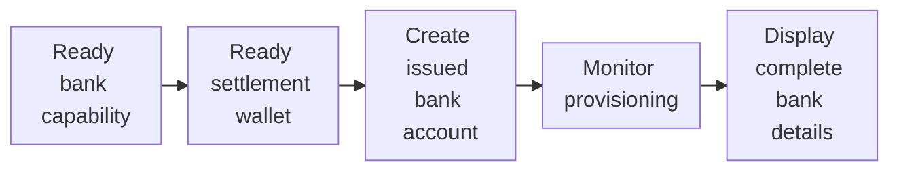

Use an issued bank account when the customer needs reusable bank details. For one-time funding instructions tied to a specific amount, use [Receive funds](/integration/receive-funds) instead.



## Before you start

You need a customer ID, a ready bank capability for the method and currency, and a ready issued wallet of the same customer. Complete open work through [Capabilities and tasks](/integration/onboarding/capabilities-and-requirements).

## 1. Create or select the settlement wallet

Create an issued wallet through [Accounts and wallets](/integration/accounts#create-the-account). Continue when its current status permits settlement.

Store its `data.id` as `SETTLEMENT_WALLET_ID`. Do not use an external wallet for `settlement.accountId`.

## 2. Create the issued bank account

Use [`POST /v3/customers/{customerId}/accounts`](/api-reference/accounts/post-v3-customers-by-customer-id-accounts) with these headers:

```http Request headers
X-API-Key: ${SWIPELUX_API_KEY}
Idempotency-Key: issued-bank-account-001
Content-Type: application/json
```

Send this request body:

```json Request body
{
  "origin": "issued",
  "type": "bank",
  "method": "ach",
  "country": "US",
  "currency": "USD",
  "settlement": {
    "accountId": "${SETTLEMENT_WALLET_ID}"
  },
  "label": "USD account"
}
```

Store the returned `data.id` as `BANK_ACCOUNT_ID`, and retain `data.status`, `data.openTaskIds`, `data.details`, and the settlement relationship.

Optional request fields:

| Field | Behavior |
| --- | --- |
| `institution` | Selects exactly this bank from the supported-capability response, with no fallback. |
| `allowPending` | Set to `true` to save the request before the bank approves the customer. Requires `institution`. |
| `settlement.currency` | `USDC` or `USDT`. Sets the stablecoin delivered to the settlement wallet. |

### Choose the bank

Send `institution` for details from a specific bank. Swipelux reserves one issued account per customer, method, currency, and institution. Without `institution`, a request returns `409 conflict` if the customer has such an account at any bank. With it, only an account at that bank conflicts.

For a non-USD SWIFT account, send the `institution` the [supported-capability response](/integration/onboarding/capabilities-and-requirements#discover-supported-capabilities) lists for that currency:

```json Request body for a EUR SWIFT account
{
  "origin": "issued",
  "type": "bank",
  "method": "swift",
  "country": "US",
  "currency": "EUR",
  "institution": "bmo",
  "settlement": {
    "accountId": "${SETTLEMENT_WALLET_ID}"
  },
  "label": "EUR SWIFT account"
}
```

A `sepa`, `faster_payments`, `ipp`, `fts`, `npp`, `spei`, `pix`, or `nip` request must name the institution its capability lists. Without it, `sepa`, `faster_payments`, and `ipp` return `422 account_institution_required`. Pix accounts use `pix_named` for customers resident in Brazil and `pix_pooled` for everyone else.

One AED IBAN receives IPP and FTS, and one bank approval covers `ipp_named` and `fts_named`. Request `ipp` or `fts`: the account returns `methods: ["ipp", "fts"]` and the requested `method`. A second AED request there returns `409 conflict` with `holder.accountId`. FTS only receives, so AED payouts use `ipp_named`.

An NGN `nip` account needs the customer's 11-digit BVN as a `bvn` tax identifier with country `NG`, on the customer or a task submission, or it returns `422 account_bvn_required`. Payouts need no BVN.

GBP `faster_payments`, AUD `npp`, and `pix_named` accounts accept pay-ins only from the customer's own bank account (`payin.senders: "account_holder"`). Other senders' payments are held for a `transaction_rfi` task, then credited or returned.

Account reads return the bank as `institution` with `id`, `name`, and a nullable `bic`.

Replaying the same request returns the original account. Changing `institution` under the same `Idempotency-Key` returns `409 idempotency_conflict`.

### Save the request before bank approval

By default, Swipelux accepts the request only once the bank capability is ready. To save it earlier, send `allowPending: true` with `institution`:

```json Request body with allowPending
{
  "origin": "issued",
  "type": "bank",
  "method": "wire",
  "country": "US",
  "currency": "USD",
  "institution": "${INSTITUTION_ID}",
  "allowPending": true,
  "settlement": {
    "accountId": "${SETTLEMENT_WALLET_ID}"
  },
  "label": "USD wire account"
}
```

While the bank's application is under review, the account returns `status: "in_review"` with `statusReason.code` set to `waiting_for_approval`, plus `applicationId` and `openTaskIds`. Complete those tasks through [Capabilities and tasks](/integration/onboarding/capabilities-and-requirements).

The saved request keeps its account ID, settlement wallet, and account slot. Once the application and capability are ready, Swipelux provisions details under the same `BANK_ACCOUNT_ID`.

Another `allowPending` request for the same slot under a different `Idempotency-Key` returns `409 conflict`. Read the account its `holder.accountId` names instead of retrying.

If the bank's application covers the capability without having requested it, an `allowPending` request returns `409 capability_not_ready` with `reason: no_ready_route` until the capability is `ready`.

If the application is rejected, canceled, or archived first, the account becomes `rejected` and frees the slot.

### Choose the settlement currency

By default, deposits settle in the settlement wallet's currency. Set `settlement.currency` to choose another stablecoin:

```json Request body with settlement currency
{
  "settlement": {
    "accountId": "${SETTLEMENT_WALLET_ID}",
    "currency": "USDT"
  }
}
```

`USDT` requires a `USD` account and a settlement wallet on a network with USDT delivery. Otherwise the request returns `400 invalid_settlement_target`. Account reads return the saved choice.

## 3. Monitor provisioning

Read [`GET /v3/customers/{customerId}/accounts/{accountId}`](/api-reference/accounts/get-v3-customers-by-customer-id-accounts-by-account-id) after creation and after each relevant webhook.

Keep the customer interface pending while `details` is absent. If `openTaskIds` is not empty, complete the tasks and refetch. Do not infer readiness from elapsed time.

If the latest `statusReason.code` is `awaiting_assignment`, create the first pay-in for the same customer, capability, and settlement wallet through [Receive funds](/integration/receive-funds), then read the bank account again.

## 4. Present bank details safely

Display only the complete details returned by the latest account read. When `details.referenceRequired` is true, show the exact `details.reference` and make it copyable. When it is false, do not invent a reference.

For issued `swift` accounts, display `details.bankName`, `details.swiftCode` (the receiving bank's BIC), `details.accountNumber`, `details.accountHolderName`, `details.accountHolderAddress`, `details.bankAddress`, and any intermediary bank fields returned. Senders must copy the beneficiary address exactly.

For other issued accounts, display `details.iban` and `details.bic` (`sepa`, `ipp`, `fts`), `details.sortCode` and `details.accountNumber` (`faster_payments`), `details.bsb` and `details.accountNumber` (`npp`), `details.clabe` (`spei`), `details.pixKey` and any `details.emv` (`pix`), or `details.nuban`, `details.bankName`, and `details.accountHolderName` (`nip`).

Do not replace these reusable details with a quoted pay-in's funding coordinates, which belong only to that transfer.

When an account's SWIFT code, routing number, or account number changes, Swipelux sends `account.details_changed`. Refetch and show the new `details`.

Next, add [Webhooks](/integration/webhooks) so provisioning updates reach your application without polling.
