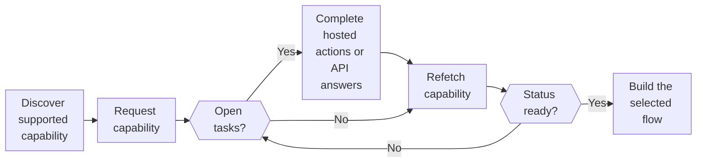

A capability tells you whether a customer can use a specific outcome, payment method, and direction. Open tasks tell you what must happen before that capability or a related resource can move forward.



```bash Environment variables
export API_BASE='https://platform.swipelux.com'
export SWIPELUX_API_KEY='replace-with-your-api-key'
```

## Discover supported capabilities

Read the customer's current options with [`GET /v3/customers/{customerId}/capabilities/supported`](/api-reference/capabilities/get-v3-customers-by-customer-id-capabilities-supported):

```bash List supported capabilities
curl --request GET \
  "${API_BASE}/v3/customers/${CUSTOMER_ID}/capabilities/supported" \
  --header "X-API-Key: ${SWIPELUX_API_KEY}"
```

Choose a response entry that matches the intended `directions`, `method`, and `accountType`. Continue only when `availability` is `available` or `beta` and `eligibility.eligible` is `true`. If `institutions` are returned, select only an ID from that response.

Each institution entry includes a `logoUrl` and an `isDefault` flag. Use `logoUrl` to show the bank's logo in a bank selection UI, and render your own generic bank icon when it is `null`. `isDefault` applies to this customer and capability only, not to the institution globally. [`GET /v3/institutions`](/api-reference/institutions/get-v3-institutions) returns the same nullable `logoUrl`. Institution IDs are opaque, so handle new IDs without code changes.

```json Institution entry
{
  "institutions": [
    {
      "id": "jpmorgan",
      "name": "JPMorgan Chase",
      "bic": "CHASUS33",
      "logoUrl": "https://wallet.swipelux.com/bank-logos/jpmorgan.png",
      "countries": ["US"],
      "isDefault": true
    }
  ]
}
```

Store the selected `data[].id` as `CAPABILITY_ID`. Never copy a capability ID from another customer or environment.

### Pooled vs named account types

Bank capabilities come in two variants, encoded as the `accountType` field and the capability ID suffix (for example `ach_pooled`, `wire_named`):

- **`pooled`**: shared Swipelux bank account. Each pay-in uses a unique reference to route funds. Pick this for one-time transfers.
- **`named`**: dedicated bank details for the customer (virtual IBAN, dedicated ACH account). Reusable and shareable with any payer. Required for [issued bank accounts](/integration/issue-bank-account).

Default to `pooled`. Use `named` only when the customer needs reusable bank details. Check the `supported` response for which variants are available.

To receive SWIFT deposits or issue SWIFT bank details, use `swift_named`. `swift_pooled` supports payouts only, so check each option's `directions` in the supported-capability response. A named SWIFT account returns reusable receiving details, including the bank's BIC, a reference when one is required, and the beneficiary address when the bank supplies it.

For issued ACH, Wire, and SWIFT accounts, you can pick an exact bank with `institution` and save the account request before the bank approves the customer. See [Issue a bank account](/integration/issue-bank-account#choose-the-bank).

## Request the capability

Request the selected option with [`POST /v3/customers/{customerId}/capabilities/{capabilityId}`](/api-reference/capabilities/post-v3-customers-by-customer-id-capabilities-by-capability-id):

```bash Request capability
curl --request POST \
  "${API_BASE}/v3/customers/${CUSTOMER_ID}/capabilities/${CAPABILITY_ID}" \
  --header "X-API-Key: ${SWIPELUX_API_KEY}" \
  --header "Idempotency-Key: capability-request-001" \
  --header "Content-Type: application/json" \
  --data '{}'
```

Use an explicit `institutions` array only when you need to select from IDs returned by the supported-capability response.

Store `data.status` as `CAPABILITY_STATUS`, `data.accountProvisioning` as `ACCOUNT_PROVISIONING_STATUS`, `data.openTaskIds` as `OPEN_TASK_IDS`, and each `data.applications[].id` in `APPLICATION_IDS`.

### Shared applications per bank

For named bank capabilities, each customer has one application case per bank. Pooled and platform capabilities use cases without a bank. Swipelux shares a case across every compatible capability you request:

- One approval can cover several capabilities. For example, an approved case at one bank can make both an ACH and a wire capability `ready`.
- A later request that matches an existing case reuses it. Swipelux opens no second application and adds no duplicate tasks.
- Cases at different banks are independent. A rejection at one bank does not affect a case at another bank.

The request response tells you which case Swipelux used:

- `201` means the request opened a new application case.
- `200` means the request resolved to an application case the customer already had, for example a repeated request for a bank capability the customer already holds, or a request for a canceled capability. A repeated request for `card` or `stablecoin_transfers` still returns [`409 capability_already_exists`](/integration/errors#capability-already-exists).
- `selectedApplicationId` is a top-level field next to `data` with the ID of the case the request selected or opened. Swipelux omits it when the request did not select a case. An idempotent replay returns the same value.

Abbreviated response:

```json Response (abbreviated)
{
  "data": {
    "id": "ach_named",
    "status": "pending",
    "openTaskIds": ["tsk_000000000000000002"],
    "applications": [{ "id": "apl_000000000000000005", "status": "in_review" }]
  },
  "selectedApplicationId": "apl_000000000000000005"
}
```

For named capabilities, send the same `institutions` list again to select the same case, or send one institution ID to target that bank. A bank that terminally rejected the customer is skipped. When you name only that bank, or every eligible bank has rejected the customer, the request returns [`409 capability_terminally_rejected`](/integration/errors#capability-terminally-rejected). To try another bank after a rejection, request the capability again with that bank's institution ID.

A capability's status reflects all of the customer's related cases. For a named capability, one `ready` case whose approval covers it is enough to make it `ready`, whatever other banks report. A pooled capability also waits for its method check, reported in `probes` on the customer applications list.

#### List the customer's applications

List every application case for the customer with [`GET /v3/customers/{customerId}/applications`](/api-reference/capabilities/get-v3-customers-by-customer-id-applications). Results are paginated with `nextCursor` and `hasMore`, and accept `updatedAfter`:

```bash List applications
curl --request GET \
  "${API_BASE}/v3/customers/${CUSTOMER_ID}/applications" \
  --header "X-API-Key: ${SWIPELUX_API_KEY}"
```

Each entry includes the application fields returned in a capability's `applications[]`, plus:

- `scope`: `named` for a case at one bank, `provider_pooled` or `platform` for cases without a bank, or `null` for an unclassified historical case. `institution` is absent for `provider_pooled` and `platform` cases.
- `requestedScope[]`: the capability keys requested against the case, each with its first `requestedAt`. Entries are never removed.
- `coverage[]`: the capability keys the case's approval covers, each with `grantedAt` and `source`. Coverage records scope, not authorization. Read the capability for its current status.
- `probes[]`: method checks for the pooled capability keys the case covers, each with `capabilityKey`, `status`, and `reason`. Named keys never require a probe.
- `generation`, `predecessorApplicationId`, and `supersededByApplicationId`: succession links. When `supersededByApplicationId` is set, the case was replaced. Follow that ID to the current case. A capability's `applications[]` lists only current cases, so a replaced case appears only in this list.

Abbreviated response:

```json Response (abbreviated)
{
  "data": [
    {
      "id": "apl_000000000000000005",
      "status": "ready",
      "scope": "named",
      "institution": { "id": "jpmorgan", "name": "JPMorgan Chase", "bic": "CHASUS33" },
      "requestedScope": [
        { "capabilityKey": "ach_named", "requestedAt": "2026-09-20T10:00:00.000Z" }
      ],
      "coverage": [
        { "capabilityKey": "ach_named", "grantedAt": "2026-09-22T12:00:00.000Z", "source": "approval" },
        { "capabilityKey": "wire_named", "grantedAt": "2026-09-22T12:00:00.000Z", "source": "approval" }
      ],
      "probes": [],
      "generation": 1,
      "predecessorApplicationId": null,
      "supersededByApplicationId": null
    }
  ],
  "nextCursor": null,
  "hasMore": false
}
```

## Complete current tasks

List tasks with [`GET /v3/customers/{customerId}/tasks`](/api-reference/tasks/list-customer-tasks), select IDs from `OPEN_TASK_IDS`, then read each current task with [`GET /v3/customers/{customerId}/tasks/{taskId}`](/api-reference/tasks/get-customer-task):

```bash List open tasks
curl --request GET \
  "${API_BASE}/v3/customers/${CUSTOMER_ID}/tasks/${TASK_ID}" \
  --header "X-API-Key: ${SWIPELUX_API_KEY}"
```

Use the latest `data.revision` and `data.requirements`. Refetch the task immediately before submitting if either may have changed.

### Reused profile evidence

For application intake tasks that accept direct API submission, Swipelux reuses information the customer already provided. When such a task is created or reconciled, Swipelux checks the customer profile and the customer's own uploaded documents. Eligible requirements already backed by a usable profile value or document move to `in_review` instead of staying actionable. Profile updates and new document uploads trigger the same check for existing tasks.

Only missing or incompatible values stay actionable. Reuse does not approve the evidence. Swipelux still reviews it. Explicit correction requests and previously answered requirements stay actionable. Owner and related-party documents are not reused, and requirements collected only through a hosted session keep their normal flow.

### Render requirements

Build forms from the metadata each requirement returns rather than from requirement keys. A requirement can include an optional short `title`, and every `request` includes a `prompt` to show beneath the heading.

Requirements with `request.type: "profile"` identify the profile field with `profilePointer` and add input metadata:

- `allowedValues`: the permitted values for a scalar field, or for each item of an array field. Submit these values, not translated display labels.
- `valueSchema`: a self-contained JSON Schema Draft 7 document that describes the input shape, nested properties, required fields, and structural constraints. Enums on objects appear on the relevant property, for example `valueSchema.items.properties.type.enum` for tax identifiers. Swipelux still applies cross-field and review validation after submission, so a value that passes the schema can still be rejected.
- `valueType: "country"`, or `itemValueType: "country"` for arrays: the field takes uppercase ISO 3166-1 alpha-2 codes. Nested country properties in `valueSchema` use `format: "iso-3166-1-alpha-2"`. Use a standard country list for localized labels.

```json Requirement
{
  "id": "req_000000000000000010",
  "key": "account_purposes",
  "title": "Account purpose",
  "status": "action_required",
  "request": {
    "type": "profile",
    "prompt": "Select every purpose that applies.",
    "required": true,
    "profilePointer": "/financialProfile/accountPurposes",
    "valueType": "array",
    "itemValueType": "string",
    "allowedValues": ["business_expenses", "ecommerce", "payroll"],
    "valueSchema": {
      "$schema": "http://json-schema.org/draft-07/schema#",
      "type": "array",
      "items": { "enum": ["business_expenses", "ecommerce", "payroll"] }
    }
  }
}
```

This example shortens the value catalog; the API returns every permitted value. Some profile requirements have no published schema and omit `valueSchema` and `allowedValues`. Render those from `prompt` and `valueType`.

Every open task includes a `dueAt` timestamp. When Swipelux authors a task without an explicit due date, `dueAt` defaults to exactly 31 days after the task's `createdAt`. Treat `dueAt` as informational: you cannot set it through the API, and it does not trigger an automatic lifecycle transition. Only the separate `deadline` field, when present, causes an automatic transition.

### Hosted actions

In the task-detail response, each entry in `verificationSessions` and `tosSessions` includes an `action` object. Task-list responses do not include these action links. Store each session `id`, then read `action.kind` before dispatching the customer; do not infer link availability from session `status`.

- `action.kind: "available"` includes `action.url` and `action.expiresAt` (currently always `null`). Store `action.url`, send the customer to it, then read the task again. The session-level `url` and `expiresAt` fields contain the same values.
- `action.kind: "unavailable"` means no link should be presented. The session-level `url` and `expiresAt` fields are absent. A session's `status` alone does not determine which action kind you receive.

```json Verification session
{
  "data": {
    "verificationSessions": [
      {
        "id": "vfy_000000000000000003",
        "key": "identity_verification",
        "type": "identity_verification",
        "status": "action_required",
        "action": {
          "kind": "available",
          "url": "https://platform.swipelux.com/kyc/redirect/cus_000000000000000001/tsk_000000000000000002/vfy_000000000000000003",
          "expiresAt": null
        },
        "url": "https://platform.swipelux.com/kyc/redirect/cus_000000000000000001/tsk_000000000000000002/vfy_000000000000000003",
        "expiresAt": null
      }
    ],
    "tosSessions": [
      {
        "id": "vfy_000000000000000004",
        "key": "terms_of_service",
        "type": "terms_of_service",
        "status": "completed",
        "action": { "kind": "unavailable" }
      }
    ]
  }
}
```

These are task-scoped actions, not a separate customer-verification lifecycle.

A hosted answer to a profile requirement for a structured value, such as an address or tax identifiers, must pass the same schema and constraint checks as a direct answer. When it does not, the requirement stays open. A requirement that Swipelux returns to `action_required` for this reason carries `reviewFeedback.code: hosted_profile_direct_submission_required`. Collect that value from the customer and submit it as an [API answer](#api-answers).

### Upload documents

When a requirement requests a document, upload it with [`POST /v3/customers/{customerId}/documents`](/api-reference/documents/post-v3-customers-by-customer-id-documents):

```bash Upload document
export DOCUMENT_PATH='/absolute/path/to/requested-document.pdf'

curl --request POST \
  "${API_BASE}/v3/customers/${CUSTOMER_ID}/documents" \
  --header "X-API-Key: ${SWIPELUX_API_KEY}" \
  --header "Idempotency-Key: customer-document-001" \
  --form "file=@${DOCUMENT_PATH}"
```

Store the returned `data.id` as `DOCUMENT_ID` before submitting the answer that references it.

Every v3 document resource includes `contentSha256`, the SHA-256 digest of the stored file as `sha256:<hex>`. Two documents with the same digest are byte-identical. To detect that the customer is uploading the same file Swipelux already rejected, hash the file before you upload it and compare the result with `contentSha256` on the rejected document. The field is `null` for documents stored before Swipelux recorded digests.

To retrieve a stored file later, call [`GET /v3/customers/{customerId}/documents/{documentId}/download`](/api-reference/documents/get-v3-customers-by-customer-id-documents-by-document-id-download). Swipelux returns a `url` that downloads the file as an attachment and expires after one hour. Archived documents return `404`.

### API answers

Submit one complete answer set for the current revision with [`POST /v3/customers/{customerId}/tasks/{taskId}/submissions`](/api-reference/task-submissions/create-customer-task-submission):

```bash Submit task answers
curl --request POST \
  "${API_BASE}/v3/customers/${CUSTOMER_ID}/tasks/${TASK_ID}/submissions" \
  --header "X-API-Key: ${SWIPELUX_API_KEY}" \
  --header "Idempotency-Key: task-submission-001" \
  --header "Content-Type: application/json" \
  --data @- <<'JSON'
{
  "taskRevision": 3,
  "answers": [
    {
      "requirementId": "req_from_current_task",
      "answer": {
        "type": "text",
        "value": "Current answer"
      }
    }
  ]
}
JSON
```

Take every requirement ID and answer type from the latest task. If the API reports that the task changed, refetch it and rebuild the submission from the new revision.

#### Keep valid answers with `allowPartial`

By default, one invalid answer fails the whole request with `400` and Swipelux stores nothing. Add `"allowPartial": true` when you want Swipelux to store the valid answers and refuse only the invalid ones:

```json Partial submission request
{
  "taskRevision": 3,
  "allowPartial": true,
  "answers": [
    { "requirementId": "req_a", "answer": { "type": "text", "value": "Salary" } },
    { "requirementId": "req_b", "answer": { "type": "document", "documentIds": ["doc_unknown"] } }
  ]
}
```

Swipelux returns `201` with the stored submission in `data`, holding only the kept answers, and lists the others in `refusedAnswers`:

```json Partial submission response
{
  "data": { "id": "sub_000000000000000001", "outcome": "in_review", "answers": [{ "requirementId": "req_a" }] },
  "refusedAnswers": [
    {
      "requirementId": "req_b",
      "code": "invalid_document_reference",
      "pointer": "/answers/1/answer",
      "message": "A referenced document is invalid."
    }
  ]
}
```

Each refused answer has one of these codes:

| `code` | Meaning |
| --- | --- |
| `invalid` | The answer does not meet the request's shape, format, or constraints, or the customer profile does not accept the value. |
| `absence_conflicts_with_profile` | An absence was sent for a value the profile holds. |
| `invalid_document_reference` | A referenced document cannot be used for this customer and request. |
| `depends_on_refused_answer` | The answer is valid on its own but is judged together with a refused one. A conditional answer and the answer that controls it are kept or refused together. |

More codes can be added. Treat an unknown code as `invalid`. `message` never repeats the submitted value.

`allowPartial` does not relax the other rules:

- The request must still answer every requirement it would have to answer without the field. Unanswered open requirements still return `422 task_submission_incomplete`.
- A body that fails the request schema itself, such as an unknown field or a wrong type, still returns `400 validation_error`.
- When no answer can be kept, Swipelux returns `400 validation_error`, stores nothing, and lists every refused answer in `errors[]`.
- `refusedAnswers` is present, possibly empty, exactly when the request sent `"allowPartial": true`. A replay with the same `Idempotency-Key` returns the same `refusedAnswers`.

Before you correct a refused answer, read the task again. A refused requirement is normally still `action_required`, but a document request can already be answered by a file on record. Submit the corrections with the new `taskRevision` and a fresh `Idempotency-Key`. Send a conditional answer together with its controlling answer.

#### Withdraw a submission awaiting review

To correct a submission that is still `in_review`, take it back with `POST /v3/customers/{customerId}/tasks/{taskId}/withdrawals`. The request has no body and needs an `Idempotency-Key`:

```bash Withdraw task submission
curl --request POST \
  "${API_BASE}/v3/customers/${CUSTOMER_ID}/tasks/${TASK_ID}/withdrawals" \
  --header "X-API-Key: ${SWIPELUX_API_KEY}" \
  --header "Idempotency-Key: task-withdrawal-001"
```

Swipelux returns `200` with the submission in `data`. Its `outcome` becomes `withdrawn`, its answers return to `action_required` without `reviewFeedback`, and the next submission starts a new `remediationRound`. Requirements already accepted and the customer profile stay unchanged. You can withdraw as many times as you need. Read the task again, then submit corrected answers.

Swipelux refuses a withdrawal in these cases:

- `404 task_not_found`: the task does not exist for this customer.
- `409 task_not_in_review`: no submission awaits review, or the task is past its deadline.
- `409 submission_already_forwarded`: a provider reviews the task or already holds the submission.

Submission `outcome` can now be `withdrawn`. Accept it, and any other value your client does not recognize, when you read submissions.

### Beneficial-owner prerequisite for businesses

Requesting a business capability that needs beneficial-owner evidence succeeds even when the customer has no qualifying owner yet. The capability is created as `restricted` with `statusReason.code: tasks_due`, and the business intake task requests the missing ownership facts, including the ownership structure.

The same task carries a `resource_reference` requirement whose request includes `qualification: "beneficial_owner"`:

```json Beneficial owner requirement
{
  "type": "resource_reference",
  "prompt": "Add or select a qualifying beneficial owner.",
  "required": true,
  "resourceType": "related_party",
  "qualification": "beneficial_owner"
}
```

A related party qualifies when it is an active `person` party of the same customer with a supplied ownership percentage of at least 25, or with `ownership.declared: true` and no percentage.

The requirement is derived from the current related-party roster, so you usually do not answer it directly:

- Creating or updating a qualifying related party meets the requirement in the same reevaluation and opens that owner's own profile and document work. See [Add business related parties](/integration/onboarding/customers#add-business-related-parties).
- You can also reference a qualifying party explicitly with a `resource_reference` answer that carries its `relatedPartyId`.
- The requirement stays listed in the current task after it is met. When no other obligation remains open, the task becomes `satisfied`.
- Archiving the last qualifying party, or removing the facts that qualified it, reopens the requirement, even after the task was `satisfied`.

## Continue when the capability is ready

Read the capability again with [`GET /v3/customers/{customerId}/capabilities/{capabilityId}`](/api-reference/capabilities/get-v3-customers-by-customer-id-capabilities-by-capability-id):

```bash Refetch capability
curl --request GET \
  "${API_BASE}/v3/customers/${CUSTOMER_ID}/capabilities/${CAPABILITY_ID}" \
  --header "X-API-Key: ${SWIPELUX_API_KEY}"
```

Replace the stored status, account-provisioning status, and task IDs with the latest response. Capability `status` reports whether the entitlement is approved. For a capability that issues an account, `accountProvisioning` separately reports whether that account is `not_started`, `in_progress`, `issued`, or `failed`; a capability that does not issue an account returns `not_applicable`.

While the capability is `pending`, two of the `statusReason.code` values it can report show whether a review is underway. `preparing_submission` means Swipelux is still preparing an application for submission and no review is underway, even if another bank's application is `rejected` or needs attention. `review_in_progress` means a review is underway, for example while an application is `in_review` or a [hosted verification](#hosted-actions) is open. Both use `resolution: wait`. A change between these codes keeps the status `pending`, so it sends no `capability.status_changed` event. Read the capability to see the current code.

Continue only when the current capability status permits the account, quote, or transfer you intend to create. When the flow needs an issued account, also wait for `accountProvisioning` to become `issued`.

Next, choose the matching journey in [Common flows](/integration/common-flows).
