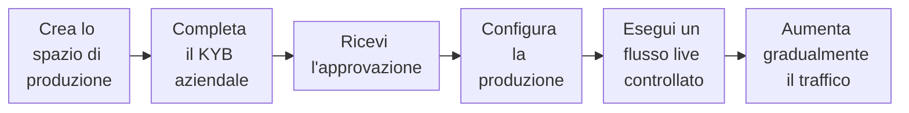

L'attivazione della produzione verifica il tuo business integratore. È separata dai customer API che crei per il tuo prodotto.

## Attiva il tuo spazio di produzione {#activate-your-production-space}

1. Accedi alla Swipelux Dashboard e seleziona **Create a production space**.
2. Apri la tab KYB o vai a [Business verification](https://www.swipelux.app/kyb).
3. Completa ogni campo richiesto e carica i documenti richiesti.
4. Invia il tuo business integratore per la verifica e attendi l'approvazione.

Solo dopo l'approvazione del KYB del tuo business integratore potrai creare customer e transazioni API in produzione.

In uno spazio live che richiede il KYB, Swipelux restituisce `422` [`merchant_kyb_not_approved`](/integration/errors#merchant-kyb-not-approved) per ogni richiesta di scrittura al di fuori della verifica aziendale e della gestione dei webhook fino all'approvazione. Ciò include customer, capability, conti, recipient, regole, quote e transfer.

Mentre attendi l'approvazione, puoi comunque:

- Inviare richieste `GET` e `HEAD`.
- Completare la verifica del tuo business (profilo, parti correlate, documenti e invii dei task per il customer KYB del tuo business).
- Gestire gli endpoint webhook tramite l'API e gestire secret key, spazi e commissioni dei rail nella dashboard.

Le impostazioni hanno dei limiti fino all'approvazione:

- Puoi effettuare in totale 20 modifiche dell'URL dei webhook all'ora, su tutti gli endpoint dei tuoi spazi live che richiedono il KYB. Le modifiche negli spazi sandbox non vengono conteggiate. Il superamento del limite sulle modifiche dell'URL dei webhook restituisce `422 merchant_kyb_not_approved` da `POST /v3/webhooks` o `PATCH /v3/webhooks/{webhookId}`.
- Nella dashboard puoi avere fino a 10 chiavi API attive per ogni spazio live che richiede il KYB.
- Nella dashboard puoi avere fino a 5 spazi per merchant mentre hai almeno uno spazio live, tutti i tuoi spazi live richiedono il KYB e nessuno è approvato. Il conteggio include sia gli spazi sandbox sia quelli live. Se uno qualsiasi degli spazi live non richiede il KYB, questo limite sugli spazi non si applica.

La dashboard rifiuta le richieste che superano il limite sulle chiavi o sugli spazi con una semplice risposta `422`, senza il codice `merchant_kyb_not_approved`. Modificare solo gli eventi di un endpoint, o salvarne l'URL attuale, non conta come modifica dell'URL. Le chiavi API revocate non vengono conteggiate nel limite sulle chiavi.

Gli spazi sandbox sono esenti dal blocco delle scritture, dal limite sulle modifiche dell'URL dei webhook e dal limite sulle chiavi, quindi puoi continuare a sviluppare e testare lì. Vengono comunque conteggiati nel limite sugli spazi del merchant.

## Mantieni la produzione indipendente

Crea le risorse di produzione in modo esplicito. Cambiare una chiave API non migra lo stato del sandbox.

- Conserva le credenziali di produzione in una voce separata del secret manager.
- Usa configurazione di deployment e ID di risorsa specifici per produzione.
- Registra un endpoint webhook e signing secret di produzione separati.
- Ricrea in produzione i customer, le capability, i conti, i recipient e le destination necessari.
- Limita l'accesso di produzione ai servizi e agli operatori che ne hanno bisogno.

Sandbox e produzione usano `https://platform.swipelux.com`; la chiave API seleziona l'ambiente.

## Completa la checklist di lancio

- [ ] Testa il percorso happy e i percorsi di errore previsti in sandbox.
- [ ] Invia un `Idempotency-Key` con ogni scrittura che lo richiede e conservalo per retry sicuri.
- [ ] Verifica le firme dei webhook prima di parsare, persisti gli ID evento in modo durevole e testa il replay.
- [ ] Gestisci capability non disponibili, task aperti e revisioni dei task modificate.
- [ ] Gestisci gli [errori API e i retry](/integration/errors) documentati, inclusi i retry idempotenti con la chiave originale.
- [ ] Espone ai tuoi operatori i fallimenti dei transfer e le istruzioni azionabili.
- [ ] Conferma che i log conservino `X-Request-Id` o `correlationId` senza esporre segreti o dati finanziari sensibili.

## Esegui un flusso live controllato

Inizia con un cliente noto e una singola transazione di basso valore. Registra:

| Controllo | Definisci prima del test |
| --- | --- |
| Scope | Cliente, capability, conto o destination, importo e metodo. |
| Risultato atteso | Stato dell'API, saldo o istruzioni ed evento webhook che ti aspetti di osservare. |
| Owner | Persona responsabile del monitoraggio del flusso completo. |
| Condizione di stop | Qualsiasi stato inatteso, webhook mancante, importo errato o task irrisolto. |

Verifica sia la risorsa API corrente sia la consegna webhook autenticata. Se una delle due differisce dal risultato atteso, fermati e indaga prima di inviare altro traffico.

Dopo che il flusso completo ha successo, aumenta il volume gradualmente monitorando gli stati di capability, conto, destination e transfer.

Torna a [Flussi comuni](/it/integration/common-flows) per il percorso di prodotto, rivedi [Errori e nuovi tentativi](/integration/errors) per la gestione dei fallimenti, o usa la [API Reference](/it/api-reference/introduction) per i contratti esatti.
