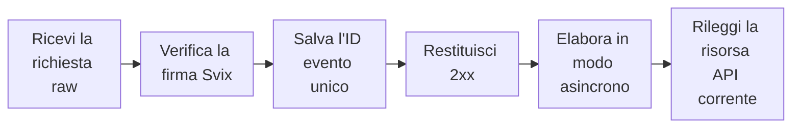

Usa i webhook per reagire ai cambiamenti asincroni. La consegna è at-least-once, quindi eventi duplicati, in ritardo e fuori ordine sono normali.



## Registra solo gli eventi di cui hai bisogno

Crea un endpoint con [`POST /v3/webhooks`](/api-reference/webhooks/post-v3-webhooks). Iscriviti solo agli eventi documentati che guidano la tua integrazione. Questo esempio usa [`transfer.state_changed`](/api-reference/webhooks/transfer-state-changed).

```bash Create webhook endpoint
export API_BASE='https://platform.swipelux.com'
export SWIPELUX_API_KEY='replace-with-your-api-key'

curl --request POST \
  "${API_BASE}/v3/webhooks" \
  --header "X-API-Key: ${SWIPELUX_API_KEY}" \
  --header "Idempotency-Key: webhook-endpoint-001" \
  --header "Content-Type: application/json" \
  --data @- <<'JSON'
{
  "url": "https://example.com/webhooks/swipelux",
  "events": ["transfer.state_changed"]
}
JSON
```

Salva il `data.id` della risposta come `WEBHOOK_ID`. Richiedi un URL del portale a [`GET /v3/webhooks/portal`](/api-reference/webhooks/get-v3-webhooks-portal) con una chiave API che ha `webhooks:write`, recupera il signing secret di questo endpoint e conservalo separatamente dalla chiave API in un secret manager. L'URL del portale concede l'accesso da solo e scade dopo un'ora, quindi richiedine uno nuovo ogni volta e non salvarlo né condividerlo.

Il portale raggruppa gli eventi v3 per risorsa: Customers, Capabilities, Accounts, Recipients, Transfers e API. Ogni evento mostra il proprio schema di payload e un esempio. Gli eventi legacy sono contrassegnati come deprecati ed elencati in un gruppo Legacy separato. Se il tuo endpoint è già iscritto a un evento legacy, continua a riceverlo. Scegli nomi di evento v3 per le nuove iscrizioni.

## Modifica gli eventi di un endpoint {#change-an-endpoints-events}

Leggi un endpoint con [`GET /v3/webhooks/{webhookId}`](/api-reference/webhooks/get-v3-webhooks-by-webhook-id). La risposta ha la stessa struttura `events` di [`GET /v3/webhooks`](/api-reference/webhooks/get-v3-webhooks). Non include mai il signing secret. Le letture richiedono `webhooks:read` e restituiscono `404 not_found` per un ID endpoint sconosciuto.

Aggiorna l'endpoint con [`PATCH /v3/webhooks/{webhookId}`](/api-reference/webhooks/patch-v3-webhooks-by-webhook-id). Invia un header `Idempotency-Key`. Gli aggiornamenti richiedono `webhooks:write`.

- Invia solo `events` per mantenere l'URL corrente.
- Invia solo `url` per mantenere la selezione di eventi corrente.
- `events` sostituisce l'intera selezione. Leggi prima l'endpoint e includi ogni evento di cui hai ancora bisogno.
- Le nuove iscrizioni devono usare nomi di evento v3.
- Puoi mantenere un nome di evento legacy se l'endpoint è già iscritto a quell'evento. L'aggiunta di un nuovo nome legacy restituisce `400 validation_error`.

Finché il KYB della tua azienda integratrice non viene approvato, le creazioni di endpoint e le modifiche dell'URL sono limitate. Vedi [Go live](/it/integration/go-live#daily-creation-limits).

Questo body mantiene l'URL e sostituisce la selezione:

```json Request body
{
  "events": ["transfer.state_changed", "capability.status_changed"]
}
```

## Usa un URL di destinazione pubblico {#use-a-public-destination-url}

Il salvataggio di un URL restituisce `400 validation_error` se uno qualsiasi degli indirizzi in cui si risolve il suo nome host è privato, di loopback, link-local, riservato o multicast, se il nome host non si risolve, oppure se è `localhost`, un nome a etichetta singola o termina con `.localhost`, `.local`, `.localdomain`, `.internal` o `.home.arpa`.

Swipelux ricontrolla ogni giorno gli URL salvati e mette in pausa un endpoint il cui nome host o indirizzo ora viene rifiutato (`disabled: true`). Per riattivarlo, invia un `url` valido con `disabled: false`.

## Verifica prima di parsare

Swipelux consegna le nuove integrazioni webhook tramite Svix. Verifica il body grezzo della richiesta con il signing secret dell'endpoint e questi header:

- `svix-id`
- `svix-timestamp`
- `svix-signature`

Non parsare JSON o causare side effect prima che la verifica abbia successo.

<CodeGroup>

```javascript JavaScript
import { Webhook } from "svix";

const verifier = new Webhook(process.env.SWIPELUX_WEBHOOK_SECRET);

export async function handleSwipeluxWebhook(request) {
  const rawBody = await request.text();
  verifier.verify(rawBody, {
    "svix-id": request.headers.get("svix-id"),
    "svix-timestamp": request.headers.get("svix-timestamp"),
    "svix-signature": request.headers.get("svix-signature"),
  });
  const event = JSON.parse(rawBody);

  await webhookInbox.insertIfAbsent({
    id: event.id,
    payload: event,
    status: "pending",
  });

  return new Response(null, { status: 204 });
}
```

```java Java
import com.svix.Webhook;
import com.svix.exceptions.WebhookVerificationException;
import java.util.List;
import java.util.Map;

class SwipeluxSignature {
  // Pass the unmodified request body and every request header.
  static boolean valid(String secret, String rawBody, Map<String, List<String>> headers) throws Exception {
    try {
      new Webhook(secret).verify(rawBody, headers);
      return true;
    } catch (WebhookVerificationException e) {
      return false;
    }
  }
}
```

</CodeGroup>

Rifiuta le richieste con firme mancanti o non valide. Mantieni disponibile il body grezzo finché la verifica non è completa.

## Persisti, conferma e poi processa

Imposta un vincolo di univocità sull'`id` dell'envelope. Persisti l'envelope verificato, restituisci `2xx` prontamente, poi processalo in modo asincrono.

Se l'ID evento esiste già, conferma la consegna senza ripetere side effect già completati. Riprendi il lavoro locale pending o fallito tramite la tua coda di retry. Non usare il campo `attempt` dell'envelope come chiave di deduplicazione o come contatore di retry di trasporto.

## Rileggi lo stato corrente

L'ordine dei webhook non è una cronologia autorevole della risorsa. Usa `resource.type` e `resource.id` per localizzare l'oggetto, poi recupera il suo stato corrente prima di aggiornare il tuo sistema.

Per un evento di transfer, chiama [`GET /v3/transfers/{transferId}`](/api-reference/money-movement/get-v3-transfers-by-transfer-id):

```bash Refetch transfer
curl --request GET \
  "${API_BASE}/v3/transfers/${TRANSFER_ID}" \
  --header "X-API-Key: ${SWIPELUX_API_KEY}"
```

Guida lo stato visibile al cliente e le azioni downstream dalla risposta API corrente. Progetta i side effect in modo che restino sicuri se due worker processano eventi correlati in ordine diverso.

## Recupera le consegne {#recover-deliveries}

Usa [`GET /v3/webhooks/portal`](/api-reference/webhooks/get-v3-webhooks-portal) per aprire i log di consegna. Con `webhooks:write` puoi anche ritentare le consegne fallite o avviare un replay manuale. Una chiave con il solo `webhooks:read` apre un portale che mostra le consegne ma non può ritentarle, riprodurle né rivelare i signing secret.

Ogni replay deve passare per la stessa verifica di firma e per la stessa inbox durevole. Per recuperare dopo un downtime, ripeti la finestra interessata e rileggi ogni risorsa referenziata. Gli ID evento completati restano no-op; i record incompleti riprendono in modo asincrono.

Successivamente, verifica in sandbox le consegne duplicate e fuori ordine, poi completa la checklist [Go live](/it/integration/go-live).
