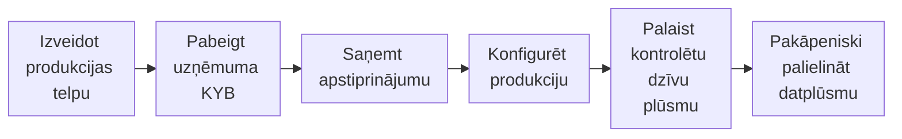

Produkcijas aktivizēšana verificē jūsu integrējošo uzņēmumu. Tā ir atsevišķa no API klientiem, ko izveidojat savam produktam.

## Aktivizējiet savu produkcijas telpu {#activate-your-production-space}

1. Pierakstieties Swipelux vadības panelī un izvēlieties **Izveidot produkcijas telpu**.
2. Atveriet KYB cilni vai dodieties uz [Uzņēmuma verifikāciju](https://www.swipelux.app/kyb).
3. Aizpildiet katru pieprasīto lauku un augšupielādējiet nepieciešamos dokumentus.
4. Iesniedziet savu integrējošo uzņēmumu verifikācijai un gaidiet apstiprinājumu.

Tikai pēc tam, kad jūsu integrējošā uzņēmuma KYB ir apstiprināts, varēsiet izveidot produkcijas API klientus un darījumus.

Dzīvajā telpā, kurai nepieciešams KYB, Swipelux līdz apstiprināšanai atgriež `422` [`merchant_kyb_not_approved`](/integration/errors#merchant-kyb-not-approved) katram rakstīšanas pieprasījumam ārpus uzņēmuma verifikācijas un webhook pārvaldības. Tas ietver klientus, iespējas, kontus, saņēmējus, noteikumus, kotējumus un pārskaitījumus.

Kamēr gaidāt apstiprinājumu, jūs joprojām varat:

- Sūtīt `GET` un `HEAD` pieprasījumus.
- Pabeigt sava uzņēmuma verifikāciju (profils, saistītās personas, dokumenti un uzdevumu iesniegumi jūsu uzņēmuma KYB klientam).
- Pārvaldīt webhook galapunktus caur API, kā arī pārvaldīt slepenās atslēgas, telpas un maksājumu kanālu komisijas vadības panelī.

Līdz apstiprināšanai iestatījumiem ir ierobežojumi:

- Varat veikt kopā 20 webhook URL izmaiņas stundā visos galapunktos jūsu dzīvajās telpās, kurām nepieciešams KYB. Izmaiņas smilšu kastes telpās netiek skaitītas. Webhook URL ierobežojuma pārsniegšana atgriež `422 merchant_kyb_not_approved` no `POST /v3/webhooks` vai `PATCH /v3/webhooks/{webhookId}`.
- Vadības panelī varat izveidot līdz 10 aktīvām API atslēgām katrā dzīvajā telpā, kurai nepieciešams KYB.
- Vadības panelī varat izveidot līdz 5 telpām vienam tirgotājam, kamēr jums ir vismaz viena dzīvā telpa, visām jūsu dzīvajām telpām nepieciešams KYB un neviena nav apstiprināta. Tiek skaitītas gan smilšu kastes, gan dzīvās telpas. Ja kādai dzīvajai telpai KYB nav nepieciešams, šis telpu ierobežojums netiek piemērots.

Vadības panelis atsaka pieprasījumus, kas pārsniedz atslēgu vai telpu ierobežojumu, ar vienkāršu `422` atbildi bez `merchant_kyb_not_approved` koda. Tikai galapunkta notikumu maiņa vai tā pašreizējā URL saglabāšana netiek uzskatīta par URL izmaiņu. Atsauktas API atslēgas netiek skaitītas atslēgu ierobežojumā.

Smilšu kastes telpām neattiecas rakstīšanas bloķēšana, webhook URL ierobežojums un atslēgu ierobežojums, tāpēc tajās varat turpināt izstrādi un testēšanu. Tās joprojām tiek skaitītas tirgotāja telpu ierobežojumā.

## Uzturiet produkciju neatkarīgu

Izveidojiet produkcijas resursus skaidri. API atslēgas maiņa nepārmet smilšu kastes stāvokli. Smilšu kastes atslēga nevar piekļūt produkcijas resursiem. Skatiet [Atslēgas tvērums](/lv/integration/authentication#key-scope).

- Glabājiet produkcijas akreditācijas datus atsevišķā noslēpumu pārvaldnieka ierakstā.
- Izmantojiet tikai produkcijai paredzētu izvietošanas konfigurāciju un resursu ID.
- Reģistrējiet atsevišķu produkcijas webhook galapunktu un parakstīšanas noslēpumu.
- No jauna izveidojiet nepieciešamos klientus, iespējas, kontus, saņēmējus un galamērķus produkcijā.
- Ierobežojiet produkcijas piekļuvi tikai tiem pakalpojumiem un operatoriem, kuriem tā nepieciešama.

Smilšu kaste un produkcija izmanto `https://platform.swipelux.com`; vidi izvēlas API atslēga.

## Pabeidziet uzsākšanas kontrolsarakstu

- [ ] Testējiet veiksmīgo ceļu un paredzamos kļūmju ceļus smilšu kastē.
- [ ] Nosūtiet `Idempotency-Key` ar katru ierakstu, kas to prasa, un saglabājiet to drošai atkārtošanai.
- [ ] Pārbaudiet webhook parakstus pirms parsēšanas, saglabājiet notikumu ID noturīgi un testējiet atkārtojumu.
- [ ] Apstrādājiet nepieejamas iespējas, atvērtus uzdevumus un mainītas uzdevumu versijas.
- [ ] Apstrādājiet dokumentētās [API kļūdas un atkārtotos mēģinājumus](/integration/errors), tostarp idempotentus atkārtojumus ar sākotnējo atslēgu.
- [ ] Parādiet operatoriem pārvedumu kļūdas un praktiskas instrukcijas.
- [ ] Apstipriniet, ka žurnāli saglabā `X-Request-Id` vai `correlationId`, neatklājot noslēpumus vai sensitīvus finanšu datus.

## Palaidiet vienu kontrolētu dzīvu plūsmu

Sāciet ar zināmu klientu un vienu maza apjoma darījumu. Ierakstiet:

| Kontrole | Definējiet pirms testa |
| --- | --- |
| Apjoms | Klients, iespēja, konts vai galamērķis, summa un metode. |
| Sagaidāmais rezultāts | API stāvoklis, atlikums vai instrukcijas un webhook notikums, ko sagaidāt novērot. |
| Īpašnieks | Persona, kas ir atbildīga par pilnas plūsmas uzraudzību. |
| Apturēšanas nosacījums | Jebkāds negaidīts stāvoklis, trūkstošs webhook, nepareiza summa vai neatrisināts uzdevums. |

Pārbaudiet gan pašreizējo API resursu, gan autentificēto webhook piegādi. Ja kaut kas atšķiras no gaidītā rezultāta, apturiet un izpētiet, pirms sūtāt vairāk trafika.

Pēc tam, kad pilna plūsma ir veiksmīga, pakāpeniski palieliniet apjomu, uzraugot iespējas, konta, galamērķa un pārveduma stāvokļus.

Atgriezieties pie [Biežākās plūsmas](/lv/integration/common-flows), lai iepazītos ar produkta ceļojumu, pārskatiet [Kļūdas un atkārtoti mēģinājumi](/integration/errors) kļūmju apstrādei vai izmantojiet [API atsauci](/lv/api-reference/introduction) precīziem līgumiem.
