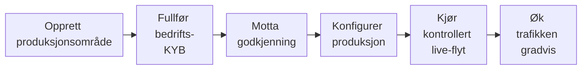

Produksjonsaktivering verifiserer den integrerende virksomheten din. Det er separat fra API-kundene du oppretter for produktet ditt.

## Aktiver produksjonsområdet ditt {#activate-your-production-space}

1. Logg inn på Swipelux Dashboard og velg **Create a production space**.
2. Åpne KYB-fanen eller gå til [Business verification](https://www.swipelux.app/kyb).
3. Fyll ut hvert etterspurte felt og last opp de nødvendige dokumentene.
4. Send den integrerende virksomheten din inn til verifisering og vent på godkjenning.

Først etter at KYB for den integrerende virksomheten din er godkjent, kan du opprette produksjons-API-kunder og -transaksjoner.

I et live-område som krever KYB, returnerer Swipelux `422` [`merchant_kyb_not_approved`](/integration/errors#merchant-kyb-not-approved) for hver skriveforespørsel utenfor bedriftsverifisering og webhook-administrasjon frem til godkjenning. Dette omfatter kunder, capabilities, kontoer, mottakere, regler, tilbud og overføringer.

Mens du venter på godkjenning, kan du fortsatt:

- Sende `GET`- og `HEAD`-forespørsler.
- Fullføre bedriftsverifiseringen din (profil, tilknyttede parter, dokumenter og oppgaveinnsendinger for virksomhetens KYB-kunde).
- Administrere webhook-endepunkter via API-et, og administrere hemmelige nøkler, områder og rail-gebyrer i dashboardet.

Innstillingene har grenser frem til godkjenning:

- Du kan gjøre totalt 20 webhook-URL-endringer per time, på tvers av alle endepunkter i live-områdene dine som krever KYB. Endringer i sandbox-områder telles ikke. Å overskride webhook-URL-grensen returnerer `422 merchant_kyb_not_approved` fra `POST /v3/webhooks` eller `PATCH /v3/webhooks/{webhookId}`.
- I dashboardet kan du ha opptil 10 aktive API-nøkler per live-område som krever KYB.
- I dashboardet kan du ha opptil 5 områder per merchant så lenge du har minst ett live-område, alle live-områdene dine krever KYB og ingen er godkjent. Dette teller både sandbox- og live-områder. Hvis et live-område ikke krever KYB, gjelder ikke denne områdegrensen.

Dashboardet avviser forespørsler som overskrider nøkkel- eller områdegrensen med et vanlig `422`-svar, uten koden `merchant_kyb_not_approved`. Å endre bare et endepunkts hendelser, eller lagre den nåværende URL-en, teller ikke som en URL-endring. Tilbakekalte API-nøkler teller ikke mot nøkkelgrensen.

Sandbox-områder er unntatt fra skriveblokkeringen, webhook-URL-grensen og nøkkelgrensen, så du kan fortsette å bygge og teste der. De teller fortsatt mot merchantens områdegrense.

## Hold produksjon uavhengig

Opprett produksjonsressurser eksplisitt. Å bytte API-nøkkel migrerer ikke sandbox-tilstand. En sandbox-nøkkel kan ikke nå produksjonsressurser. Se [Nøkkelomfang](/no/integration/authentication#key-scope).

- Oppbevar produksjonslegitimasjon i en separat oppføring hos hemmelighetshåndteringen.
- Bruk kun produksjonsspesifikk utrullingskonfigurasjon og ressurs-ID-er.
- Registrer et separat produksjons-webhook-endepunkt og signeringshemmelighet.
- Gjenskap de nødvendige kundene, capabilities, kontoene, mottakerne og destinasjonene i produksjon.
- Begrens produksjonstilgang til tjenestene og operatørene som trenger den.

Sandbox og produksjon bruker `https://platform.swipelux.com`; API-nøkkelen velger miljøet.

## Fullfør lanseringssjekklisten

- [ ] Test happy path og forventede feilstier i sandbox.
- [ ] Send en `Idempotency-Key` med hver skrive-operasjon som krever det, og behold den for trygge retries.
- [ ] Verifiser webhook-signaturer før parsing, persister hendelses-ID-er holdbart, og test avspilling.
- [ ] Håndter utilgjengelige capabilities, åpne oppgaver og endrede oppgaverevisjoner.
- [ ] Håndter dokumenterte [API-feil og nye forsøk](/integration/errors), inkludert idempotente retries med den opprinnelige nøkkelen.
- [ ] Vis overføringsfeil og handlingsrettede instruksjoner for operatørene dine.
- [ ] Bekreft at loggene beholder `X-Request-Id` eller `correlationId` uten å eksponere hemmeligheter eller sensitiv finansiell data.

## Kjør én kontrollert live-flyt

Start med en kjent kunde og én transaksjon med lav verdi. Registrer:

| Kontroll | Definer før testen |
| --- | --- |
| Omfang | Kunde, capability, konto eller destinasjon, beløp og metode. |
| Forventet resultat | API-tilstand, saldo eller instruksjoner, og webhook-hendelsen du forventer å observere. |
| Eier | Person som er ansvarlig for å følge hele flyten. |
| Stoppvilkår | Enhver uventet tilstand, manglende webhook, feil beløp eller uløst oppgave. |

Verifiser både gjeldende API-ressurs og den autentiserte webhook-leveransen. Hvis noen av dem avviker fra forventet resultat, stopp og undersøk før du sender mer trafikk.

Etter at hele flyten lykkes, øk volumet gradvis mens du overvåker capability-, konto-, destinasjons- og overføringstilstander.

Gå tilbake til [Vanlige flyter](/no/integration/common-flows) for produktreisen, gjennomgå [Feil og nye forsøk](/integration/errors) for feilhåndtering, eller bruk [API-referansen](/no/api-reference/introduction) for nøyaktige kontrakter.
