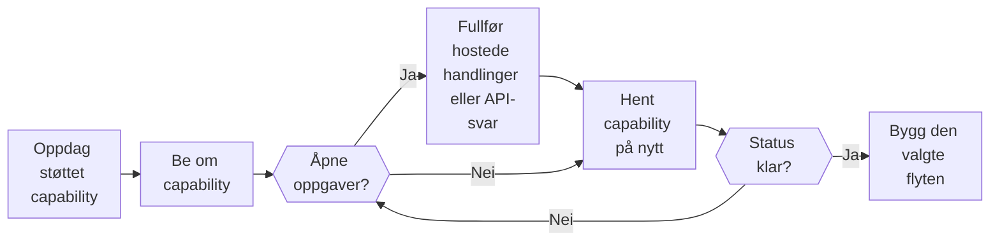

En capability forteller deg om en kunde kan bruke et bestemt utfall, betalingsmetode og retning. Åpne oppgaver forteller deg hva som må skje før capability-en eller en relatert ressurs kan gå videre.



```bash Environment variables
export API_BASE='https://platform.swipelux.com'
export SWIPELUX_API_KEY='replace-with-your-api-key'
```

## Oppdag støttede capabilities {#discover-supported-capabilities}

Les kundens gjeldende valg med [`GET /v3/customers/{customerId}/capabilities/supported`](/api-reference/capabilities/get-v3-customers-by-customer-id-capabilities-supported):

```bash List supported capabilities
curl --request GET \
  "${API_BASE}/v3/customers/${CUSTOMER_ID}/capabilities/supported" \
  --header "X-API-Key: ${SWIPELUX_API_KEY}"
```

Velg en responsoppføring som samsvarer med tiltenkt `directions`, `method` og `accountType`. Fortsett kun når `availability` er `available` eller `beta` og `eligibility.eligible` er `true`. Hvis `institutions` returneres, velg kun én ID fra den responsen.

Hver institusjonsoppføring inneholder en `logoUrl` og et `isDefault`-flagg. Bruk `logoUrl` til å vise bankens logo i et grensesnitt for bankvalg, og vis ditt eget generiske bankikon når den er `null`. `isDefault` gjelder kun for denne kunden og capability-en, ikke for institusjonen globalt. [`GET /v3/institutions`](/api-reference/institutions/get-v3-institutions) returnerer den samme `logoUrl`, som kan være null. Institusjons-ID-er er ugjennomsiktige, så håndter nye ID-er uten kodeendringer.

```json Institution entry
{
  "institutions": [
    {
      "id": "jpmorgan",
      "name": "JPMorgan Chase",
      "bic": "CHASUS33",
      "logoUrl": "https://wallet.swipelux.com/bank-logos/jpmorgan.png",
      "countries": ["US"],
      "isDefault": true,
      "currencies": [
        { "code": "USD", "institution": "jpmorgan" }
      ]
    }
  ]
}
```

For hver navngitt capability viser hver institusjonsoppføring også `currencies`. Hvert element gir en valuta-`code` som en utstedt konto kan motta, og `institution` du sender når du [åpner den kontoen](/no/integration/issue-bank-account#choose-the-bank). `ach_named`, `wire_named` og `rtp_named` viser USD. `sepa_named` viser EUR, `faster_payments_named` viser GBP, og `ipp_named` viser AED. `swift_named` viser alle valutaer banken utsteder SWIFT-kontoer i. En valuta kan oppgi en annen institusjon enn selve oppføringen. For eksempel oppgir SWIFT-valutaer utenom USD hos `lead_bank` `bmo`. Samlede capabilities utelater `currencies`.

For `swift_named` bestemmer banken hvilke av disse valutaene hver kunde kan åpne. En konto i en valuta banken ikke tilbyr denne kunden, ender som `rejected` med `statusReason.code: currency_unavailable`.

Send `bmo` bare når du åpner kontoen. En capability-forespørsel eller oppgaveforhåndsvisning som oppgir `bmo` i `institutions`, returnerer `422 capability_institutions_unsupported`. Be om `swift_named` hos `lead_bank` i stedet.

Når du utelater `institutions`, velger Swipelux den gjeldende standardbanken for denne kunden. Standarden bestemmes per kunde og kan endre seg over tid, for eksempel når kundens profil endres eller en banks onboarding åpner eller stenger. Les `isDefault` fra svaret med støttede capabilities hver gang i stedet for å lagre det. I live-modus:

- `ach_named` og `wire_named` bruker Lead Bank (`lead_bank`) som standard når Lead Bank tar imot nye kunder og kan onboarde denne kunden: profilen oppgir minst ett land og Lead Bank godtar hvert land i den, profilen til en bedrift oppgir en selskapsform som Lead Bank godtar, og kunden har ingen `ready`-søknad hos en annen bank, navngitt eller samlet. Ellers bruker de JPMorgan Chase (`jpmorgan`) som standard.
- `ach_pooled` og `wire_pooled` bruker JPMorgan Chase (`jpmorgan`) som standard.

Standarden gjelder bare for et nytt valg. En godkjent (`ready`) søknad kunden allerede har, eller en gjeldende søknad hos en annen bank, har fortsatt forrang foran standarden og foran banken som er merket med `isDefault`. For å låse en bank sender du ID-en dens i `institutions`. I sandboxen tilbys ACH-, Wire- og SWIFT-capabilities bare hos JPMorgan Chase (`jpmorgan`). Se [Sandbox-testing](/no/integration/sandbox).

Lagre den valgte `data[].id` som `CAPABILITY_ID`. Kopier aldri en capability-ID fra en annen kunde eller et annet miljø.

### Vis hvorfor en bank ikke er tilgjengelig {#show-why-a-bank-is-unavailable}

Hver oppføring inneholder også `unavailableInstitutions`. Den lister opp bankene som tilbyr denne capability-varianten, men ikke godtar denne kunden. Hver oppføring har en `id`, et `name` og en ikke-tom `reasons`-matrise. Hver årsak har samme form som `statusReason`, med `actor: "provider"` og `retryable: false`. Bruk `unavailableInstitutions` til å vise kunder hvorfor en bank mangler i grensesnittet ditt for bankvalg, for eksempel ved å vise banken som deaktivert med årsakens `message`.

```json Unavailable institution entry
{
  "unavailableInstitutions": [
    {
      "id": "lead_bank",
      "name": "Lead Bank",
      "reasons": [
        {
          "code": "jurisdiction_unsupported",
          "message": "The bank does not accept customers from a country on this customer's profile.",
          "actor": "provider",
          "retryable": false
        }
      ]
    }
  ]
}
```

Gjeldende årsakskoder:

| Kode | Betydning |
| --- | --- |
| `jurisdiction_unsupported` | Banken godtar ikke et land i kundens profil. |
| `legal_form_unsupported` | Banken godtar ikke kundens juridiske form. |
| `customer_type_unsupported` | Banken godtar ikke kundens type. |

Håndter ukjente koder uten kodeendringer, fordi Swipelux kan legge til nye koder. En bank vises aldri i både `institutions` og `unavailableInstitutions`. `unavailableInstitutions` er alltid til stede og er `[]` på pooled oppføringer og oppføringer som ikke er bank. En bank som ikke står i noen av listene, er utelatt av en grunn som ikke har med denne kunden å gjøre. Hvis du oppgir en utilgjengelig bank i en capability-forespørsel, returneres fortsatt [`422 capability_institutions_unsupported`](/integration/errors#capability-institutions-unsupported).

### Sjekk hvor en konto kan åpnes {#check-where-an-account-can-open}

Hver oppføring inneholder også `banks`. På named oppføringer lister den opp hver bank i `institutions` eller `unavailableInstitutions`, pluss enhver bank der kunden har en søknad for denne varianten. På andre oppføringer er den `[]`. Hver bank har samme `id`, `name`, `bic` og `logoUrl` som en institusjonsoppføring, og legger til kundens status hos banken:

```json Bank entry
{
  "banks": [
    {
      "id": "jpmorgan",
      "name": "JPMorgan Chase",
      "bic": "CHASUS33",
      "logoUrl": null,
      "status": "approved",
      "applicationId": "apl_000000000000000005",
      "accountOpening": "now",
      "currencies": [
        { "code": "USD", "institution": "jpmorgan" }
      ]
    }
  ]
}
```

`status` er én av disse verdiene:

- `approved`: en klar søknad hos banken dekker denne varianten.
- `pending`: en søknad hos banken har bedt om den, og banken har ikke godkjent den ennå.
- `refused`: banken avviste kunden.
- `not_requested`: ingen søknad hos banken ber om den. En capability-forespørsel kan velge denne banken.
- `not_offered`: banken godtar ikke denne kunden for denne varianten.

`applicationId` oppgir søknaden som bestemmer `status`, eller er `null`. `accountOpening` forteller deg hva en [forespørsel om en utstedt konto](/no/integration/issue-bank-account#choose-the-bank) som oppgir denne banken, gjør nå:

- `now`: forespørselen godtas, og kontoen utstedes.
- `after_approval`: forespørselen godtas med `allowPending: true` og venter på bankens godkjenning.
- `application`: be først om capability-en med denne banken i `institutions`.
- `none`: ingen kontoforespørsel godtas hos denne banken nå.

For `now` og `after_approval` viser `currencies` bare valutaene en forespørsel godtas i. En valuta kunden allerede har en konto i hos denne banken, er derfor utelatt. Ellers viser den alle valutaer banken åpner denne varianten i. Hvert element oppgir `institution` du skal sende, som i `institutions[].currencies`.

Avgjør om du skal tilby kontoåpning hos en bank kun ut fra `accountOpening`. `institutions` svarer på et annet spørsmål: hvor en ny capability-forespørsel kan gå. Den kan vise én standardbank mens en annen bank allerede har godkjent kunden.

### Pooled vs named kontotyper {#pooled-vs-named-account-types}

Bankcapabilities finnes i to varianter, kodet som `accountType`-feltet og suffiks i capability-ID-en (for eksempel `ach_pooled`, `wire_named`):

- **`pooled`**: delt Swipelux-bankkonto. Hver pay-in bruker en unik referanse for å rute midler. Velg denne for engangsoverføringer.
- **`named`**: dedikerte bankopplysninger for kunden (virtuell IBAN, dedikert ACH-konto). Gjenbrukbare og delbare med hvilken som helst betaler. Kreves for [utstedte bankkontoer](/no/integration/issue-bank-account).

Bruk `pooled` som standard. Bruk `named` kun når kunden trenger gjenbrukbare bankopplysninger. Sjekk `supported`-responsen for hvilke varianter som er tilgjengelige.

Bruk `swift_named` for å motta SWIFT-innskudd eller utstede SWIFT-bankopplysninger. `swift_pooled` støtter kun utbetalinger, så sjekk `directions` for hvert alternativ i responsen for støttede capabilities. En named SWIFT-konto returnerer gjenbrukbare mottaksopplysninger, inkludert bankens BIC, en referanse når det kreves, og mottakerens adresse når banken oppgir den.

For utstedte ACH-, Wire- og SWIFT-kontoer kan du velge en bestemt bank med `institution` og lagre kontoforespørselen før banken godkjenner kunden. Se [Utsted en bankkonto](/no/integration/issue-bank-account#choose-the-bank).

## Be om capability-en {#request-the-capability}

Be om det valgte alternativet med [`POST /v3/customers/{customerId}/capabilities/{capabilityId}`](/api-reference/capabilities/post-v3-customers-by-customer-id-capabilities-by-capability-id):

```bash Request capability
curl --request POST \
  "${API_BASE}/v3/customers/${CUSTOMER_ID}/capabilities/${CAPABILITY_ID}" \
  --header "X-API-Key: ${SWIPELUX_API_KEY}" \
  --header "Idempotency-Key: capability-request-001" \
  --header "Content-Type: application/json" \
  --data '{}'
```

Bruk en eksplisitt `institutions`-liste kun når du må velge fra ID-er returnert av responsen for støttede capabilities.

Lagre `data.status` som `CAPABILITY_STATUS`, `data.accountProvisioning` som `ACCOUNT_PROVISIONING_STATUS`, `data.openTaskIds` som `OPEN_TASK_IDS`, og hver `data.applications[].id` i `APPLICATION_IDS`.

### Delte søknader per bank {#shared-applications-per-bank}

For named bankcapabilities har hver kunde én søknadssak per bank. Pooled- og plattform-capabilities bruker saker uten bank. Swipelux deler en sak på tvers av alle kompatible capabilities du ber om:

- Én godkjenning kan dekke flere capabilities. For eksempel kan en godkjent sak hos én bank gjøre både en ACH- og en wire-capability `ready`.
- En senere forespørsel som samsvarer med en eksisterende sak, gjenbruker den. Swipelux åpner ingen ny søknad og legger ikke til dupliserte oppgaver.
- Saker hos forskjellige banker er uavhengige. Et avslag hos én bank påvirker ikke en sak hos en annen bank.

Responsen på forespørselen forteller deg hvilken sak Swipelux brukte:

- `201` betyr at forespørselen åpnet en ny søknadssak.
- `200` betyr at forespørselen ble løst til en søknadssak kunden allerede hadde, for eksempel en gjentatt forespørsel om en bankcapability kunden allerede har, eller en forespørsel om en kansellert bankcapability som slutter seg til den eksisterende søknaden. En gjentatt forespørsel om `card` eller `stablecoin_transfers` returnerer fortsatt [`409 capability_already_exists`](/integration/errors#capability-already-exists), og en forespørsel om en kansellert `card`-capability returnerer [`409 capability_not_reopenable`](/integration/errors#capability-not-reopenable).
- `selectedApplicationId` er et felt på toppnivå ved siden av `data` med ID-en til saken som forespørselen valgte eller åpnet. Swipelux utelater feltet når forespørselen ikke valgte noen sak. En idempotent gjentakelse returnerer samme verdi.

Forkortet respons:

```json Response (abbreviated)
{
  "data": {
    "id": "ach_named",
    "status": "pending",
    "openTaskIds": ["tsk_000000000000000002"],
    "applications": [{ "id": "apl_000000000000000005", "status": "in_review" }]
  },
  "selectedApplicationId": "apl_000000000000000005"
}
```

For named capabilities sender du den samme `institutions`-listen på nytt for å velge den samme saken, eller én institusjons-ID for å målrette den banken. En bank som endelig har avslått kunden, hoppes over. Når du bare angir den banken, eller alle kvalifiserte banker har avslått kunden, returnerer forespørselen [`409 capability_terminally_rejected`](/integration/errors#capability-terminally-rejected). For å prøve en annen bank etter et avslag, be om capability-en på nytt med den bankens institusjons-ID.

Statusen til en capability gjenspeiler alle kundens relaterte saker. For en named capability er én `ready`-sak med en godkjenning som dekker den, nok til å gjøre den `ready`, uansett hva andre banker rapporterer. En pooled capability venter også på metodesjekken sin, som rapporteres i `probes` i kundens søknadsliste.

#### List kundens søknader {#list-the-customers-applications}

List alle søknadssaker for kunden med [`GET /v3/customers/{customerId}/applications`](/api-reference/capabilities/get-v3-customers-by-customer-id-applications). Resultatene pagineres med `nextCursor` og `hasMore`, og godtar `updatedAfter`:

```bash List applications
curl --request GET \
  "${API_BASE}/v3/customers/${CUSTOMER_ID}/applications" \
  --header "X-API-Key: ${SWIPELUX_API_KEY}"
```

Hver oppføring inneholder søknadsfeltene som returneres i en capabilitys `applications[]`, samt:

- `scope`: `named` for en sak hos én bank, `provider_pooled` eller `platform` for saker uten bank, eller `null` for en uklassifisert historisk sak. `institution` er fraværende for `provider_pooled`- og `platform`-saker.
- `requestedScope[]`: capability-nøklene som er forespurt mot saken, hver med sin første `requestedAt`. Oppføringer fjernes aldri.
- `coverage[]`: capability-nøklene som sakens godkjenning dekker, hver med `grantedAt` og `source`. Dekningen registrerer omfang, ikke autorisasjon. Les capability-en for å se gjeldende status.
- `probes[]`: metodesjekker for de pooled capability-nøklene saken dekker, hver med `capabilityKey`, `status` og `reason`. Named nøkler krever aldri en probe.
- `generation`, `predecessorApplicationId` og `supersededByApplicationId`: etterfølgerlenker. Når `supersededByApplicationId` er satt, er saken erstattet. Følg den ID-en til den gjeldende saken. En capabilitys `applications[]` viser bare gjeldende saker, så en erstattet sak vises bare i denne listen.

Forkortet respons:

```json Response (abbreviated)
{
  "data": [
    {
      "id": "apl_000000000000000005",
      "status": "ready",
      "scope": "named",
      "institution": { "id": "jpmorgan", "name": "JPMorgan Chase", "bic": "CHASUS33" },
      "requestedScope": [
        { "capabilityKey": "ach_named", "requestedAt": "2026-09-20T10:00:00.000Z" }
      ],
      "coverage": [
        { "capabilityKey": "ach_named", "grantedAt": "2026-09-22T12:00:00.000Z", "source": "approval" },
        { "capabilityKey": "wire_named", "grantedAt": "2026-09-22T12:00:00.000Z", "source": "approval" }
      ],
      "probes": [],
      "generation": 1,
      "predecessorApplicationId": null,
      "supersededByApplicationId": null
    }
  ],
  "nextCursor": null,
  "hasMore": false
}
```

## Fullfør gjeldende oppgaver {#complete-current-tasks}

List oppgaver med [`GET /v3/customers/{customerId}/tasks`](/api-reference/tasks/list-customer-tasks), velg ID-er fra `OPEN_TASK_IDS`, og les så hver gjeldende oppgave med [`GET /v3/customers/{customerId}/tasks/{taskId}`](/api-reference/tasks/get-customer-task):

```bash List open tasks
curl --request GET \
  "${API_BASE}/v3/customers/${CUSTOMER_ID}/tasks/${TASK_ID}" \
  --header "X-API-Key: ${SWIPELUX_API_KEY}"
```

Bruk siste `data.revision` og `data.requirements`. Hent oppgaven på nytt umiddelbart før innsending hvis noen av delene kan ha endret seg.

### Gjenbrukte profilbevis {#reused-profile-evidence}

For intake-oppgaver for søknader som godtar direkte innsending via API, gjenbruker Swipelux informasjon kunden allerede har oppgitt. Når en slik oppgave opprettes eller avstemmes, sjekker Swipelux kundeprofilen og kundens egne opplastede dokumenter. Kvalifiserte krav som allerede støttes av en brukbar profilverdi eller et dokument, flyttes til `in_review` i stedet for å forbli handlingsklare. Profiloppdateringer og nye dokumentopplastinger utløser den samme sjekken for eksisterende oppgaver.

Kun manglende eller inkompatible verdier forblir handlingsklare. Gjenbruk godkjenner ikke beviset. Swipelux gjennomgår det fortsatt. Eksplisitte forespørsler om korrigering og krav som allerede er besvart, forblir handlingsklare. Dokumenter for eiere og nærstående parter gjenbrukes ikke, og krav som kun samles inn gjennom en hosted sesjon, følger sin vanlige flyt.

### Gjengi krav {#render-requirements}

Bygg skjemaer fra metadataene hvert krav returnerer, ikke fra kravnøkler. Et krav kan inneholde en valgfri kort `title`, og hver `request` inneholder en `prompt` som skal vises under overskriften.

Krav med `request.type: "profile"` identifiserer profilfeltet med `profilePointer` og legger til metadata for inndata:

- `allowedValues`: de tillatte verdiene for et skalarfelt, eller for hvert element i et array-felt. Send inn disse verdiene, ikke oversatte visningsetiketter.
- `valueSchema`: et selvstendig JSON Schema Draft 7-dokument som beskriver formen på inndataene, nestede egenskaper, påkrevde felt og strukturelle begrensninger. Enums på objekter vises på den aktuelle egenskapen, for eksempel `valueSchema.items.properties.type.enum` for skatteidentifikatorer. Swipelux utfører fortsatt validering på tvers av felt og ved gjennomgang etter innsending, så en verdi som består skjemaet, kan likevel bli avvist.
- `valueType: "country"`, eller `itemValueType: "country"` for arrays: feltet tar ISO 3166-1 alpha-2-koder med store bokstaver. Nestede landegenskaper i `valueSchema` bruker `format: "iso-3166-1-alpha-2"`. Bruk en standard landliste for lokaliserte etiketter.

```json Requirement
{
  "id": "req_000000000000000010",
  "key": "account_purposes",
  "title": "Account purpose",
  "status": "action_required",
  "request": {
    "type": "profile",
    "prompt": "Select every purpose that applies.",
    "required": true,
    "profilePointer": "/financialProfile/accountPurposes",
    "valueType": "array",
    "itemValueType": "string",
    "allowedValues": ["business_expenses", "ecommerce", "payroll"],
    "valueSchema": {
      "$schema": "http://json-schema.org/draft-07/schema#",
      "type": "array",
      "items": { "enum": ["business_expenses", "ecommerce", "payroll"] }
    }
  }
}
```

Dette eksempelet forkorter verdikatalogen. API-et returnerer alle tillatte verdier. Noen profilkrav har ikke noe publisert skjema og utelater `valueSchema` og `allowedValues`. Gjengi disse fra `prompt` og `valueType`.

Hver åpen oppgave inneholder et `dueAt`-tidsstempel. Når Swipelux oppretter en oppgave uten en eksplisitt forfallsdato, settes `dueAt` som standard til nøyaktig 31 dager etter oppgavens `createdAt`. Behandle `dueAt` som informativt: du kan ikke sette det via API-et, og det utløser ingen automatisk livssyklusovergang. Bare det separate feltet `deadline` forårsaker en automatisk overgang når det er satt.

### Hostede handlinger {#hosted-actions}

I svaret med oppgavedetaljer inneholder hver oppføring i `verificationSessions` og `tosSessions` et `action`-objekt. Svar med oppgavelister inneholder ikke disse handlingslenkene. Lagre `id` for hver sesjon, og les deretter `action.kind` før du sender kunden videre. Ikke utled tilgjengeligheten av lenken fra sesjonens `status`.

- `action.kind: "available"` inkluderer `action.url` og `action.expiresAt` (for øyeblikket alltid `null`). Lagre `action.url`, send kunden dit, og les deretter oppgaven på nytt. Feltene `url` og `expiresAt` på sesjonsnivå inneholder de samme verdiene.
- `action.kind: "unavailable"` betyr at ingen lenke skal vises. Feltene `url` og `expiresAt` på sesjonsnivå er fraværende. Sesjonens `status` alene avgjør ikke hvilken handlingstype du mottar.

```json Verification session
{
  "data": {
    "verificationSessions": [
      {
        "id": "vfy_000000000000000003",
        "key": "identity_verification",
        "type": "identity_verification",
        "status": "action_required",
        "coveredRequirementIds": ["req_000000000000000011", "req_000000000000000012"],
        "action": {
          "kind": "available",
          "url": "https://platform.swipelux.com/kyc/redirect/cus_000000000000000001/tsk_000000000000000002/vfy_000000000000000003",
          "expiresAt": null
        },
        "url": "https://platform.swipelux.com/kyc/redirect/cus_000000000000000001/tsk_000000000000000002/vfy_000000000000000003",
        "expiresAt": null
      }
    ],
    "tosSessions": [
      {
        "id": "vfy_000000000000000004",
        "key": "terms_of_service",
        "type": "terms_of_service",
        "status": "completed",
        "action": { "kind": "unavailable" }
      }
    ]
  }
}
```

Dette er oppgaveavgrensede handlinger, ikke en separat livssyklus for kundeverifisering.

Hver `verificationSessions[]`-oppføring i oppgavelesinger og kundens oppgavedetaljer inneholder `coveredRequirementIds`. Den viser ID-ene til oppgavens aktive krav som sesjonen kan fylle ut. Bruk den til å se hvilke krav en hosted sesjon eller en [importert verifisering](#import-an-existing-identity-verification) kan avgjøre. Fyll ut alle andre krav gjennom [API-svar](#api-answers).

For nye intake-oppgaver for personer dekker den hostede identitetssesjonen bare ID-dokumentet, selfien og adressebevis. Krav om midlerbevis, som `proof_of_funds`, `source_of_funds_document`, `named_source_of_funds_document` og `sole_proprietor_document`, er ikke en del av den hostede sesjonen. [Last opp](#upload-documents) og send inn disse dokumentene direkte. Swipelux gjennomgår dem, og oppgaven forblir åpen til de er godtatt.

Et hostet svar på et profilkrav for en strukturert verdi, for eksempel en adresse eller skatteidentifikatorer, må bestå de samme skjema- og begrensningskontrollene som et direkte svar. Hvis det ikke gjør det, forblir kravet åpent. Et krav som Swipelux returnerer til `action_required` av denne grunnen, har `reviewFeedback.code: hosted_profile_direct_submission_required`. Samle inn verdien fra kunden og send den inn som et [API-svar](#api-answers).

### Importer en eksisterende identitetsverifisering {#import-an-existing-identity-verification}

Hvis du allerede verifiserer personer i din egen konto hos Swipelux' leverandør av identitetsverifisering, kan du importere den verifiseringen inn i identitetssesjonen til kundens intake-oppgave i stedet for å sende kunden gjennom den hostede flyten. Dette alternativet gjelder bare API-integrasjoner med individuelle kunder. Virksomheter og nærstående parter støttes ikke.

Før du importerer, må du sette opp deling med leverandøren av identitetsverifisering:

1. Be Swipelux om partnertokenet, og legg deretter til Swipelux som delingspartner i kontoen din hos leverandøren av identitetsverifisering.
2. For live-verifiseringer genererer du et share token for Swipelux med mottakerens klient-ID (`forClientId`) `swipelux.com_21030`.
3. Send tokenet til Swipelux før det utløper. Share tokens er ugjennomsiktige, kan bare brukes én gang, er på maksimalt 1 024 UTF-8-byte og utløper som standard etter 20 minutter. Behandle hvert token som en legitimasjon.

Oppgaven må være en intake-oppgave for en person og tilby den hostede verifiseringssesjonen som innsendingsmetode. Sesjonen må ha `type: "identity_verification"` og `status: "action_required"`. Kunden kan ikke allerede ha en verifisering som pågår eller er fullført hos Swipelux, og en import kan ikke allerede pågå. Å åpne den hostede lenken starter verifiseringen, men å lese oppgaven gjør det ikke. Kall deretter `POST /v3/customers/{customerId}/tasks/{taskId}/verification-sessions/{verificationSessionId}/share-token`. Forespørselen krever de samme tillatelsene `accounts:write`, `customers:read` og `customers:write` som oppgaveinnsendinger, pluss en `Idempotency-Key`:

```json Request body
{
  "shareToken": "<share token>"
}
```

```json Response
{
  "verificationSessionId": "vfy_000000000000000003",
  "status": "in_review"
}
```

Leverandøren kopierer de samsvarende trinnene til Swipelux' konto, og kontrollene kjøres på nytt mot nivået oppgaven krever. Swipelux lagrer eller logger aldri share tokenet.

- `status: "in_review"` betyr at kontrollene pågår. Når kontrollene er ferdige, avgjør Swipelux de dekkede kravene på samme måte som for en hosted sesjon.
- `status: "action_required"` betyr at trinn mangler. Kunden kan fullføre dem via sesjonens eksisterende hostede lenke, eller du kan sende inn de dekkede kravene direkte.

Importen fyller bare ut kravene som er oppført i `coveredRequirementIds`: ID-dokumentet, selfien og, der oppgaven krever det, adressebevis. Send inn profilsvar, midlerbevis og andre krav som [API-svar](#api-answers). For å spille av en forespørsel på nytt sender du den igjen med samme `Idempotency-Key`.

| Status | Kode | Hva du gjør |
| --- | --- | --- |
| `409` | `verification_already_started` | Denne kunden har allerede en verifisering som pågår eller er fullført hos Swipelux, eller en import pågår allerede, for eksempel fordi kunden åpnet en hostet lenke. Ikke prøv på nytt. Fortsett gjennom den eksisterende sesjonen. |
| `409` | `verification_session_not_allowed` | Oppgaven eller sesjonen er ikke kvalifisert for import. Ikke prøv på nytt. Les oppgaven og bruk metodene den tilbyr. |
| `422` | `share_token_rejected` | Leverandøren av identitetsverifisering avviste tokenet, for eksempel fordi det var utløpt, allerede brukt eller utstedt for en annen mottaker. Generer et nytt token for Swipelux og prøv på nytt med en ny `Idempotency-Key`. |
| `503` | `kyc_provider_unavailable` | Med `retryable: true` hadde Swipelux ennå ikke sendt tokenet. Prøv på nytt etter en stund. Med `retryable: false` kan importen ha skjedd, men den kunne ikke bekreftes. Ikke send tokenet på nytt. Fortsett via sesjonens hostede lenke. |

### Last opp dokumenter {#upload-documents}

Når et krav ber om et dokument, last det opp med [`POST /v3/customers/{customerId}/documents`](/api-reference/documents/post-v3-customers-by-customer-id-documents):

```bash Upload document
export DOCUMENT_PATH='/absolute/path/to/requested-document.pdf'

curl --request POST \
  "${API_BASE}/v3/customers/${CUSTOMER_ID}/documents" \
  --header "X-API-Key: ${SWIPELUX_API_KEY}" \
  --header "Idempotency-Key: customer-document-001" \
  --form "file=@${DOCUMENT_PATH}"
```

Lagre den returnerte `data.id` som `DOCUMENT_ID` før du sender inn svaret som refererer til den.

Hver v3-dokumentressurs inkluderer `contentSha256`, SHA-256-sjekksummen for den lagrede filen som `sha256:` etterfulgt av den heksadesimale sjekksummen med små bokstaver. To dokumenter med samme sjekksum er byte-identiske. For å sjekke om en fil allerede er lastet opp av kunden, for eksempel en fil en saksbehandler ba om å erstatte, beregner du SHA-256 for filen før du laster den opp og sammenligner den med `contentSha256` på dokumentene som svarene i den tidligere innsendingen refererer til i `documentIds`. Feltet er `null` for dokumenter som ble lagret før Swipelux registrerte sjekksummer.

Et dokumentsvar må inneholde minst én fil som ikke allerede er returnert for denne forespørselen. Når hver fil i svaret ble returnert i en tidligere gjennomgang, avviser Swipelux svaret med `documents_already_returned`. Du kan sende tidligere filer på nytt sammen med en ny. Hvis en fil ble returnert ved en feil, laster du den opp på nytt for å få en ny dokument-ID. Den som gjennomgår, ser fortsatt den tidligere avgjørelsen.

For å hente en lagret fil senere, kall [`GET /v3/customers/{customerId}/documents/{documentId}/download`](/api-reference/documents/get-v3-customers-by-customer-id-documents-by-document-id-download). Swipelux returnerer en `url` som laster ned filen som et vedlegg og utløper etter én time. Arkiverte dokumenter returnerer `404`.

### API-svar {#api-answers}

Send inn ett komplett svarsett for gjeldende revisjon med [`POST /v3/customers/{customerId}/tasks/{taskId}/submissions`](/api-reference/task-submissions/create-customer-task-submission):

```bash Submit task answers
curl --request POST \
  "${API_BASE}/v3/customers/${CUSTOMER_ID}/tasks/${TASK_ID}/submissions" \
  --header "X-API-Key: ${SWIPELUX_API_KEY}" \
  --header "Idempotency-Key: task-submission-001" \
  --header "Content-Type: application/json" \
  --data @- <<'JSON'
{
  "taskRevision": 3,
  "answers": [
    {
      "requirementId": "req_from_current_task",
      "answer": {
        "type": "text",
        "value": "Current answer"
      }
    }
  ]
}
JSON
```

Hent hver krav-ID og svar-type fra siste oppgave. Hvis API-et melder at oppgaven har endret seg, hent den på nytt og bygg innsendingen på nytt fra den nye revisjonen.

#### Behold gyldige svar med `allowPartial` {#keep-valid-answers-with-allowpartial}

Som standard får ett avvist svar hele forespørselen til å feile, og Swipelux lagrer ingenting. Svaret er `400 validation_error`, `400 invalid_document_reference`, `400 documents_already_returned` eller `409 absence_conflicts_with_profile`. Legg til `"allowPartial": true` når du vil at Swipelux skal lagre de gyldige svarene og bare avvise de ugyldige:

```json Partial submission request
{
  "taskRevision": 3,
  "allowPartial": true,
  "answers": [
    { "requirementId": "req_a", "answer": { "type": "text", "value": "Salary" } },
    { "requirementId": "req_b", "answer": { "type": "document", "documentIds": ["doc_unknown"] } }
  ]
}
```

Swipelux returnerer `201` med den lagrede innsendingen i `data`, som bare inneholder svarene som ble beholdt, og lister de andre i `refusedAnswers`:

```json Partial submission response
{
  "data": { "id": "sub_000000000000000001", "outcome": "in_review", "answers": [{ "requirementId": "req_a" }] },
  "refusedAnswers": [
    {
      "requirementId": "req_b",
      "code": "invalid_document_reference",
      "pointer": "/answers/1/answer",
      "message": "A referenced document is invalid."
    }
  ]
}
```

Hvert avvist svar har én av disse kodene:

| `code` | Betydning |
| --- | --- |
| `invalid` | Svaret oppfyller ikke forespørselens form, format eller begrensninger, eller kundeprofilen godtar ikke verdien. |
| `absence_conflicts_with_profile` | Et fravær ble sendt for en verdi som profilen inneholder. |
| `invalid_document_reference` | Et referert dokument kan ikke brukes for denne kunden og denne forespørselen. |
| `documents_already_returned` | Hver fil i dokumentsvaret er allerede returnert for denne forespørselen. Send en ny fil, alene eller sammen med tidligere filer. |
| `depends_on_refused_answer` | Svaret er gyldig i seg selv, men vurderes sammen med et avvist svar. Et betinget svar og svaret som styrer det, beholdes eller avvises sammen. |

Flere koder kan bli lagt til. Behandle en ukjent kode som `invalid`. `message` gjentar aldri den innsendte verdien.

`allowPartial` lemper ikke på de andre reglene:

- Forespørselen må fortsatt besvare hvert krav den måtte besvare uten feltet. Ubesvarte åpne krav returnerer fortsatt `422 task_submission_incomplete`.
- En body som ikke oppfyller selve forespørselsskjemaet, for eksempel et ukjent felt eller feil type, returnerer fortsatt `400 validation_error`.
- Når ingen svar kan beholdes, returnerer Swipelux `400 validation_error`, lagrer ingenting og lister hvert avvist svar i `errors[]`.
- `refusedAnswers` er til stede, eventuelt tom, nøyaktig når forespørselen sendte `"allowPartial": true`. En gjentakelse med samme `Idempotency-Key` returnerer de samme `refusedAnswers`.

Les oppgaven på nytt før du retter et avvist svar. Et avvist krav er vanligvis fortsatt `action_required`, men en dokumentforespørsel kan allerede være besvart av en fil som er registrert. Send inn rettelsene med ny `taskRevision` og en ny `Idempotency-Key`. Send et betinget svar sammen med svaret som styrer det.

#### Trekk tilbake en innsending som venter på gjennomgang {#withdraw-a-submission-awaiting-review}

For å rette en innsending som fortsatt er `in_review`, trekker du den tilbake med `POST /v3/customers/{customerId}/tasks/{taskId}/withdrawals`. Forespørselen har ingen body og krever en `Idempotency-Key`. API-nøkler trenger `accounts:write`, `customers:read` og `customers:write`, som for innsendinger:

```bash Withdraw task submission
curl --request POST \
  "${API_BASE}/v3/customers/${CUSTOMER_ID}/tasks/${TASK_ID}/withdrawals" \
  --header "X-API-Key: ${SWIPELUX_API_KEY}" \
  --header "Idempotency-Key: task-withdrawal-001"
```

Swipelux returnerer `200` med innsendingen i `data`. `outcome` blir `withdrawn`, svarene går tilbake til `action_required` uten `reviewFeedback`, og neste innsending starter en ny `remediationRound`. Krav som allerede er akseptert, og kundeprofilen forblir uendret. Svar som Swipelux fylte ut fra profilen eller fra registrerte filer, forblir under gjennomgang. Du kan trekke tilbake så mange ganger du trenger. Les oppgaven på nytt, og send deretter inn rettede svar.

Swipelux avviser en tilbaketrekking i disse tilfellene:

- `404 task_not_found`: oppgaven finnes ikke for denne kunden.
- `409 task_not_in_review`: ikke nøyaktig én innsending venter på gjennomgang (ingen, eller flere enn én, for eksempel en delvis innsending og rettelsen av den), eller oppgavens frist har passert.
- `409 submission_already_forwarded`: banken gjennomgår denne oppgaven direkte, eller Swipelux har allerede sendt innsendingen videre til gjennomgang. Oppgaver opprettet med `POST /v3/sandbox/tasks` returnerer det også.

`outcome` for en innsending kan nå være `withdrawn`. Oppdater alle klienter som sjekker `outcome` mot en fast liste.

### UBO-forutsetning for virksomheter {#beneficial-owner-prerequisite-for-businesses}

Å be om en virksomhets-capability som trenger UBO-bevis lykkes selv når kunden ennå ikke har en kvalifiserende eier. Capability-en opprettes som `restricted` med `statusReason.code: tasks_due`, og intake-oppgaven for virksomheten ber om de manglende eierskapsfaktaene, inkludert eierskapsstrukturen.

Den samme oppgaven inneholder et `resource_reference`-krav der forespørselen inkluderer `qualification: "beneficial_owner"`:

```json Beneficial owner requirement
{
  "type": "resource_reference",
  "prompt": "Add or select a qualifying beneficial owner.",
  "required": true,
  "resourceType": "related_party",
  "qualification": "beneficial_owner"
}
```

En nærstående part kvalifiserer når den er en aktiv `person`-part hos samme kunde med en oppgitt eierandel på minst 25, eller med `ownership.declared: true` uten oppgitt eierandel.

Kravet utledes fra den gjeldende listen over nærstående parter, så du svarer vanligvis ikke på det direkte:

- Å opprette eller oppdatere en kvalifiserende nærstående part oppfyller kravet i samme reevaluering og åpner den eierens eget profil- og dokumentarbeid. Se [Legg til nærstående parter for virksomheten](/no/integration/onboarding/customers#add-business-related-parties).
- Du kan også referere til en kvalifiserende part eksplisitt med et `resource_reference`-svar som inneholder dens `relatedPartyId`.
- Kravet forblir oppført i den gjeldende oppgaven etter at det er oppfylt. Når ingen annen forpliktelse gjenstår som åpen, blir oppgaven `satisfied`.
- Å arkivere den siste kvalifiserende parten, eller fjerne faktaene som kvalifiserte den, gjenåpner kravet, selv etter at oppgaven var `satisfied`.

## Fortsett når capability-en er klar {#continue-when-the-capability-is-ready}

Les capability-en på nytt med [`GET /v3/customers/{customerId}/capabilities/{capabilityId}`](/api-reference/capabilities/get-v3-customers-by-customer-id-capabilities-by-capability-id):

```bash Refetch capability
curl --request GET \
  "${API_BASE}/v3/customers/${CUSTOMER_ID}/capabilities/${CAPABILITY_ID}" \
  --header "X-API-Key: ${SWIPELUX_API_KEY}"
```

Erstatt den lagrede statusen, kontoutstedelsesstatusen og oppgave-ID-ene med siste respons. Capability-ens `status` viser om rettigheten er godkjent. For en capability som utsteder en konto, rapporterer `accountProvisioning` separat om den kontoen er `not_started`, `in_progress`, `issued` eller `failed`; en capability som ikke utsteder en konto, returnerer `not_applicable`.

Mens capability-en er `pending`, viser to av `statusReason.code`-verdiene den kan rapportere om en gjennomgang pågår. `preparing_submission` betyr at Swipelux fortsatt forbereder en søknad for innsending og at ingen gjennomgang pågår, selv om en annen banks søknad er `rejected` eller trenger oppmerksomhet. `review_in_progress` betyr at en gjennomgang pågår, for eksempel mens en søknad er `in_review` eller en [hostet verifisering](#hosted-actions) er åpen. Begge bruker `resolution: wait`. En endring mellom disse kodene beholder statusen `pending`, så det sendes ingen `capability.status_changed`-hendelse. Les capability-en for å se gjeldende kode.

En capability kan også være `restricted` med `statusReason.code: offer_unavailable` og `resolution: contact_support`. Swipelux returnerer denne koden når en godkjent søknad dekker capability-en, men ingen gjeldende produkttilbud tillater den. Søknaden er allerede godkjent, så det endrer ikke capability-en å vente. Kontakt Swipelux-support i stedet for å polle. I dette tilfellet erstatter denne koden `related_application_action_required` og `resolution: wait`. Åpne kundeoppgaver har fortsatt forrang, så fullfør eventuelle gjeldende oppgaver først.

```json Capability restricted by offer availability
{
  "status": "restricted",
  "statusReason": {
    "code": "offer_unavailable",
    "resolution": "contact_support",
    "message": "The approved Application covers this capability, but no current offer permits it. Contact support."
  }
}
```

Fortsett kun når gjeldende capability-status tillater kontoen, tilbudet eller overføringen du har til hensikt å opprette. Når flyten trenger en utstedt konto, vent også til `accountProvisioning` blir `issued`.

Deretter, velg den samsvarende reisen i [Vanlige flyter](/no/integration/common-flows).
