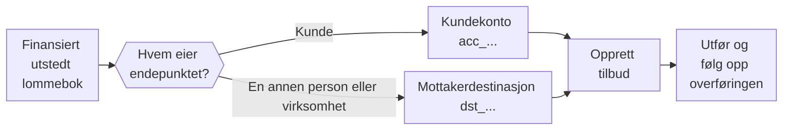

Hver payout starter fra en klar, finansiert utstedt lommebok. Destinasjonsmodellen avhenger av hvem som eier endepunktet.



## Før du starter

Hent kildelommeboken på nytt. Bekreft at gjeldende status tillater payout-en og at tilgjengelig saldo dekker det tiltenkte kildebeløpet. Lagre dens responsavledede ID som `SOURCE_WALLET_ID`.

Du trenger også en klar payout-capability for gjeldende kunde og valgt destinasjon.

Eksisterende Tron-lommebøker kan sende USDT til en annen Tron-lommebok med et `stablecoin_transfers`-tilbud. Inn og ut må bruke samme nettverk og stablecoin. Du kan ikke opprette nye utstedte lommebøker på Tron.

## 1. Klargjør destinasjonen

<Tabs>
  <Tab title="Førsteparts">

Bruk en kundeeid ekstern bankkonto når kunden eier endepunktet. Opprett den med [`POST /v3/customers/{customerId}/accounts`](/api-reference/accounts/post-v3-customers-by-customer-id-accounts) og disse headerne:

```http Request headers
X-API-Key: ${SWIPELUX_API_KEY}
Idempotency-Key: payout-account-001
Content-Type: application/json
```

```json Request body
{
  "origin": "external",
  "type": "bank",
  "methods": ["ach", "wire"],
  "country": "US",
  "currency": "USD",
  "details": {
    "routingNumber": "021000021",
    "accountNumber": "123456789",
    "accountType": "checking",
    "bankName": "Example Bank",
    "accountHolderName": "Acme Payments SAS"
  },
  "label": "Customer operating account"
}
```

Les den med [`GET /v3/customers/{customerId}/accounts/{accountId}`](/api-reference/accounts/get-v3-customers-by-customer-id-accounts-by-account-id). Fortsett kun når gjeldende status tillater payout-en. Lagre `acc_`-ID-en som `PAYOUT_DESTINATION_ID`.

  </Tab>
  <Tab title="Tredjeparts">

Opprett personen eller virksomheten og deres bank- eller lommebok-endepunkt via [Mottakere og destinasjoner](/no/integration/recipients). Fortsett kun når destinasjonen er klar.

Lagre den returnerte `dst_`-ID-en som `PAYOUT_DESTINATION_ID`. Ikke bruk mottakerens `rcp_`-ID som tilbudsdestinasjon.

  </Tab>
</Tabs>

## 2. Opprett payout-tilbudet

Bruk [`POST /v3/quotes`](/api-reference/money-movement/post-v3-quotes) med disse headerne:

```http Request headers
X-API-Key: ${SWIPELUX_API_KEY}
Idempotency-Key: payout-quote-001
Content-Type: application/json
```

```json Request body
{
  "customerId": "${CUSTOMER_ID}",
  "capabilityId": "${CAPABILITY_ID}",
  "in": {
    "amount": "150.00",
    "currency": "USDC",
    "accountId": "${SOURCE_WALLET_ID}"
  },
  "destinationId": "${PAYOUT_DESTINATION_ID}",
  "out": {
    "currency": "USD"
  }
}
```

Lagre `data.id` som `QUOTE_ID` og presenter den returnerte prisen og gebyrene.

### Velg en bankrute {#choose-a-bank-route}

For en payout fra krypto til fiat kan du angi den valgfrie `institutionId` for å kreve en godkjent bankrute for kunden. Utelat den for å bruke automatisk ruting.

```json Request body with institutionId
{
  "customerId": "${CUSTOMER_ID}",
  "capabilityId": "${CAPABILITY_ID}",
  "institutionId": "${INSTITUTION_ID}",
  "in": {
    "amount": "150.00",
    "currency": "USDC",
    "accountId": "${SOURCE_WALLET_ID}"
  },
  "destinationId": "${PAYOUT_DESTINATION_ID}",
  "out": {
    "currency": "USD"
  }
}
```

- En eksplisitt `institutionId` faller aldri tilbake til en annen bank. Når den valgte banken ikke har noen klar rute for denne kunden, capability-en og destinasjonen, returnerer `POST /v3/quotes` `422` [`bank_not_supported_for_customer`](/integration/errors#bank-not-supported-for-customer) med pekeren `/institutionId`.
- `institutionId` er bare gyldig på payout-tilbud fra krypto til fiat. Å sende den på et pay-in-, kort- eller stablecoin-overføringstilbud returnerer `400` [`validation_error`](/integration/errors#validation-error).
- Lesing av tilbud og overføringer gjengir `institutionId` for den valgte ruten, også en automatisk valgt rute, når banken kan identifiseres.

### SWIFT-payouts {#swift-payouts}

I produksjon krever USD SWIFT-payouts en klar SWIFT-capability som støtter payouts (`swift_pooled` eller `swift_named`), og de finansieres med USDC på Ethereum, Base eller Polygon, eller med USDT på Ethereum eller Polygon. Mottakerbeløpet etter gebyrer må være minst 100.00 USD.

En SWIFT-destinasjon trenger bankens gateadresse i `bankAddress`, `bankCity`, `bankState` og `bankPostalCode`. BIC-landet må samsvare med bankens land. Swipelux henter mottakerens adresse fra kunde- eller mottakerprofilen.

### SWIFT-utbetalinger i utenlandsk valuta {#foreign-currency-swift-payouts}

Med en klar Lead Bank (`lead_bank`) `swift_named`-capability kan en kunde sende SWIFT-utbetalinger i AUD, CAD, CHF, CZK, DKK, EUR, GBP, HKD, HUF, JPY, MXN, NOK, NZD, PLN, SEK, SGD og ZAR. Banken bestemmer hvilke av disse valutaene hver kunde kan bruke. For en valuta banken ikke tilbyr kunden, returnerer `POST /v3/quotes` `422` [`bank_not_supported_for_customer`](/integration/errors#bank-not-supported-for-customer) på `/out/currency`. Du kan ikke teste disse utbetalingene i sandboxen.

Betal til en SWIFT-konto eller -destinasjon i utbetalingsvalutaen, med `bankAddress` og `bankCity`. For EUR, GBP, CHF, CZK, DKK, HUF, NOK, PLN og SEK må `accountNumber` være en gyldig IBAN. For de andre valutaene sender du en gyldig IBAN eller et lokalt kontonummer på 5 til 34 sifre, som for MXN er en 18-sifret CLABE. Kontoinnehaverens adresse trenger et postnummer. En destinasjon som bryter disse reglene, returnerer `422` [`recipient_destination_invalid`](/integration/errors#recipient-destination-invalid), og `errors[].code` angir problemet.

Lag et tilbud med et nøyaktig USDC-`in.amount` og angi `out.currency`:

```json Request body
{
  "customerId": "${CUSTOMER_ID}",
  "capabilityId": "${CAPABILITY_ID}",
  "in": {
    "amount": "150.00",
    "currency": "USDC",
    "accountId": "${SOURCE_WALLET_ID}"
  },
  "destinationId": "${PAYOUT_DESTINATION_ID}",
  "out": {
    "currency": "EUR"
  }
}
```

Swipelux trekker gebyret sitt i USD fra USDC-beløpet og veksler resten til bankens kurs. Tilbudets `out.amount` er et estimat, merket med `out.amountEstimated: true`, og å sende `out.amount` returnerer `422 validation_error`. JPY-beløp har ingen desimaler. Når utbetalingen er fullført, viser `amounts.out` og `amounts.settled` det utbetalte beløpet. En returnert utbetaling går til gjennomgang hos Swipelux og refunderes ikke automatisk.

### Pix-payouts {#pix-payouts}

Pix- og Pix Safe-[mottakerdestinasjoner](/no/integration/recipients) mottar BRL. Be om tilbud på payout-en med kundens klare Pix-capability (`pix_pooled`), finansier den med USDC, og sett `out.currency` til `BRL`. USDT kan ikke finansiere en BRL-payout.

En Pix-payout kan ikke ha et utviklergebyr. Hvis kildekontoen har utviklergebyrer, setter du `fees.breakdown.developer` til `{"fixed": "0.00", "bips": 0}` i tilbudsforespørselen. Ellers returnerer `POST /v3/quotes` `400` [`validation_error`](/integration/errors#validation-error).

Swipelux priser tilbudet først etter at bankopplysningene for destinasjonen er godkjent. Mens de verifiseres, returnerer `POST /v3/quotes` `400` [`validation_error`](/integration/errors#validation-error) med en `detail` som sier at destinasjonen fortsatt verifiseres, så be om et nytt tilbud når verifiseringen er fullført. Hvis bankopplysningene ble avvist eller oppsettet av destinasjonen er ufullstendig, ber `detail` deg i stedet kontakte støtte, og nye tilbud fortsetter å mislykkes til støtte har fullført oppsettet. Hvis verifiseringen ikke kan kontrolleres, returneres `503` [`quote_temporarily_unavailable`](/integration/errors#quote-temporarily-unavailable); prøv igjen senere.

## 3. Utfør payout-en

Opprett overføringen med [`POST /v3/transfers`](/api-reference/money-movement/post-v3-transfers). Bruk én ny nøkkel for denne tiltenkte utførelsen:

```http Request headers
X-API-Key: ${SWIPELUX_API_KEY}
Idempotency-Key: payout-transfer-001
Content-Type: application/json
```

```json Request body
{
  "quoteId": "${QUOTE_ID}"
}
```

Lagre overføringens `data.id` som `TRANSFER_ID`. En vellykket opprettelse starter payout-en; den beviser ikke levering.

## 4. Følg opp levering

Les [`GET /v3/transfers/{transferId}`](/api-reference/money-movement/get-v3-transfers-by-transfer-id) etter opprettelse og etter hver hendelse. Bruk siste `data.state`, `data.stateDetail` og `data.openTaskIds` for å avgjøre om du skal vente, handle eller vise et terminalt utfall.

Deretter, gå gjennom [Tilbud og overføringer](/no/integration/quotes-and-transfers) for nøyaktige beløp, trygg utførelsesgjenoppretting og overføringsoppgaver.
