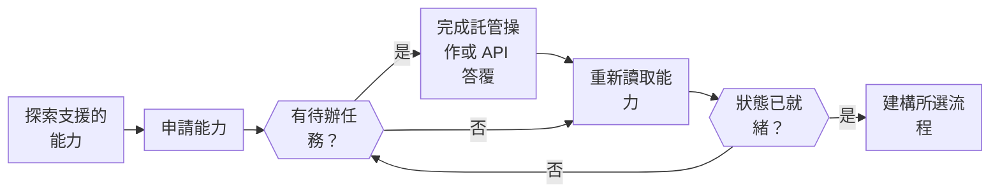

能力(capability)會告訴您客戶是否能使用特定的結果、支付方式與方向。待辦任務(open tasks)則告訴您在該能力或相關資源可以繼續之前必須完成哪些事項。



```bash Environment variables
export API_BASE='https://platform.swipelux.com'
export SWIPELUX_API_KEY='replace-with-your-api-key'
```

## 探索支援的能力 {#discover-supported-capabilities}

使用 [`GET /v3/customers/{customerId}/capabilities/supported`](/api-reference/capabilities/get-v3-customers-by-customer-id-capabilities-supported) 讀取客戶當前可用的選項:

```bash List supported capabilities
curl --request GET \
  "${API_BASE}/v3/customers/${CUSTOMER_ID}/capabilities/supported" \
  --header "X-API-Key: ${SWIPELUX_API_KEY}"
```

選擇符合預期 `directions`、`method` 與 `accountType` 的回應項目。僅在 `availability` 為 `available` 或 `beta`,且 `eligibility.eligible` 為 `true` 時繼續。若回傳了 `institutions`,僅從該回應中選擇一個 ID。

每個機構項目都包含 `logoUrl` 與 `isDefault` 旗標。請使用 `logoUrl` 在銀行選擇介面中顯示銀行標誌,並在其為 `null` 時顯示您自己的通用銀行圖示。`isDefault` 僅適用於此客戶與此能力,而非機構的全域設定。[`GET /v3/institutions`](/api-reference/institutions/get-v3-institutions) 會回傳相同且可為 null 的 `logoUrl`。機構 ID 為不透明值,因此請在不修改程式碼的情況下處理新的 ID。

```json Institution entry
{
  "institutions": [
    {
      "id": "jpmorgan",
      "name": "JPMorgan Chase",
      "bic": "CHASUS33",
      "logoUrl": "https://wallet.swipelux.com/bank-logos/jpmorgan.png",
      "countries": ["US"],
      "isDefault": true,
      "currencies": [
        { "code": "USD", "institution": "jpmorgan" }
      ]
    }
  ]
}
```

對於每個具名能力,每個機構項目也會列出 `currencies`。每一項提供發行帳戶可接收的幣別 `code`,以及您在[開立該帳戶](/zh-Hant/integration/issue-bank-account#choose-the-bank)時要傳送的 `institution`。`ach_named`、`wire_named` 與 `rtp_named` 列出 USD。`sepa_named` 列出 EUR,`faster_payments_named` 列出 GBP,`ipp_named` 列出 AED。`swift_named` 列出該銀行發行 SWIFT 帳戶的所有幣別。某個幣別可能指向與項目本身不同的機構。例如,`lead_bank` 的非 USD SWIFT 幣別會指向 `bmo`。共用能力不包含 `currencies`。

對於 `swift_named`,由銀行決定每位客戶可開立其中哪些幣別。若帳戶幣別不在銀行提供給此客戶的範圍內,帳戶最終會變為 `rejected`,並附上 `statusReason.code: currency_unavailable`。

僅在開立帳戶時傳送 `bmo`。在 `institutions` 中指定 `bmo` 的能力申請或任務預覽會傳回 `422 capability_institutions_unsupported`。請改為在 `lead_bank` 申請 `swift_named`。

當您省略 `institutions` 時,Swipelux 會為此客戶選擇適用的預設銀行。預設銀行依客戶決定,且可能隨時間改變,例如客戶資料變更,或某家銀行的開戶開放或關閉時。請每次都從支援能力的回應中讀取 `isDefault`,而非將其儲存。在正式模式下:

- 當 Lead Bank 接受新客戶且能為此客戶開戶時,`ach_named` 與 `wire_named` 預設使用 Lead Bank(`lead_bank`):資料中至少列出一個國家且 Lead Bank 接受其中的每個國家,企業資料中列出的法律形式為 Lead Bank 所接受,且客戶在其他銀行沒有 `ready` 的申請(無論具名或共用)。否則預設使用 JPMorgan Chase(`jpmorgan`)。
- `ach_pooled` 與 `wire_pooled` 預設使用 JPMorgan Chase(`jpmorgan`)。

預設銀行僅適用於新的選擇。客戶既有的已核准(`ready`)申請,或在其他銀行的目前申請,仍優先於預設銀行及標示為 `isDefault` 的銀行。若要指定銀行,請在 `institutions` 中傳送其 ID。在沙箱中,ACH、Wire 與 SWIFT 能力僅由 JPMorgan Chase(`jpmorgan`)提供。請參閱[沙箱測試](/zh-Hant/integration/sandbox)。

將選定的 `data[].id` 儲存為 `CAPABILITY_ID`。切勿從其他客戶或其他環境複製 capability ID。

### 顯示銀行無法使用的原因 {#show-why-a-bank-is-unavailable}

每個項目也都包含 `unavailableInstitutions`。它會列出提供此能力變體但不接受此客戶的銀行。每個項目都有 `id`、`name` 以及非空的 `reasons` 陣列。每個原因的結構與 `statusReason` 相同，並帶有 `actor: "provider"` 與 `retryable: false`。請使用 `unavailableInstitutions` 向客戶說明某家銀行為何未出現在您的銀行選擇介面中，例如將該銀行顯示為停用狀態，並附上原因的 `message`。

```json Unavailable institution entry
{
  "unavailableInstitutions": [
    {
      "id": "lead_bank",
      "name": "Lead Bank",
      "reasons": [
        {
          "code": "jurisdiction_unsupported",
          "message": "The bank does not accept customers from a country on this customer's profile.",
          "actor": "provider",
          "retryable": false
        }
      ]
    }
  ]
}
```

目前的原因代碼：

| 代碼 | 意義 |
| --- | --- |
| `jurisdiction_unsupported` | 該銀行不接受客戶資料中的某個國家。 |
| `legal_form_unsupported` | 該銀行不接受客戶的法律形式。 |
| `customer_type_unsupported` | 該銀行不接受客戶的類型。 |

請在不修改程式碼的情況下處理未知代碼，因為 Swipelux 可能會新增代碼。同一家銀行絕不會同時出現在 `institutions` 與 `unavailableInstitutions` 中。`unavailableInstitutions` 一律會出現，且在共用型與非銀行項目中為 `[]`。未出現在任一清單中的銀行，是因與此客戶無關的原因而被排除。在能力申請中指定無法使用的銀行，仍會傳回 [`422 capability_institutions_unsupported`](/integration/errors#capability-institutions-unsupported)。

### 查看可在哪裡開立帳戶 {#check-where-an-account-can-open}

每個項目也都包含 `banks`。在專屬型項目中，它會列出 `institutions` 或 `unavailableInstitutions` 中的每家銀行，以及客戶在該處擁有此變體申請的任何銀行。在其他項目中為 `[]`。每家銀行都具有與機構項目相同的 `id`、`name`、`bic` 與 `logoUrl`，並另外提供客戶在該銀行的狀態：

```json Bank entry
{
  "banks": [
    {
      "id": "jpmorgan",
      "name": "JPMorgan Chase",
      "bic": "CHASUS33",
      "logoUrl": null,
      "status": "approved",
      "applicationId": "apl_000000000000000005",
      "accountOpening": "now",
      "currencies": [
        { "code": "USD", "institution": "jpmorgan" }
      ]
    }
  ]
}
```

`status` 為下列值之一：

- `approved`：該銀行的一個就緒申請涵蓋此變體。
- `pending`：該銀行的一個申請已請求此變體，但銀行尚未核准。
- `refused`：銀行拒絕了該客戶。
- `not_requested`：該銀行沒有任何申請請求此變體。能力申請可以選擇這家銀行。
- `not_offered`：銀行不接受此客戶使用此變體。

`applicationId` 指出決定 `status` 的申請，或為 `null`。`accountOpening` 會告訴您，指定這家銀行的[發行帳戶請求](/zh-Hant/integration/issue-bank-account#choose-the-bank)目前會有什麼結果：

- `now`：請求會被接受，且帳戶會被發行。
- `after_approval`：請求會在 `allowPending: true` 下被接受，並等待銀行核准。
- `application`：請先申請能力，並在 `institutions` 中包含這家銀行。
- `none`：這家銀行目前不接受任何帳戶請求。

對於 `now` 與 `after_approval`，`currencies` 只會列出請求會被接受的幣別。因此，客戶在這家銀行已持有帳戶的幣別不會列出。其他情況下，它會列出該銀行開立此變體的所有幣別。每一項都會指出要傳送的 `institution`，與 `institutions[].currencies` 相同。

請僅根據 `accountOpening` 決定是否在某家銀行提供開戶。`institutions` 回答的是另一個問題：新的能力申請可以送往哪裡。它可能只列出一家預設銀行，而另一家銀行已經核准了該客戶。

### 共用型與專屬型帳戶類型 {#pooled-vs-named-account-types}

銀行能力有兩種變體,分別以 `accountType` 欄位與 capability ID 尾綴(例如 `ach_pooled`、`wire_named`)標示:

- **`pooled`**: 共用的 Swipelux 銀行帳戶。每筆入金使用唯一的參考編號來路由資金。用於一次性轉帳。
- **`named`**: 為客戶專屬的銀行資料(虛擬 IBAN、專屬 ACH 帳戶)。可重複使用並可與任何付款人分享。[發行銀行帳戶](/zh-Hant/integration/issue-bank-account)必須使用此類型。

預設請採用 `pooled`。僅在客戶需要可重複使用的銀行資料時才使用 `named`。可在 `supported` 回應中查看有哪些變體可用。

若要接收 SWIFT 存款或發行 SWIFT 銀行資料,請使用 `swift_named`。`swift_pooled` 僅支援出金,因此請在支援能力回應中檢查每個選項的 `directions`。專屬型 SWIFT 帳戶會回傳可重複使用的收款資料,包括銀行的 BIC、在需要時提供的參考編號,以及在銀行提供時的受益人地址。

對於發行的 ACH、Wire 與 SWIFT 帳戶,您可以透過 `institution` 指定特定銀行,並在銀行核准客戶之前先儲存帳戶請求。請參閱[發行銀行帳戶](/zh-Hant/integration/issue-bank-account#choose-the-bank)。

## 申請能力 {#request-the-capability}

使用 [`POST /v3/customers/{customerId}/capabilities/{capabilityId}`](/api-reference/capabilities/post-v3-customers-by-customer-id-capabilities-by-capability-id) 申請所選的選項:

```bash Request capability
curl --request POST \
  "${API_BASE}/v3/customers/${CUSTOMER_ID}/capabilities/${CAPABILITY_ID}" \
  --header "X-API-Key: ${SWIPELUX_API_KEY}" \
  --header "Idempotency-Key: capability-request-001" \
  --header "Content-Type: application/json" \
  --data '{}'
```

僅在您需要從支援能力回應所提供的 ID 中挑選時,才使用明確的 `institutions` 陣列。

將 `data.status` 儲存為 `CAPABILITY_STATUS`、`data.accountProvisioning` 儲存為 `ACCOUNT_PROVISIONING_STATUS`、`data.openTaskIds` 儲存為 `OPEN_TASK_IDS`,並將每個 `data.applications[].id` 存入 `APPLICATION_IDS`。

### 每家銀行共用的申請 {#shared-applications-per-bank}

對於專屬型銀行能力,每位客戶在每家銀行各有一個申請案件。共用型與平台能力使用不隸屬任何銀行的案件。Swipelux 會在您申請的所有相容能力之間共用同一個案件:

- 一次核准可涵蓋多項能力。例如,某家銀行已核准的案件可以讓 ACH 與 wire 能力都變為 `ready`。
- 之後符合現有案件的申請會重複使用該案件。Swipelux 不會開啟第二個申請,也不會新增重複的任務。
- 不同銀行的案件彼此獨立。某家銀行的拒絕不會影響另一家銀行的案件。

申請的回應會告訴您 Swipelux 使用了哪個案件:

- `201` 表示該申請開啟了新的申請案件。
- `200` 表示該申請對應到客戶既有的申請案件,例如針對客戶已持有的銀行能力重複申請,或申請已取消的銀行能力且該申請加入其既有的申請案件。針對 `card` 或 `stablecoin_transfers` 的重複申請仍會回傳 [`409 capability_already_exists`](/integration/errors#capability-already-exists),而申請已取消的 `card` 能力會回傳 [`409 capability_not_reopenable`](/integration/errors#capability-not-reopenable)。
- `selectedApplicationId` 是與 `data` 並列的頂層欄位,包含該申請所選擇或開啟之案件的 ID。當申請未選擇任何案件時,Swipelux 會省略此欄位。冪等重放會回傳相同的值。

精簡後的回應:

```json Response (abbreviated)
{
  "data": {
    "id": "ach_named",
    "status": "pending",
    "openTaskIds": ["tsk_000000000000000002"],
    "applications": [{ "id": "apl_000000000000000005", "status": "in_review" }]
  },
  "selectedApplicationId": "apl_000000000000000005"
}
```

對於專屬型能力,請再次傳送相同的 `institutions` 清單以選擇同一個案件,或傳送單一機構 ID 以指定該銀行。已最終拒絕該客戶的銀行會被略過。當您只指定該銀行,或所有符合資格的銀行都已拒絕該客戶時,申請會回傳 [`409 capability_terminally_rejected`](/integration/errors#capability-terminally-rejected)。若要在遭拒後嘗試另一家銀行,請使用該銀行的機構 ID 再次申請該能力。

能力的狀態反映客戶所有相關案件的情況。對於專屬型能力,只要有一個 `ready` 案件的核准涵蓋該能力,即足以使其變為 `ready`,不論其他銀行回報什麼。共用型能力還需等待其方式檢查完成,檢查結果會在客戶申請清單的 `probes` 中回報。

#### 列出客戶的申請 {#list-the-customers-applications}

使用 [`GET /v3/customers/{customerId}/applications`](/api-reference/capabilities/get-v3-customers-by-customer-id-applications) 列出客戶的所有申請案件。結果會以 `nextCursor` 與 `hasMore` 分頁,並接受 `updatedAfter`:

```bash List applications
curl --request GET \
  "${API_BASE}/v3/customers/${CUSTOMER_ID}/applications" \
  --header "X-API-Key: ${SWIPELUX_API_KEY}"
```

每個項目都包含能力的 `applications[]` 中回傳的申請欄位,另外還有:

- `scope`: `named` 表示某一家銀行的案件,`provider_pooled` 或 `platform` 表示不隸屬任何銀行的案件,`null` 表示未分類的歷史案件。`provider_pooled` 與 `platform` 案件不會包含 `institution`。
- `requestedScope[]`: 針對該案件申請的能力鍵,每個都附有其首次的 `requestedAt`。項目永遠不會被移除。
- `coverage[]`: 該案件的核准所涵蓋的能力鍵,每個都附有 `grantedAt` 與 `source`。涵蓋範圍記錄的是範圍,而非授權。請讀取能力以取得其目前狀態。
- `probes[]`: 針對該案件所涵蓋之共用型能力鍵的方式檢查,每個都附有 `capabilityKey`、`status` 與 `reason`。專屬型能力鍵永遠不需要檢查。
- `generation`、`predecessorApplicationId` 與 `supersededByApplicationId`: 承繼連結。當 `supersededByApplicationId` 已設定時,表示該案件已被取代。請依該 ID 前往目前的案件。能力的 `applications[]` 僅列出目前的案件，因此被取代的案件只會出現在此列表中。

精簡後的回應:

```json Response (abbreviated)
{
  "data": [
    {
      "id": "apl_000000000000000005",
      "status": "ready",
      "scope": "named",
      "institution": { "id": "jpmorgan", "name": "JPMorgan Chase", "bic": "CHASUS33" },
      "requestedScope": [
        { "capabilityKey": "ach_named", "requestedAt": "2026-09-20T10:00:00.000Z" }
      ],
      "coverage": [
        { "capabilityKey": "ach_named", "grantedAt": "2026-09-22T12:00:00.000Z", "source": "approval" },
        { "capabilityKey": "wire_named", "grantedAt": "2026-09-22T12:00:00.000Z", "source": "approval" }
      ],
      "probes": [],
      "generation": 1,
      "predecessorApplicationId": null,
      "supersededByApplicationId": null
    }
  ],
  "nextCursor": null,
  "hasMore": false
}
```

## 完成當前任務 {#complete-current-tasks}

使用 [`GET /v3/customers/{customerId}/tasks`](/api-reference/tasks/list-customer-tasks) 列出任務,從 `OPEN_TASK_IDS` 中選擇 ID,然後使用 [`GET /v3/customers/{customerId}/tasks/{taskId}`](/api-reference/tasks/get-customer-task) 讀取每個當前任務:

```bash List open tasks
curl --request GET \
  "${API_BASE}/v3/customers/${CUSTOMER_ID}/tasks/${TASK_ID}" \
  --header "X-API-Key: ${SWIPELUX_API_KEY}"
```

請使用最新的 `data.revision` 與 `data.requirements`。若兩者中任一可能已變更,請在提交前立即重新讀取任務。

### 重複使用的個人資料佐證 {#reused-profile-evidence}

對於接受直接 API 提交的申請資料收集任務,Swipelux 會重複使用客戶已提供的資訊。當此類任務建立或重新核對時,Swipelux 會檢查客戶個人資料以及客戶自行上傳的文件。已有可用個人資料值或文件佐證的符合資格要求會移至 `in_review`,而不會維持可操作狀態。個人資料更新與新的文件上傳也會對既有任務觸發相同的檢查。

只有缺少或不相容的值會維持可操作狀態。重複使用並不代表核准該佐證。Swipelux 仍會審查它。明確的更正要求與先前已答覆的要求會維持可操作狀態。所有者與關係人的文件不會被重複使用,而僅透過託管工作階段收集的要求則維持其一般流程。

### 呈現要求 {#render-requirements}

請根據每項要求所回傳的中繼資料建構表單,而不是根據要求鍵。要求可以包含選用的簡短 `title`,且每個 `request` 都包含要顯示在標題下方的 `prompt`。

`request.type: "profile"` 的要求會以 `profilePointer` 標識個人資料欄位,並加入輸入中繼資料:

- `allowedValues`: 純量欄位的允許值,或陣列欄位中每個項目的允許值。請提交這些值,而非翻譯後的顯示標籤。
- `valueSchema`: 一份自成一體的 JSON Schema Draft 7 文件,描述輸入的形態、巢狀屬性、必填欄位與結構限制。物件上的列舉會出現在相關屬性上,例如稅務識別碼的 `valueSchema.items.properties.type.enum`。Swipelux 在提交後仍會套用跨欄位與審查驗證,因此通過結構描述的值仍可能遭到拒絕。
- `valueType: "country"`,或陣列的 `itemValueType: "country"`: 此欄位接受大寫的 ISO 3166-1 alpha-2 代碼。`valueSchema` 中的巢狀國家屬性使用 `format: "iso-3166-1-alpha-2"`。請使用標準國家清單來取得在地化標籤。

```json Requirement
{
  "id": "req_000000000000000010",
  "key": "account_purposes",
  "title": "Account purpose",
  "status": "action_required",
  "request": {
    "type": "profile",
    "prompt": "Select every purpose that applies.",
    "required": true,
    "profilePointer": "/financialProfile/accountPurposes",
    "valueType": "array",
    "itemValueType": "string",
    "allowedValues": ["business_expenses", "ecommerce", "payroll"],
    "valueSchema": {
      "$schema": "http://json-schema.org/draft-07/schema#",
      "type": "array",
      "items": { "enum": ["business_expenses", "ecommerce", "payroll"] }
    }
  }
}
```

此範例縮短了值目錄,API 會回傳所有允許的值。部分個人資料要求沒有已發布的結構描述,因此會省略 `valueSchema` 與 `allowedValues`。請根據 `prompt` 與 `valueType` 呈現這些要求。

每個未完成任務都包含 `dueAt` 時間戳記。當 Swipelux 建立任務且未明確指定到期日期時,`dueAt` 預設為任務 `createdAt` 之後整整 31 天。請將 `dueAt` 視為僅供參考:您無法透過 API 設定它,它也不會觸發任何自動生命週期轉換。只有單獨的 `deadline` 欄位(如存在)才會觸發自動轉換。

### 託管操作 {#hosted-actions}

在任務詳細資料回應中，`verificationSessions` 與 `tosSessions` 的每一筆項目都包含 `action` 物件。任務清單回應不包含這些動作連結。請儲存每個工作階段的 `id`，並在引導客戶前讀取 `action.kind`；不要從工作階段的 `status` 推斷連結是否可用。

- `action.kind: "available"` 會包含 `action.url` 與 `action.expiresAt`（目前一律為 `null`）。請儲存 `action.url`，將客戶引導至該網址，然後再次讀取任務。工作階段層級的 `url` 與 `expiresAt` 欄位包含相同的值。
- `action.kind: "unavailable"` 表示不應顯示連結。工作階段層級的 `url` 與 `expiresAt` 欄位不存在。僅憑工作階段的 `status` 無法判定會收到哪種動作類型。

```json Verification session
{
  "data": {
    "verificationSessions": [
      {
        "id": "vfy_000000000000000003",
        "key": "identity_verification",
        "type": "identity_verification",
        "status": "action_required",
        "coveredRequirementIds": ["req_000000000000000011", "req_000000000000000012"],
        "action": {
          "kind": "available",
          "url": "https://platform.swipelux.com/kyc/redirect/cus_000000000000000001/tsk_000000000000000002/vfy_000000000000000003",
          "expiresAt": null
        },
        "url": "https://platform.swipelux.com/kyc/redirect/cus_000000000000000001/tsk_000000000000000002/vfy_000000000000000003",
        "expiresAt": null
      }
    ],
    "tosSessions": [
      {
        "id": "vfy_000000000000000004",
        "key": "terms_of_service",
        "type": "terms_of_service",
        "status": "completed",
        "action": { "kind": "unavailable" }
      }
    ]
  }
}
```

這些是與任務相關的操作,而不是獨立的客戶驗證生命週期。

任務讀取與客戶任務詳細資料中的每一筆 `verificationSessions[]` 項目都包含 `coveredRequirementIds`。它列出該工作階段可填寫的任務有效要求 ID。請用它來查看託管工作階段或[匯入的驗證](#import-an-existing-identity-verification)可處理哪些要求。其他所有要求請透過 [API 答覆](#api-answers)填寫。

對於新的個人 intake 任務，託管身分工作階段僅涵蓋身分證件、selfie 與地址證明。資金證明要求（例如 `proof_of_funds`、`source_of_funds_document`、`named_source_of_funds_document` 與 `sole_proprietor_document`）不屬於託管工作階段。請直接[上傳](#upload-documents)並提交這些文件。Swipelux 會審查它們，任務會維持開啟直到文件被接受。

對於結構化值（例如地址或稅務識別碼）的個人資料要求，託管答覆必須通過與直接答覆相同的結構描述與限制檢查。若未通過，該要求會保持開啟。因這一原因被 Swipelux 退回 `action_required` 的要求會帶有 `reviewFeedback.code: hosted_profile_direct_submission_required`。請向客戶收集該值，並以 [API 答覆](#api-answers)提交。

### 匯入既有的身分驗證 {#import-an-existing-identity-verification}

如果您已在 Swipelux 身分驗證提供者處的自有帳戶中驗證個人，您可以將該驗證匯入客戶 intake 任務的身分工作階段，而不必讓客戶走完託管流程。此選項僅適用於個人客戶的 API 整合。不支援企業與關係人。

匯入前，請先與您的身分驗證提供者設定共享：

1. 向 Swipelux 索取其合作夥伴權杖，然後在您的身分驗證提供者帳戶中將 Swipelux 新增為共享合作夥伴。
2. 針對正式環境驗證，為 Swipelux 產生 share token，收件方 client ID（`forClientId`）為 `swipelux.com_21030`。
3. 請在權杖到期前將其傳送給 Swipelux。Share token 為不透明、僅能使用一次、最多 1,024 個 UTF-8 位元組，且預設在 20 分鐘後到期。請將每個權杖視為憑證。

該任務必須是個人 intake 任務，且提供託管驗證工作階段作為提交方式。工作階段必須具有 `type: "identity_verification"` 與 `status: "action_required"`。客戶不得已在 Swipelux 有進行中或已完成的驗證，且不得已有匯入正在進行。開啟託管連結會開始驗證，但讀取任務不會。接著呼叫 `POST /v3/customers/{customerId}/tasks/{taskId}/verification-sessions/{verificationSessionId}/share-token`。此請求需要與任務提交相同的 `accounts:write`、`customers:read` 與 `customers:write` 權限，以及 `Idempotency-Key`：

```json Request body
{
  "shareToken": "<share token>"
}
```

```json Response
{
  "verificationSessionId": "vfy_000000000000000003",
  "status": "in_review"
}
```

您的提供者會將相符的步驟複製到 Swipelux 的帳戶，並依任務要求的等級重新執行檢查。Swipelux 絕不會儲存或記錄 share token。

- `status: "in_review"` 表示檢查尚在進行中。檢查完成後，Swipelux 會以與託管工作階段相同的方式處理所涵蓋的要求。
- `status: "action_required"` 表示缺少步驟。客戶可透過該工作階段既有的託管連結完成這些步驟，您也可以直接提交所涵蓋的要求。

匯入僅會填寫 `coveredRequirementIds` 中列出的要求：身分證件、selfie，以及任務要求時的地址證明。請以 [API 答覆](#api-answers)提交個人資料答覆、資金證明與其他要求。若要重播請求，請以相同的 `Idempotency-Key` 再次傳送。

| 狀態 | 代碼 | 處理方式 |
| --- | --- | --- |
| `409` | `verification_already_started` | 此客戶已在 Swipelux 有進行中或已完成的驗證，或已有匯入正在進行，例如因為客戶開啟了託管連結。請勿重試。請透過既有的工作階段繼續。 |
| `409` | `verification_session_not_allowed` | 該任務或工作階段不符合匯入資格。請勿重試。請讀取任務並使用其提供的方式。 |
| `422` | `share_token_rejected` | 身分驗證提供者拒絕了權杖，例如因為權杖已到期、已被使用，或是核發給其他收件方。請為 Swipelux 產生新權杖，並以新的 `Idempotency-Key` 重試。 |
| `503` | `kyc_provider_unavailable` | 若為 `retryable: true`，表示 Swipelux 尚未送出權杖。請稍候再重試。若為 `retryable: false`，匯入可能已發生但無法確認。請勿重新傳送權杖。請透過該工作階段的託管連結繼續。 |

### 上傳文件 {#upload-documents}

當要求提供文件時,請使用 [`POST /v3/customers/{customerId}/documents`](/api-reference/documents/post-v3-customers-by-customer-id-documents) 上傳:

```bash Upload document
export DOCUMENT_PATH='/absolute/path/to/requested-document.pdf'

curl --request POST \
  "${API_BASE}/v3/customers/${CUSTOMER_ID}/documents" \
  --header "X-API-Key: ${SWIPELUX_API_KEY}" \
  --header "Idempotency-Key: customer-document-001" \
  --form "file=@${DOCUMENT_PATH}"
```

在提交引用該文件的答覆前,將回傳的 `data.id` 儲存為 `DOCUMENT_ID`。

每個 v3 文件資源都包含 `contentSha256`,即已儲存檔案的 SHA-256 摘要,格式為 `sha256:` 後接小寫十六進位摘要。摘要相同的兩份文件在位元組上完全相同。若要檢查某個檔案是否已由客戶上傳過(例如審核人員要求替換的檔案),請在上傳前計算其 SHA-256,並與上一次提交的回答在 `documentIds` 中引用之文件上的 `contentSha256` 比對。對於在 Swipelux 記錄摘要之前儲存的文件,此欄位為 `null`。

文件回答必須至少包含一個尚未針對該請求被退回的檔案。當回答中的每個檔案都已在先前的審核中被退回時，Swipelux 會以 `documents_already_returned` 拒絕該回答。您可以將先前的檔案與新檔案一起重新傳送。若某個檔案是被誤退回，請重新上傳以取得新的文件 ID。審核人員仍會看到先前的決定。

若之後要取回已儲存的檔案,請呼叫 [`GET /v3/customers/{customerId}/documents/{documentId}/download`](/api-reference/documents/get-v3-customers-by-customer-id-documents-by-document-id-download)。Swipelux 會回傳一個 `url`,以附件形式下載檔案,且該連結於一小時後到期。已封存的文件會回傳 `404`。

### API 答覆 {#api-answers}

使用 [`POST /v3/customers/{customerId}/tasks/{taskId}/submissions`](/api-reference/task-submissions/create-customer-task-submission) 為當前版本提交一組完整的答覆:

```bash Submit task answers
curl --request POST \
  "${API_BASE}/v3/customers/${CUSTOMER_ID}/tasks/${TASK_ID}/submissions" \
  --header "X-API-Key: ${SWIPELUX_API_KEY}" \
  --header "Idempotency-Key: task-submission-001" \
  --header "Content-Type: application/json" \
  --data @- <<'JSON'
{
  "taskRevision": 3,
  "answers": [
    {
      "requirementId": "req_from_current_task",
      "answer": {
        "type": "text",
        "value": "Current answer"
      }
    }
  ]
}
JSON
```

請從最新的任務中取用每個 requirement ID 與答覆類型。若 API 回報任務已變更,請重新讀取,並根據新版本重新建構提交內容。

#### 使用 `allowPartial` 保留有效回答 {#keep-valid-answers-with-allowpartial}

預設情況下,一個被拒絕的回答會讓整個請求失敗,Swipelux 不會儲存任何內容。回應為 `400 validation_error`、`400 invalid_document_reference`, `400 documents_already_returned` 或 `409 absence_conflicts_with_profile`。若您希望 Swipelux 儲存有效的回答,只拒絕無效的回答,請加入 `"allowPartial": true`:

```json Partial submission request
{
  "taskRevision": 3,
  "allowPartial": true,
  "answers": [
    { "requirementId": "req_a", "answer": { "type": "text", "value": "Salary" } },
    { "requirementId": "req_b", "answer": { "type": "document", "documentIds": ["doc_unknown"] } }
  ]
}
```

Swipelux 會傳回 `201`,`data` 中是已儲存的提交,只包含保留的回答,其餘回答則列在 `refusedAnswers` 中:

```json Partial submission response
{
  "data": { "id": "sub_000000000000000001", "outcome": "in_review", "answers": [{ "requirementId": "req_a" }] },
  "refusedAnswers": [
    {
      "requirementId": "req_b",
      "code": "invalid_document_reference",
      "pointer": "/answers/1/answer",
      "message": "A referenced document is invalid."
    }
  ]
}
```

每個被拒絕的回答都帶有以下其中一個代碼:

| `code` | 意義 |
| --- | --- |
| `invalid` | 回答不符合請求的結構、格式或限制,或客戶資料不接受該值。 |
| `absence_conflicts_with_profile` | 針對資料中已有的值傳送了缺漏說明。 |
| `invalid_document_reference` | 所引用的文件無法用於此客戶與此請求。 |
| `documents_already_returned` | 文件回答中的每個檔案都已針對此請求被退回。請傳送新檔案，可單獨傳送，也可與先前的檔案一起傳送。 |
| `depends_on_refused_answer` | 此回答本身有效,但會與一個被拒絕的回答一併判斷。條件式回答與控制它的回答會一起保留或一起拒絕。 |

日後可能新增代碼。請將未知代碼視為 `invalid`。`message` 從不重複所提交的值。

`allowPartial` 不會放寬其他規則:

- 請求仍必須回答在未使用此欄位時需要回答的每個要求。未回答的開放要求仍會傳回 `422 task_submission_incomplete`。
- 本身就不符合請求結構描述的請求本文(例如含有未知欄位或類型錯誤)仍會傳回 `400 validation_error`。
- 若沒有任何回答可以保留,Swipelux 會傳回 `400 validation_error`,不儲存任何內容,並在 `errors[]` 中列出每個被拒絕的回答。
- 唯有在請求傳送了 `"allowPartial": true` 時,`refusedAnswers` 才會出現(可能為空)。使用相同 `Idempotency-Key` 重送會傳回相同的 `refusedAnswers`。

更正被拒絕的回答之前,請重新讀取任務。被拒絕的要求通常仍為 `action_required`,但文件請求可能已由存檔中的檔案回答。請使用新的 `taskRevision` 與新的 `Idempotency-Key` 提交更正。條件式回答請與控制它的回答一起傳送。

#### 撤回等待審核的提交 {#withdraw-a-submission-awaiting-review}

若要更正仍處於 `in_review` 的提交,請使用 `POST /v3/customers/{customerId}/tasks/{taskId}/withdrawals` 將其撤回。此請求沒有本文,且需要 `Idempotency-Key`。與提交相同,API 金鑰需要 `accounts:write`、`customers:read` 與 `customers:write`:

```bash Withdraw task submission
curl --request POST \
  "${API_BASE}/v3/customers/${CUSTOMER_ID}/tasks/${TASK_ID}/withdrawals" \
  --header "X-API-Key: ${SWIPELUX_API_KEY}" \
  --header "Idempotency-Key: task-withdrawal-001"
```

Swipelux 會傳回 `200`,`data` 中是該提交。其 `outcome` 變為 `withdrawn`,其回答回到 `action_required` 且不帶 `reviewFeedback`,下一次提交會開始新的 `remediationRound`。已被接受的要求與客戶資料維持不變。Swipelux 依據資料或存檔檔案填入的回答仍在審核中。您可以視需要多次撤回。請重新讀取任務,再提交更正後的回答。

在下列情況下,Swipelux 會拒絕撤回:

- `404 task_not_found`: 此客戶沒有該任務。
- `409 task_not_in_review`: 等待審核的提交不是恰好一個(沒有,或不只一個,例如一個部分提交及其更正),或任務已過期限。
- `409 submission_already_forwarded`: 銀行直接審核此任務,或 Swipelux 已將提交轉送審核。透過 `POST /v3/sandbox/tasks` 建立的任務也會傳回此錯誤。

提交的 `outcome` 現在可能為 `withdrawn`。請更新任何將 `outcome` 與固定清單比對的用戶端。

### 企業的最終受益人前置條件 {#beneficial-owner-prerequisite-for-businesses}

申請需要最終受益人佐證的企業能力,即使客戶尚未有符合資格的所有者,也會成功。該能力會以 `restricted` 建立,並帶有 `statusReason.code: tasks_due`,而企業資料收集任務會要求缺少的所有權事實,包括所有權結構。

同一任務帶有一項 `resource_reference` 要求,其請求包含 `qualification: "beneficial_owner"`:

```json Beneficial owner requirement
{
  "type": "resource_reference",
  "prompt": "Add or select a qualifying beneficial owner.",
  "required": true,
  "resourceType": "related_party",
  "qualification": "beneficial_owner"
}
```

當關係人為同一客戶名下的有效 `person` 關係人,且提供的所有權比例達 25 以上,或具有 `ownership.declared: true` 但未提供所有權比例時,即符合資格。

該要求是從當前的關係人名冊推導而來,因此您通常不會直接答覆它:

- 建立或更新符合資格的關係人,會在同一次重新評估中滿足該要求,並開啟該所有者本身的個人資料與文件工作。請參閱[新增企業關係人](/zh-Hant/integration/onboarding/customers#add-business-related-parties)。
- 您也可以使用帶有其 `relatedPartyId` 的 `resource_reference` 答覆,明確引用符合資格的關係人。
- 該要求在被滿足後仍會列在當前任務中。當沒有其他未完成的義務時,任務會變為 `satisfied`。
- 封存最後一位符合資格的關係人,或移除使其符合資格的事實,會重新開啟該要求,即使任務先前已為 `satisfied`。

## 能力就緒後繼續 {#continue-when-the-capability-is-ready}

使用 [`GET /v3/customers/{customerId}/capabilities/{capabilityId}`](/api-reference/capabilities/get-v3-customers-by-customer-id-capabilities-by-capability-id) 再次讀取能力:

```bash Refetch capability
curl --request GET \
  "${API_BASE}/v3/customers/${CUSTOMER_ID}/capabilities/${CAPABILITY_ID}" \
  --header "X-API-Key: ${SWIPELUX_API_KEY}"
```

將儲存的狀態、帳戶核發狀態與任務 ID 替換為最新的回應。能力的 `status` 回報權限是否已獲核准。對於會核發帳戶的能力,`accountProvisioning` 會另外回報該帳戶為 `not_started`、`in_progress`、`issued` 或 `failed`;不核發帳戶的能力則會回傳 `not_applicable`。

當能力處於 `pending` 時，它可能回報的 `statusReason.code` 值中有兩個可表明審查是否正在進行。`preparing_submission` 表示 Swipelux 仍在準備提交申請，尚未開始審查，即使另一家銀行的申請為 `rejected` 或需要處理也是如此。`review_in_progress` 表示審查正在進行，例如申請處於 `in_review` 或[託管驗證](#hosted-actions)處於開啟狀態時。兩者都使用 `resolution: wait`。在這兩個代碼之間切換時狀態仍為 `pending`，因此不會傳送 `capability.status_changed` 事件。讀取能力即可查看目前的代碼。

能力也可能處於 `restricted` 狀態，並帶有 `statusReason.code: offer_unavailable` 和 `resolution: contact_support`。當已核准的申請涵蓋該能力，但目前沒有任何方案允許該能力時，Swipelux 會傳回此代碼。申請已獲核准，因此等待不會改變該能力。請聯絡 Swipelux 支援團隊，而不是輪詢。在這種情況下，此代碼取代 `related_application_action_required` 和 `resolution: wait`。未完成的客戶任務仍然優先，因此請先完成所有目前的任務。

```json Capability restricted by offer availability
{
  "status": "restricted",
  "statusReason": {
    "code": "offer_unavailable",
    "resolution": "contact_support",
    "message": "The approved Application covers this capability, but no current offer permits it. Contact support."
  }
}
```

僅在當前能力狀態允許您預期建立的帳戶、報價或轉帳時才繼續。若流程需要已核發的帳戶,也請等待 `accountProvisioning` 變為 `issued`。

接下來,請於[常見流程](/zh-Hant/integration/common-flows) 中選擇對應的路徑。
